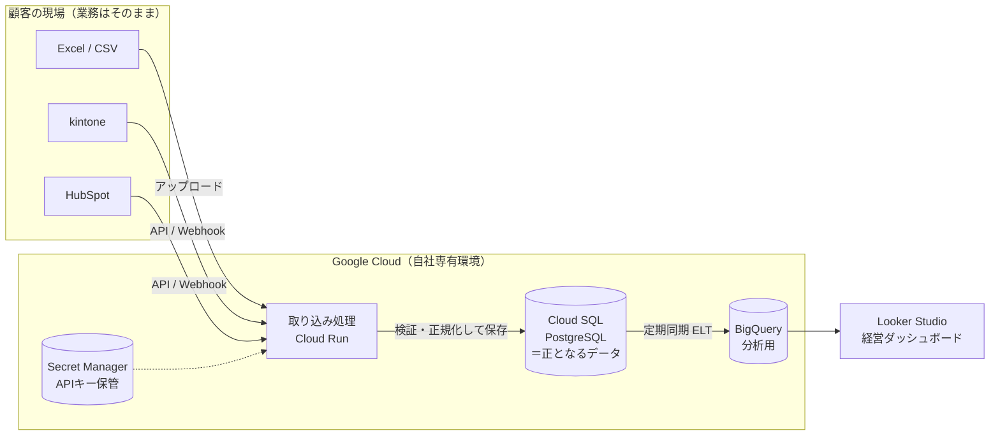

# カリキュラム全体像

## 0. 受講開始にあたっての微調整案

元の6章構成は「基礎 → DB → セキュリティ → DWH → 提案」と積み上げ順が良く、そのまま採用します。そのうえで、**受託ビジネスとして案件を取って納品・保守まで回す**というゴールから逆算して、次の6点を加えています。

| # | 調整内容 | 理由 |
|---|---|---|
| ① | **第1章の冒頭に「完成形アーキテクチャの全体地図」を置く** | 各単元が最終的にどの部品の話なのかが分かると、記憶の定着が段違いになる。講師として教える際にも使える |
| ② | **クラウドを GCP に寄せる**（Cloud SQL for PostgreSQL / Cloud Run / BigQuery / Secret Manager） | BigQuery が GCP なので、DB・実行環境・権限管理（IAM）・ネットワークを同じクラウドに揃えると、構成も説明もシンプルになる。Fargate（AWS）は比較対象として扱う |
| ③ | **「データ取り込み実装」の章を新設（第4章）** | ゴール2の中核なのに元案では手薄だった部分。SaaS API からの取得（ページネーション・レート制限・差分取得）、Excel の名寄せ・クレンジング、Webhook とバッチの使い分けを扱う |
| ④ | **運用・保守の単元を追加**（バックアップ/リストア、監視、障害対応、コスト管理） | 受託ビジネスでは保守運用契約が継続収益になる。「作って終わり」の業者との差別化ポイント |
| ⑤ | **法務・契約の単元を追加**（個人情報保護法、委託先としての責任、SLA、データの持ち出し） | 顧客データを預かる以上、経営者から必ず聞かれる。技術より先にここで信用を失うケースが多い |
| ⑥ | **ローカルで手を動かすハンズオンを各章に入れる**（Docker で PostgreSQL 等） | 読むだけでは「説明できる」止まり。最終的にデモ環境を**営業用ポートフォリオ**として使えるようにする |

---

## 完成形アーキテクチャ（このカリキュラムで作れるようになるもの）

---

## 章構成と進捗

### 第1章：コンピューターの構造とOS・サーバーの基礎
- [ ] 1-1 CPU・メモリ・ストレージの役割とデータ処理の流れ → [`chapter-01/01-hardware-and-data-flow.md`](./chapter-01/01-hardware-and-data-flow.md)
- [ ] 1-2 OS（Linux）の役割、プロセスとスレッド
- [ ] 1-3 ファイルシステムと権限管理（パーミッション）
- [ ] 1-4 サーバーとは何か（物理サーバー / 仮想マシン / コンテナ、Cloud Run と Fargate）
- [ ] ハンズオン：Docker で Linux コンテナを起動し、プロセス・権限を観察する

### 第2章：インターネットとネットワークの仕組み
- [ ] 2-1 IPアドレス、サブネットマスク、CIDR、ルーティング
- [ ] 2-2 TCP/UDP、ポート番号
- [ ] 2-3 DNS
- [ ] 2-4 HTTP/HTTPS と TLS 暗号化の仕組み
- [ ] 2-5 ファイアウォール、ロードバランサー、VPC（プライベートネットワーク）
- [ ] ハンズオン：`dig` / `curl -v` / `openssl s_client` で通信を観察する

### 第3章：データベース（RDB）の基礎と設計・堅牢化
- [ ] 3-1 RDB のアーキテクチャ（テーブル、ページ、インデックス、B-tree、WAL）
- [ ] 3-2 トランザクション、ACID、分離レベル、デッドロック
- [ ] 3-3 論理設計（第1〜第3正規化）— Excel 台帳を正規化する
- [ ] 3-4 物理設計（データ型、制約、インデックス設計、パフォーマンス）
- [ ] 3-5 DB セキュリティ（権限分離、RLS、暗号化、監査ログ）
- [ ] ハンズオン：Docker で PostgreSQL を立て、正規化したスキーマを構築する

### 第4章：データ取り込みの設計と実装 〔新設〕
- [ ] 4-1 SaaS API の基本（認証、ページネーション、レート制限、差分取得）
- [ ] 4-2 Excel / CSV の取り込み（文字コード、名寄せ、表記ゆれ、バリデーション）
- [ ] 4-3 Webhook とバッチの使い分け、冪等性（同じデータを2回受けても壊れない設計）
- [ ] ハンズオン：kintone（または模擬API）→ PostgreSQL の同期処理を作る

### 第5章：Web・API・インフラの多層防御セキュリティ
- [ ] 5-1 主要な脅威と手口（SQLi、BOLA/IDOR、マスアサインメント、認証情報漏洩、DoS）
- [ ] 5-2 通信経路の保護（WAF、ゼロトラスト、シークレット管理）
- [ ] 5-3 Webhook 受信時の署名検証と非同期キュー処理の耐障害性
- [ ] 5-4 クラウドの権限管理（IAM、最小権限、サービスアカウント）

### 第6章：データウェアハウス（BigQuery）と分析基盤の構築
- [ ] 6-1 OLTP と OLAP の違い（なぜ本番 RDB で集計してはいけないか）
- [ ] 6-2 BigQuery のアーキテクチャ（カラム型ストレージ、スキャン課金）
- [ ] 6-3 データパイプライン設計（RDB → BigQuery、ELT の考え方）
- [ ] 6-4 分析用テーブル設計（スター・スキーマ、パーティション）
- [ ] 6-5 Looker Studio でサンプル経営ダッシュボードを構築

### 第7章：運用・保守と法務 〔新設〕
- [ ] 7-1 バックアップとリストア（RPO / RTO）
- [ ] 7-2 監視・アラート・障害対応
- [ ] 7-3 クラウドコスト管理と見積もり
- [ ] 7-4 個人情報保護法、委託契約、SLA の基礎

### 第8章：顧客提案と言語化トレーニング（模擬案件演習）
- [ ] 8-1 仮想クライアント（Excel / kintone 乱用企業）へのヒアリング
- [ ] 8-2 提案書作成（構成図・見積もり・ROI 試算）
- [ ] 8-3 技術選定理由・セキュリティ担保の根拠を説明するロールプレイ
- [ ] 最終課題：デモ環境 + 提案書をポートフォリオとしてまとめる
