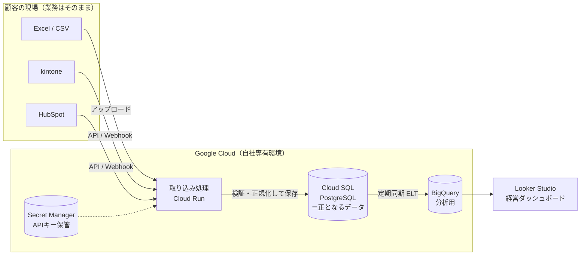

# カリキュラム全体像

## 0. 受講開始にあたっての微調整案

元の6章構成は「基礎 → DB → セキュリティ → DWH → 提案」と積み上げ順が良く、そのまま採用します。そのうえで、**受託ビジネスとして案件を取って納品・保守まで回す**というゴールから逆算して、次の6点を加えています。

| # | 調整内容 | 理由 |
|---|---|---|
| ① | **第1章の冒頭に「完成形アーキテクチャの全体地図」を置く** | 各単元が最終的にどの部品の話なのかが分かると、記憶の定着が段違いになる。講師として教える際にも使える |
| ② | **クラウドを GCP に寄せる**（Cloud SQL for PostgreSQL / Cloud Run / BigQuery / Secret Manager） | BigQuery が GCP なので、DB・実行環境・権限管理（IAM）・ネットワークを同じクラウドに揃えると、構成も説明もシンプルになる。Fargate（AWS）は比較対象として扱う |
| ③ | **「データ取り込み実装」の章を新設（第4章）** | ゴール2の中核なのに元案では手薄だった部分。SaaS API からの取得（ページネーション・レート制限・差分取得）、Excel の名寄せ・クレンジング、Webhook とバッチの使い分けを扱う |
| ④ | **運用・保守の単元を追加**（バックアップ/リストア、監視、障害対応、コスト管理） | 受託ビジネスでは保守運用契約が継続収益になる。「作って終わり」の業者との差別化ポイント |
| ⑤ | **法務・契約の単元を追加**（個人情報保護法、委託先としての責任、SLA、データの持ち出し） | 顧客データを預かる以上、経営者から必ず聞かれる。技術より先にここで信用を失うケースが多い |
| ⑥ | **ローカルで手を動かすハンズオンを入れる**（第1〜6章。MacBook ＋ Docker Desktop / BigQuery サンドボックス） | 読むだけでは「説明できる」止まり。最終的にデモ環境を**営業用ポートフォリオ**として使えるようにする |

---

## 完成形アーキテクチャ（このカリキュラムで作れるようになるもの）

---

## 章構成と進捗

各単元を終えたら、チェックボックスを `[x]` に変えてコミットしてください。目安時間は、読む・課題に答える・ハンズオンを含めた時間です。

### 準備：環境構築（目安 30〜60分）

- [ ] [MacBook の環境構築（Homebrew・Docker Desktop・Git / GitHub・VS Code）](./SETUP-MAC.md)

### 第1章：コンピューターの構造とOS・サーバーの基礎（目安 4〜6時間）

- [ ] [1-1 CPU・メモリ・ストレージの役割とデータ処理の流れ](./chapter-01/01-hardware-and-data-flow.md)　｜　[回答](./answers/chapter-01/01.md)
- [ ] [1-2 OS（Linux）の役割、プロセスとスレッド](./chapter-01/02-os-process-thread.md)　｜　[回答](./answers/chapter-01/02.md)
- [ ] [1-3 ファイルシステムと権限管理（パーミッション）](./chapter-01/03-filesystem-permissions.md)　｜　[回答](./answers/chapter-01/03.md)
- [ ] [1-4 サーバーとは何か（物理サーバー / 仮想マシン / コンテナ、Cloud Run と Fargate）](./chapter-01/04-servers-vm-containers.md)　｜　[回答](./answers/chapter-01/04.md)
- [ ] [ハンズオン：Linux コンテナの中でプロセス・権限・メモリを観察する](./chapter-01/hands-on.md)　｜　[回答](./answers/chapter-01/hands-on.md)

### 第2章：インターネットとネットワークの仕組み（目安 5〜7時間）

- [ ] [2-1 IPアドレス、サブネットマスク、CIDR、ルーティング](./chapter-02/01-ip-cidr-routing.md)　｜　[回答](./answers/chapter-02/01.md)
- [ ] [2-2 TCP / UDP とポート番号](./chapter-02/02-tcp-udp-ports.md)　｜　[回答](./answers/chapter-02/02.md)
- [ ] [2-3 DNS（ドメイン名の仕組み）](./chapter-02/03-dns.md)　｜　[回答](./answers/chapter-02/03.md)
- [ ] [2-4 HTTP / HTTPS と TLS 暗号化の仕組み](./chapter-02/04-http-https-tls.md)　｜　[回答](./answers/chapter-02/04.md)
- [ ] [2-5 ファイアウォール、ロードバランサー、VPC（プライベートネットワーク）](./chapter-02/05-firewall-lb-vpc.md)　｜　[回答](./answers/chapter-02/05.md)
- [ ] [ハンズオン：通信を「見える化」する](./chapter-02/hands-on.md)　｜　[回答](./answers/chapter-02/hands-on.md)

### 第3章：データベース（RDB）の基礎と設計・堅牢化（目安 8〜12時間）

- [ ] [3-1 RDB のアーキテクチャ（テーブル、ページ、インデックス、B-tree、WAL）](./chapter-03/01-rdb-architecture.md)　｜　[回答](./answers/chapter-03/01.md)
- [ ] [3-2 トランザクション、ACID 特性、分離レベル、デッドロック](./chapter-03/02-transactions-acid.md)　｜　[回答](./answers/chapter-03/02.md)
- [ ] [3-3 論理設計（第1〜第3正規化）— Excel 台帳を正規化する](./chapter-03/03-normalization.md)　｜　[回答](./answers/chapter-03/03.md)
- [ ] [3-4 物理設計（データ型、制約、インデックス設計、パフォーマンス）](./chapter-03/04-physical-design.md)　｜　[回答](./answers/chapter-03/04.md)
- [ ] [3-5 DB セキュリティ（権限分離、行レベルセキュリティ、暗号化、監査ログ）](./chapter-03/05-db-security.md)　｜　[回答](./answers/chapter-03/05.md)
- [ ] [ハンズオン：PostgreSQL で「正規化・インデックス・トランザクション・権限」を体験する](./chapter-03/hands-on.md)　｜　[回答](./answers/chapter-03/hands-on.md)

### 第4章：データ取り込みの設計と実装 〔新設〕（目安 6〜9時間）

- [ ] [4-1 SaaS API の基本（認証、ページネーション、レート制限、差分取得）](./chapter-04/01-saas-api.md)　｜　[回答](./answers/chapter-04/01.md)
- [ ] [4-2 Excel / CSV の取り込み（文字コード、名寄せ、表記ゆれ、バリデーション）](./chapter-04/02-excel-csv.md)　｜　[回答](./answers/chapter-04/02.md)
- [ ] [4-3 Webhook とバッチの使い分け、冪等性（同じデータを2回受けても壊れない設計）](./chapter-04/03-webhook-batch-idempotency.md)　｜　[回答](./answers/chapter-04/03.md)
- [ ] [ハンズオン：模擬 kintone API から PostgreSQL へ同期する](./chapter-04/hands-on.md)　｜　[回答](./answers/chapter-04/hands-on.md)

### 第5章：Web・API・インフラの多層防御セキュリティ（目安 5〜7時間）

- [ ] [5-1 主要な脅威と手口（SQLi、BOLA/IDOR、マスアサインメント、認証情報漏洩、DoS）](./chapter-05/01-threats.md)　｜　[回答](./answers/chapter-05/01.md)
- [ ] [5-2 通信経路の保護（WAF、ゼロトラスト、シークレット管理）](./chapter-05/02-network-protection-secrets.md)　｜　[回答](./answers/chapter-05/02.md)
- [ ] [5-3 SaaS Webhook 受信時の署名検証と、非同期キュー処理の耐障害性](./chapter-05/03-webhook-signature-queue.md)　｜　[回答](./answers/chapter-05/03.md)
- [ ] [5-4 クラウドの権限管理（IAM、最小権限、サービスアカウント）](./chapter-05/04-cloud-iam.md)　｜　[回答](./answers/chapter-05/04.md)
- [ ] [ハンズオン：脆弱なコードを攻撃し、対策版と比べる](./chapter-05/hands-on.md)　｜　[回答](./answers/chapter-05/hands-on.md)

### 第6章：データウェアハウス（BigQuery）と分析基盤の構築（目安 8〜12時間）

- [ ] [6-1 OLTP と OLAP の違い（なぜ本番 RDB で集計してはいけないか）](./chapter-06/01-oltp-olap.md)　｜　[回答](./answers/chapter-06/01.md)
- [ ] [6-2 BigQuery のアーキテクチャ（カラム型ストレージ、スキャン課金）](./chapter-06/02-bigquery-architecture.md)　｜　[回答](./answers/chapter-06/02.md)
- [ ] [6-3 データパイプライン設計（RDB → BigQuery、ELT の考え方）](./chapter-06/03-pipeline-elt.md)　｜　[回答](./answers/chapter-06/03.md)
- [ ] [6-4 分析用テーブル設計（スター・スキーマ、粒度、指標の定義）](./chapter-06/04-analytics-modeling.md)　｜　[回答](./answers/chapter-06/04.md)
- [ ] [6-5 Looker Studio で経営ダッシュボードを構築する](./chapter-06/05-looker-studio.md)　｜　[回答](./answers/chapter-06/05.md)
- [ ] [ハンズオン：BigQuery に分析基盤を作り、Looker Studio で経営ダッシュボードを公開する](./chapter-06/hands-on.md)　｜　[回答](./answers/chapter-06/hands-on.md)

### 第7章：運用・保守と法務 〔新設〕（目安 4〜6時間）

- [ ] [7-1 バックアップとリストア（RPO / RTO）](./chapter-07/01-backup-restore.md)　｜　[回答](./answers/chapter-07/01.md)
- [ ] [7-2 監視・アラート・障害対応](./chapter-07/02-monitoring-incident.md)　｜　[回答](./answers/chapter-07/02.md)
- [ ] [7-3 クラウドコスト管理と見積もり、ROI の考え方](./chapter-07/03-cost-estimation.md)　｜　[回答](./answers/chapter-07/03.md)
- [ ] [7-4 個人情報保護法、委託契約、SLA の基礎](./chapter-07/04-legal-contracts.md)　｜　[回答](./answers/chapter-07/04.md)

### 第8章：顧客提案と言語化トレーニング（模擬案件演習）（目安 6〜10時間 ＋ 最終課題）

- [ ] [8-1 仮想クライアントへのヒアリング](./chapter-08/01-hearing.md)　｜　[回答](./answers/chapter-08/01.md)
- [ ] [8-2 提案書の作成（構成図・進め方・見積もり・ROI）](./chapter-08/02-proposal.md)　｜　[回答](./answers/chapter-08/02.md)
- [ ] [8-3 技術選定理由・セキュリティ担保の根拠を説明するロールプレイ](./chapter-08/03-roleplay-qa.md)　｜　[回答](./answers/chapter-08/03.md)
- [ ] [最終課題：デモ環境 ＋ 提案書を、営業用ポートフォリオとしてまとめる](./chapter-08/final-project.md)　｜　[回答](./answers/chapter-08/final-project.md)

