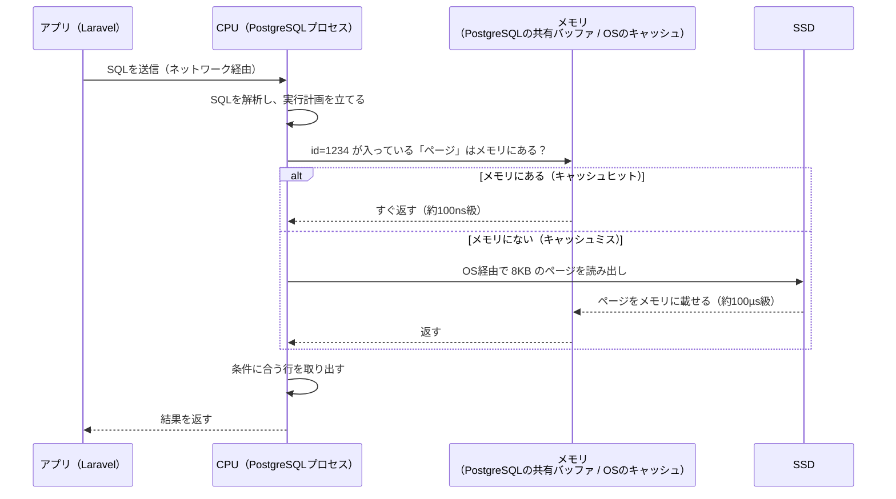

# 単元 1-1：CPU・メモリ・ストレージの役割とデータ処理の流れ

> **この単元のゴール**
> 「データベースにデータを保存する」「検索する」と言ったとき、コンピューターの中で**物理的に何が起きているか**を説明できるようになる。

---

## 【概念の解説】

### 1. コンピューターの3つの主役

コンピューターがデータを扱うとき、登場人物は基本的に3つです。

| 部品 | 役割 | たとえ（オフィス） | 電源を切ると |
|---|---|---|---|
| **CPU** | 計算・判断をする | 仕事をする**社員本人** | ― |
| **メモリ（RAM / DRAM）** | 作業中のデータを置く | **机の上** | **消える**（揮発性） |
| **ストレージ（SSD / HDD）** | データを長期保存する | **倉庫の書類棚** | 残る（不揮発性） |

重要な原則はひとつだけです。

> **CPU は、メモリ上にあるデータしか直接処理できない。**

倉庫（ストレージ）にある書類は、いったん机（メモリ）に持ってこないと読めません。結果を残したければ、机から倉庫に戻す必要があります。コンピューターの処理はすべて、この「**倉庫 → 机 → 社員 → 机 → 倉庫**」の往復です。

### 2. 速度差が「桁違い」であること

3つの部品は、アクセス速度がまったく違います。実際の数値（目安）と、**1ナノ秒を1秒に引き伸ばした**場合の体感時間を並べるとこうなります。

| アクセス先 | 実際の時間（目安） | 1ns = 1秒 に換算すると |
|---|---|---|
| CPU 内部のキャッシュ（L1） | 約 1 ns | 1秒 |
| メモリ（DRAM） | 約 100 ns | 約 1分40秒 |
| SSD（NVMe）からの読み出し | 約 100 µs | **約 1日** |
| HDD からの読み出し（シーク） | 約 10 ms | **約 4か月** |
| 東京 ↔ 米国西海岸の往復通信 | 約 100 ms | **約 3年** |

ここから分かることは2つです。

- **メモリに乗っていればすぐ終わる処理が、ストレージを読みに行った瞬間に何千倍も遅くなる。**
- **ネットワーク越しの通信は、さらにその上をいく。**（第2章で詳しく扱います）

「システムが重い」の正体の大半は、CPU の計算が遅いことではなく、**データを待っている時間**です。

### 3. 例：PostgreSQL で顧客を1件検索するとき、物理的に起きていること

あなたがアプリから次の SQL を投げたとします。

```sql
SELECT * FROM customers WHERE id = 1234;
```



ポイントは3つです。

1. **DB はデータを「行」ではなく「ページ」という塊（PostgreSQL では 8KB）で読み書きする。** 1行だけ欲しくても、その行を含む 8KB をまるごと机に持ってくる。
2. **よく使うページはメモリに置きっぱなしにする（キャッシュ）。** だから DB サーバーはメモリを大量に積むほど速くなりやすい。
3. **メモリが足りないと、毎回 SSD を読みに行くので急激に遅くなる。** さらに深刻になると、OS がメモリの中身をストレージに逃がす「スワップ」が起き、システム全体が極端に遅くなる。

### 4. 書き込みのときは「消える机」が問題になる

```sql
UPDATE customers SET phone = '03-xxxx-xxxx' WHERE id = 1234;
```

更新処理も、まずは**メモリ上のページを書き換える**ところから始まります。ここで問題が生じます。

> 「更新しました」と返事をした直後に**停電したら？** メモリの中身は消えます。

そのため DB は、変更内容を**ストレージに確実に書き込んでから**「完了（COMMIT）」と返事をする仕組みを持っています（OS に対して「バッファに溜めず、ディスクに書き切れ」と命じる `fsync` という操作を使います）。この仕組みの中核が **WAL（Write-Ahead Log：先行書き込みログ）** で、第3章で詳しく扱います。

ここでは「**速さのためにメモリを使い、安全のためにストレージに書く。DB はこの綱引きを設計で解いている**」とだけ押さえてください。

### 5. セキュリティの視点：データは「どこに」存在しているか

同じ顧客データでも、ある瞬間にはこれだけの場所に存在しえます。

| 場所 | 状態 | リスクの例 |
|---|---|---|
| ストレージ上のファイル | 長期間残る | 廃棄・盗難されたディスクからの流出 |
| メモリ上 | **暗号化されていない平文**で展開される | プログラムの欠陥でメモリの中身を読まれる |
| ネットワーク上 | 移動中 | 通信の盗聴（第2章） |
| バックアップ・ログ | 忘れられがち | 本番より守りが甘く、そこから漏れる |

実例を2つ挙げます。

- **Heartbleed（2014年）**：暗号化通信ライブラリ OpenSSL の欠陥により、攻撃者がサーバーの**メモリの中身を少しずつ読み出せた**。そこには秘密鍵やパスワードが平文で載っていた。**「ディスクを暗号化しているから安全」とは言えない**ことを示した事件。
- **神奈川県 HDD 転売事件（2019年発覚）**：リース返却された行政データ入りの HDD が、データ消去されないまま転売された。**ストレージは電源を切ってもデータが残る**という性質の裏返し。

---

## 【実務・ビジネスとの結びつき】

### これが理解できていないと起きること

| 現場の症状 | 根本原因（この単元の知識） |
|---|---|
| 「Excel が重くて開かない・固まる」 | Excel はファイル全体をメモリに展開する。行数が数十万〜上限（1,048,576行）に近づくと PC のメモリを食い尽くす |
| 「DB サーバーのスペックを上げたのに速くならない」 | 遅さの原因は CPU ではなく**メモリ不足によるストレージ読み出し**だった。お金をかける場所を間違えている |
| 「夜間バッチ中、日中の業務システムまで遅くなる」 | 集計処理がキャッシュ（メモリ）を大量のデータで押し流し、普段の業務データがメモリから追い出された（第6章の「本番 DB で集計してはいけない理由」に直結） |
| 「停電・障害後にデータが一部消えた」 | 書き込みがメモリ止まりで、ストレージに確定していなかった |
| 「サーバーを廃棄したら情報漏洩になった」 | ストレージの物理破壊・暗号化をしていなかった |

### 顧客のどの課題を解決するか

- **「Excel が重い・壊れる」**という現場の痛みを、「Excel は"机の上に全部広げる"道具なので、データが増えると原理的に限界が来る。DB は"倉庫から必要なページだけ持ってくる"道具」と**根本原因から説明できる**ようになる。
- クラウドの料金プラン（メモリ量・CPU 数・ディスク種別）を、**顧客のデータ量と使い方から根拠を持って選べる**ようになる。過剰スペックを避けることは、そのまま**提案価格の競争力**になる。
- 「データはクラウドのどこに、どんな状態で存在し、どう守られているか」を説明できることが、**セキュリティ面の信頼獲得**の第一歩になる。

---

## 【理解度チェック課題】

**Q1.**
CPU・メモリ・SSD のうち、電源を切るとデータが消えるのはどれですか。また、その性質があるにもかかわらず、DB がメモリを積極的に使うのはなぜですか。

**Q2.**
ある会社の顧客管理 DB で、「朝イチの最初の検索だけ遅く、2回目以降は速い」という現象が起きています。この単元の知識を使って、何が起きているか説明してください。

**Q3.**
「うちはサーバーのディスクを暗号化しているから、データが盗まれる心配はない」という主張には、どんな穴がありますか。データが存在しうる場所の観点から、少なくとも2つ挙げてください。

---

## 【顧客向け言語化トレーニング】

次の質問に、**専門用語（メモリ、ストレージ、CPU、キャッシュ等）を使わずに**答えてください。1〜3文程度、実際に口頭で話すつもりで書くのが理想です。

**演習1**
> 社長「今のExcelで十分回ってるのに、なんでわざわざデータベースにするの？ Excelだってパソコンにちゃんと保存されてるでしょ？」

**演習2**
> 社長「クラウドのサーバーって、月3万円のプランと月10万円のプランがあるけど、何が違うの？ 高い方が安心なんでしょ？」

<details>
<summary>💡 回答のヒント（考えてから開く）</summary>

- 演習1：「保存されているか」ではなく、「**データが増えたとき・複数人が同時に触るとき・壊れたとき**に何が起きるか」に論点をずらすと伝わりやすい。机と倉庫のたとえが使える。
- 演習2：「高い＝安心」ではなく、「**何にお金を払っているか**（同時に作業できる量 / 机の広さ / 倉庫の速さ）」を分解し、「御社の使い方ならここにお金をかけるべき」と言えると、提案者として信頼される。

</details>

---

回答は [`answers/chapter-01/01.md`](../answers/chapter-01/01.md) に記入してください。
