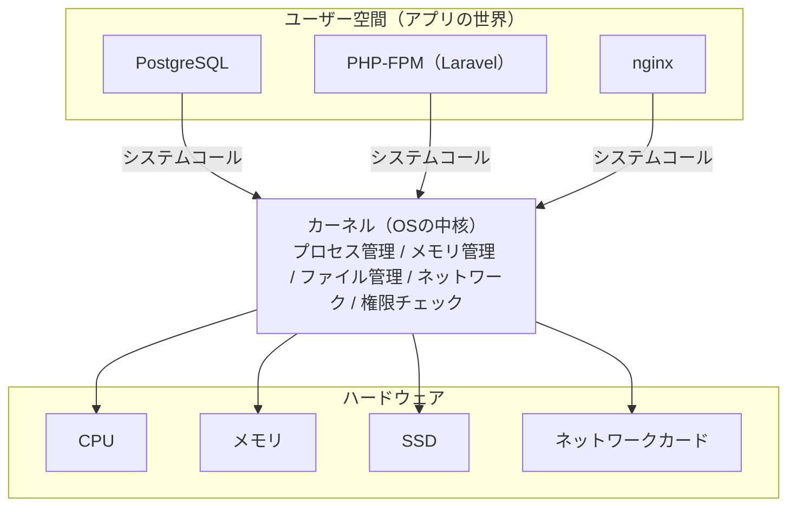

# 単元 1-2：OS（Linux）の役割、プロセスとスレッド

> **この単元のゴール**
> 「サーバーでプログラムが動いている」とは何が起きている状態なのかを、OS・プロセス・スレッドの言葉で説明できるようになる。

---

## 【概念の解説】

### 1. OS は「ハードウェアの管理人」

単元1-1で、CPU・メモリ・ストレージという3つの部品を見ました。しかし、アプリ（PostgreSQL や Laravel）が直接これらの部品を操作することはありません。間に必ず **OS（オペレーティングシステム）** が入ります。



OS の中核部分を **カーネル** と呼びます。カーネルの仕事は大きく5つです。

| 仕事 | 内容 | たとえ（オフィス） |
|---|---|---|
| プロセス管理 | どのプログラムに CPU をどれだけ使わせるか決める | シフト管理 |
| メモリ管理 | 各プログラムに机（メモリ）の区画を割り当て、他人の区画を覗けないようにする | 座席管理 |
| ファイル管理 | ストレージ上のデータを「ファイル」として整理する | 書庫の目録 |
| ネットワーク | 通信データの送受信を仲介する | 郵便受付 |
| 権限チェック | 「この人はこの操作をしてよいか」を毎回確認する | 警備員 |

アプリがファイルを読んだり通信したりしたいときは、カーネルに「お願い」を出します。このお願いを **システムコール** と呼びます。`open()`（ファイルを開く）、`read()`、`write()`、`fsync()`（単元1-1で出てきた「ディスクに書き切れ」）などがその例です。

> **重要：アプリは自分でハードウェアに触れない。必ずカーネルを通る。だからカーネルは「権限チェックの関所」になれる。**

### 2. プロセス：実行中のプログラム

ストレージ上にある `postgres` という実行ファイルは、ただのデータです。これを起動すると、カーネルは次のものを用意します。

- メモリ上の専用区画（他のプロセスからは見えない）
- プロセス ID（PID）という番号
- 「誰の権限で動いているか」（実行ユーザー）
- 開いているファイルや通信の一覧

この「実行中のプログラム＋その持ち物一式」を **プロセス** と呼びます。

Linux では `ps` コマンドで確認できます。

```text
$ ps aux | grep postgres
USER      PID  %CPU %MEM  COMMAND
postgres  812   0.0  1.2  postgres: checkpointer
postgres  813   0.0  0.8  postgres: background writer
postgres  814   0.0  0.5  postgres: walwriter
postgres 2051   3.1  2.4  postgres: app_user salesdb 10.0.1.5(51234) SELECT
```

注目ポイントは2つです。

- **PostgreSQL は、接続1本ごとに1つのプロセスを作る。** 上の PID 2051 は、`app_user` という DB ユーザーがアプリサーバー `10.0.1.5` から接続して SELECT を実行中、という意味です。
- **すべて `postgres` という OS ユーザーで動いている。** root（管理者）では動いていません。これは意図的な設計です（後述）。

### 3. スレッド：プロセスの中の「作業者」

1つのプロセスの中で、複数の作業を並行して進めたいことがあります。そのための仕組みが **スレッド** です。

| | プロセス | スレッド |
|---|---|---|
| メモリ | **それぞれ独立**（隔離されている） | 同じプロセス内で**共有** |
| 作成コスト | 重い | 軽い |
| 片方が壊れたら | 他のプロセスは無事 | 同じプロセスの全スレッドが道連れになりやすい |
| たとえ | 別々の部屋で働く社員 | 同じ部屋で机を共有する社員 |

- **PostgreSQL**：接続ごとに**プロセス**（隔離重視。1接続の異常が他に波及しにくい）
- **MySQL**：接続ごとに**スレッド**（軽さ重視）
- **PHP-FPM**：リクエストを処理する**プロセス**を複数用意して使い回す

どちらが正しいではなく、**隔離と軽さのトレードオフ**です。

### 4. CPU の取り合いと「コンテキストスイッチ」

CPU のコア数は 2〜数十程度ですが、サーバー上では数百のプロセスが動いています。カーネルは、ごく短い時間（ミリ秒単位）ごとに CPU を使うプロセスを切り替えて、全員が同時に動いているように見せています。この切り替えを **コンテキストスイッチ** と呼びます。

切り替えにはコストがかかります。そのため、**接続数（＝プロセス数）が多すぎると、CPU は「仕事」より「切り替え」に時間を使ってしまう**ことがあります。PostgreSQL に「最大接続数（`max_connections`）」の設定があり、実務で **コネクションプール**（接続を使い回す仕組み）が必須とされるのはこのためです。

### 5. セキュリティの視点：「誰として動いているか」がすべて

カーネルは、プロセスが何かをしようとするたびに「**このプロセスの実行ユーザーに、その権限があるか**」を確認します。つまり、

> **プロセスが乗っ取られたとき、攻撃者は「そのプロセスの実行ユーザーができること」を全部できる。**

| アプリの実行ユーザー | Web アプリの脆弱性を突かれたときの被害 |
|---|---|
| root（管理者） | サーバー上のあらゆるファイルの読み書き、他のプログラムの改ざん、裏口の設置。**サーバー全体が乗っ取られる** |
| 専用の一般ユーザー（例：`www-data`） | そのユーザーが読めるファイルの範囲に被害が限定される |

これが **最小権限の原則**（必要最低限の権限だけ与える）の、OS レベルでの意味です。PostgreSQL が root での起動を拒否するのも、この原則を強制するためです。

さらに、**プロセスごとにメモリが隔離されている**ことも重要な防御です。Web アプリのプロセスが乗っ取られても、カーネルが守っている限り、別プロセスの DB のメモリを直接覗くことはできません。逆に言えば、単元1-1の Heartbleed は「**自分のプロセス内のメモリ**」を読まれた事件でした。プロセス内は隔離の内側なので、カーネルは守ってくれないのです。

---

## 【実務・ビジネスとの結びつき】

### これが理解できていないと起きること

| 現場の症状 | 根本原因 |
|---|---|
| 「アクセスが集中したら DB が "too many connections" で止まった」 | 接続ごとにプロセスを作る DB に、アプリが接続を張りすぎた。コネクションプール未設計 |
| 「サーバーの CPU 使用率は低いのに遅い」 | CPU ではなく、ディスク待ち（単元1-1）やロック待ち（第3章）でプロセスが止まっている |
| 「小さな脆弱性からサーバー全体を乗っ取られた」 | Web アプリを root で動かしていた |
| 「1つのバッチ処理が暴走して、全システムが止まった」 | プロセスごとのメモリ・CPU 上限を設定していなかった（第1章 1-4 のコンテナで対策できる） |

### 顧客のどの課題を解決するか

- 「なぜ今のシステムは月末に止まるのか」を、**接続数・プロセス数の観点から診断できる**。
- 提案時に「アプリは権限を絞った専用ユーザーで動かし、乗っ取られても被害が広がらない設計にします」と、**セキュリティ対策を具体的な仕組みで説明できる**。
- クラウドのインスタンス選定で「CPU コア数を増やすべきか、メモリを増やすべきか」を判断する材料になる。

---

## 【理解度チェック課題】

**Q1.**
アプリ（例：PostgreSQL）がファイルを読みたいとき、自分で SSD を操作せずに OS（カーネル）を経由するのはなぜですか。セキュリティの観点を含めて答えてください。

**Q2.**
PostgreSQL は「接続ごとにプロセス」、MySQL は「接続ごとにスレッド」という設計です。それぞれの長所・短所を、メモリの隔離という観点から説明してください。

**Q3.**
Laravel アプリを root ユーザーで動かしているサーバーで、ファイルアップロード機能の脆弱性を突かれ、攻撃者が任意のコマンドを実行できるようになりました。専用の一般ユーザーで動かしていた場合と比べて、被害はどう違いますか。

---

## 【顧客向け言語化トレーニング】

専門用語（OS、プロセス、権限、root 等）を使わずに答えてください。

**演習1**
> 担当者「月末の締め日だけシステムが止まるんです。サーバーのスペックを上げれば解決しますか？」

**演習2**
> 社長「セキュリティ対策って具体的に何してくれるの？ ウイルス対策ソフトを入れるってこと？」

<details>
<summary>💡 回答のヒント（考えてから開く）</summary>

- 演習1：「スペック不足」とは限らない。「同時に窓口に並ぶ人が多すぎて、受付係が交代するだけで手一杯になっている」ような状態の可能性を、窓口のたとえで説明できると良い。すぐに「はい」と答えず「まず原因を調べます」と言えることが信頼につながる。
- 演習2：「侵入されない対策」だけでなく「**万が一侵入されても被害が広がらない設計**」があることを伝える。社員全員にマスターキーを渡さない会社のたとえが使える。

</details>
