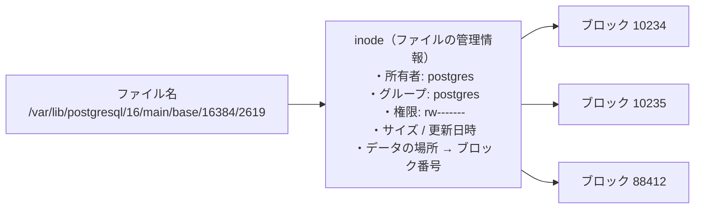

# 単元 1-3：ファイルシステムと権限管理（パーミッション）

> **この単元のゴール**
> サーバー上のデータが「ファイル」としてどう保存され、誰が読み書きできるかがどう決まるのかを説明できるようになる。設定ミス1つで情報漏洩が起きる理由を理解する。

---

## 【概念の解説】

### 1. ファイルシステム：ストレージに「目録」をつける仕組み

SSD そのものは、番号のついた小さな区画（ブロック）がずらっと並んでいるだけの装置です。「顧客リスト.csv はどこからどこまで」という情報は持っていません。

この **ブロックの集まりに名前・場所・持ち主・権限をつけて「ファイル」として管理する仕組み** が **ファイルシステム** です（Linux では ext4 や xfs が代表的）。



ポイント：

- ファイルの中身とは別に、**inode（アイノード）** という管理情報がある。ここに「持ち主」と「権限」が記録されている。
- **ファイルを削除しても、多くの場合は「目録から消す」だけで、ブロックの中身はすぐには消えない。** 単元1-1の HDD 転売事件で、消したはずのデータが復元できた理由はこれです。

### 2. Linux のディレクトリ構成（よく出てくる場所）

| 場所 | 中身 | 実務での注意 |
|---|---|---|
| `/etc` | 設定ファイル | DB 接続情報やパスワードが置かれがち |
| `/var/log` | ログ | **個人情報やトークンがログに出力されていることがある** |
| `/var/lib/postgresql` | PostgreSQL のデータ本体 | DB のテーブルは実体としてはここのファイル群 |
| `/var/www` | Web アプリの置き場（慣習） | 公開ディレクトリの外に秘密情報を置くこと |
| `/home/ユーザー名` | 各ユーザーの作業場所 | |
| `/tmp` | 一時ファイル | 誰でも書ける。機密データを置かない |

> **DB のテーブルも、最終的にはファイルシステム上のファイルである。** だから OS の権限設定が甘いと、DB の権限設定をすり抜けてデータファイルを直接コピーされる。

### 3. パーミッション：「誰が」「何を」できるか

`ls -l` コマンドでファイルの権限を確認できます。

```text
$ ls -l /var/www/app/.env
-rw-r----- 1 deploy www-data 1024 Oct 27 10:00 .env
```

`-rw-r-----` の部分を分解します。

```text
 -   rw-   r--   ---
 │    │     │     └─ その他の全員（others）：何もできない
 │    │     └─────── グループ（www-data）：読むだけ
 │    └───────────── 所有者（deploy）：読み書き
 └────────────────── 種類（- はファイル、d はディレクトリ）
```

| 記号 | 意味（ファイル） | 意味（ディレクトリ） |
|---|---|---|
| `r` (read) | 中身を読める | 中のファイル一覧を見られる |
| `w` (write) | 中身を書き換えられる | 中にファイルを作成・削除できる |
| `x` (execute) | プログラムとして実行できる | 中に入れる（アクセスできる） |

数字で表すこともあります。`r=4, w=2, x=1` を足し算します。

| 表記 | 数字 | 典型的な用途 |
|---|---|---|
| `rw-------` | `600` | 秘密鍵、パスワードファイル（本人だけ） |
| `rw-r-----` | `640` | 設定ファイル（本人＋アプリのグループが読む） |
| `rw-r--r--` | `644` | 公開して問題ない一般ファイル |
| `rwxr-xr-x` | `755` | プログラム、公開ディレクトリ |
| `rwxrwxrwx` | `777` | **全員が何でもできる。原則使ってはいけない** |

この確認を毎回行っているのが、単元1-2で学んだ**カーネル**です。プロセスがファイルを `open()` するたびに、「このプロセスの実行ユーザーは、このファイルに対してこの操作をしてよいか」を inode の情報と照合します。

### 4. root は権限チェックを素通りする

Linux の管理者ユーザー **root** は、上記のパーミッションチェックを基本的に**無視できます**。`600` のファイルも読めます。だからこそ、

- 普段の作業やアプリの実行に root を使わない
- 必要なときだけ `sudo` で一時的に借りる（誰が何をしたかログに残る）

というのが鉄則です。

### 5. セキュリティの視点：「777」と「公開ディレクトリ」の事故

Web サーバーでよく起きる事故パターンを見てみましょう。

**事故パターンA：とりあえず777**

「アップロードがうまくいかない」→「権限エラーだ」→ `chmod -R 777 /var/www` で解決…。

これで、**サーバー上のどのプロセスでも、アプリのコードを書き換えられる**状態になります。別の脆弱性から侵入した攻撃者が、ログイン画面のコードに「入力されたパスワードを外部に送信する」処理を仕込むことが可能になります。

**事故パターンB：公開ディレクトリに秘密情報**

Web サーバー（nginx 等）は、特定のディレクトリ（例：`/var/www/app/public`）の中身をインターネットに公開します。ここに

- DB 接続情報を書いた設定ファイル（`.env`）
- DB のバックアップファイル（`backup.sql`）
- Excel から変換した顧客 CSV

を置いてしまうと、URL を知っている（または推測した）誰でもダウンロードできます。**パーミッションは「サーバー内のユーザー」に対する制御であり、Web サーバーが公開してしまえば無意味**になる点に注意してください。Laravel が `public/` だけを公開し、`.env` をその外に置く構成になっているのは、この事故を防ぐためです。

---

## 【実務・ビジネスとの結びつき】

### これが理解できていないと起きること

| 現場の症状 | 根本原因 |
|---|---|
| 「顧客データの CSV が検索エンジンに載っていた」 | 公開ディレクトリにエクスポートファイルを置いていた |
| 「サイトが改ざんされた」 | `777` 設定により、侵入した攻撃者がコードを書き換えられた |
| 「退職者がサーバーからデータを持ち出していた」 | 共有アカウント・広すぎる権限で、誰が何をしたか追えない |
| 「ログから API キーが漏れた」 | ログファイルの権限が緩く、かつ機密情報をログに出力していた |

### 顧客のどの課題を解決するか

- 中小企業では「共有フォルダに全社員がフルアクセス」「Excel にパスワードをかけて終わり」という運用が多い。**「誰が」「どのデータに」「何をできるか」を設計する**という考え方そのものが、提案の価値になる。
- データ取り込み基盤では、顧客から受け取った Excel / CSV を一時的にサーバーに置く場面がある。**置き場所・権限・削除タイミングを設計できる**ことは、預かる側としての信頼に直結する。

---

## 【理解度チェック課題】

**Q1.**
`-rw-r-----  deploy  www-data  .env` というファイルについて、(a) deploy ユーザー、(b) www-data グループに属するユーザー、(c) それ以外のユーザー、がそれぞれ何をできるか答えてください。また数字表記では何になりますか。

**Q2.**
「ファイルを削除したからデータは消えた」とは言い切れないのはなぜですか。ファイルシステムの仕組みから説明してください。

**Q3.**
Linux のパーミッションを正しく `600` に設定していたのに、そのファイルがインターネットから誰でもダウンロードできてしまいました。考えられる原因は何ですか。

---

## 【顧客向け言語化トレーニング】

専門用語（パーミッション、ファイルシステム、root 等）を使わずに答えてください。

**演習1**
> 担当者「今はファイルサーバーの共有フォルダに全部入れて、全員が見られるようにしています。便利なんですけど、何か問題ありますか？」

**演習2**
> 社長「古いパソコンやサーバーを捨てるとき、中のデータは"ゴミ箱を空にする"で消しておけば大丈夫だよね？」

<details>
<summary>💡 回答のヒント（考えてから開く）</summary>

- 演習1：「便利さ」を否定せず、「全員に全部の鍵を渡している状態」のリスク（誤操作での削除、退職者の持ち出し、1人のPCが乗っ取られたら全データが危険）を具体的に。「役割ごとに見られる範囲を分ける」解決策をセットで。
- 演習2：「ゴミ箱を空にする」は「本の目次から章を消しただけで、ページは残っている」状態。物理破壊・専用ソフトでの消去・最初から暗号化しておく、の選択肢を示す。

</details>

---

回答は [`answers/chapter-01/03.md`](../answers/chapter-01/03.md) に記入してください。
