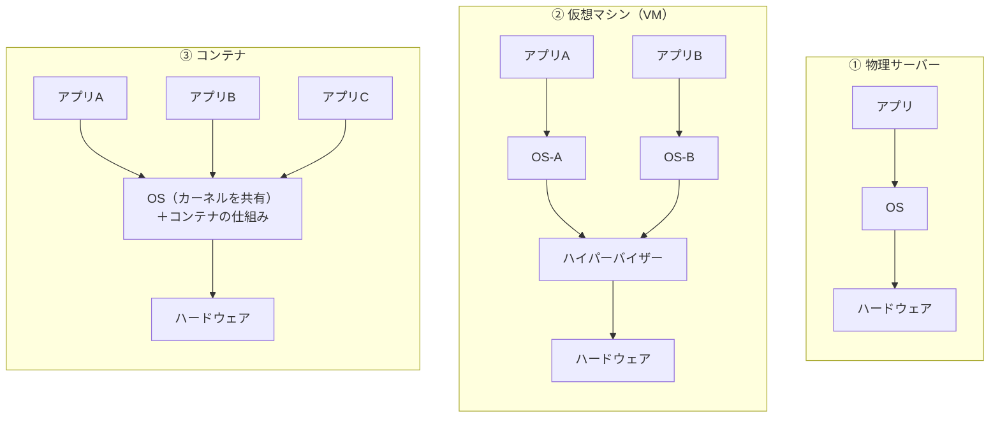

# 単元 1-4：サーバーとは何か（物理サーバー / 仮想マシン / コンテナ、Cloud Run と Fargate）

> **この単元のゴール**
> 「サーバー」「クラウド」「コンテナ」という言葉の物理的な実体を説明でき、顧客の規模に合った実行環境を選べるようになる。

---

## 【概念の解説】

### 1. サーバーとは「役割」の名前

**サーバー（server）** は「サービスを提供する側」という**役割**の名前です。特別な機械を指すわけではありません。単元1-1〜1-3で学んだ CPU・メモリ・ストレージ・OS があり、ネットワーク越しにリクエストを受けて応答するプロセスが動いていれば、それはサーバーです。

- Web サーバー：HTTP リクエストを受けて HTML や JSON を返すプロセス（nginx 等）
- DB サーバー：SQL を受けて結果を返すプロセス（PostgreSQL 等）

問題は「**そのプロセスを、どんな箱の中で動かすか**」です。箱には3段階あります。

### 2. 3種類の箱

#### ① 物理サーバー

1台の機械に1つの OS。単純で性能を出し切れますが、

- 購入・設置に数週間かかる
- 使わない時間も電気代・場所代がかかる
- 壊れたら物理的に交換が必要

中小企業の社内に置かれた「サーバー室の箱」がこれです。

#### ② 仮想マシン（VM）

**ハイパーバイザー** というソフトウェアが、1台の物理マシンを**何台ものマシンがあるかのように見せかけ**ます。それぞれの VM には独立した OS が載ります。

- 数分で作成・削除できる
- VM 同士は OS ごと分かれているので隔離が強い
- ただし OS をまるごと載せるので、起動に数十秒〜数分、メモリも OS の分だけ余計に使う

AWS の EC2、Google Cloud の Compute Engine は VM を貸すサービスです。「クラウドのサーバー」の多くは、**データセンターにある巨大な物理マシンの一部を VM として借りている**状態です。

#### ③ コンテナ

コンテナは、**OS のカーネル（単元1-2）を共有しつつ、プロセスを「隔離された小部屋」に入れる**仕組みです。Linux カーネルの2つの機能でできています。

| 機能 | 役割 | たとえ |
|---|---|---|
| **namespaces** | プロセスから見える世界を制限する（他のプロセス、ファイル、ネットワークが見えない） | 窓のない個室 |
| **cgroups** | CPU・メモリの使用量に上限をかける | 個室ごとの電気使用量の上限 |

- OS をまるごと載せないので、起動は数秒以下、軽い
- 「アプリ＋必要なライブラリ」を**イメージ**という1つのパッケージにまとめられ、どこでも同じように動く（Docker がその代表的なツール）
- ただしカーネルを共有するため、**隔離の強さは VM より弱い**。カーネルに脆弱性があれば、コンテナの外に抜け出される可能性がある

### 3. クラウドの「どこまで任せるか」

クラウドでは、箱の種類に加えて「**どこまでをクラウド事業者に管理してもらうか**」を選びます。

| 管理する範囲 | VM（Compute Engine / EC2） | サーバーレスコンテナ（Cloud Run / Fargate） | マネージドDB（Cloud SQL / RDS） |
|---|---|---|---|
| ハードウェア | 事業者 | 事業者 | 事業者 |
| OS のパッチ適用 | **自分** | 事業者 | 事業者 |
| スケール（台数の増減） | **自分** | 事業者（自動） | 半自動 |
| アプリ / データ / 権限設定 | **自分** | **自分** | **自分** |

**最後の行は、どれを選んでも必ず自分の責任**です。これを **責任共有モデル** と呼びます。「クラウドだから安全」ではなく、「**クラウドは土台を守る。上に載せるものの設定は利用者が守る**」という分担です。クラウドでの情報漏洩事故の多くは、事業者側ではなく**利用者側の設定ミス**（データの公開設定、緩すぎる権限）が原因です。

### 4. Cloud Run と Fargate

このカリキュラムでは、データ取り込み処理の実行環境として **Cloud Run**（Google Cloud）を使います。AWS の **Fargate** はほぼ同じ立ち位置のサービスです。

| | Cloud Run（GCP） | ECS on Fargate（AWS） |
|---|---|---|
| 何を渡すか | コンテナイメージ | コンテナイメージ |
| OS 管理 | 不要 | 不要 |
| 課金 | リクエスト処理中の時間が中心。**アクセスがなければほぼ0円にできる** | タスクが起動している時間 |
| 定期実行 | Cloud Run jobs ＋ Cloud Scheduler | ECS スケジュールタスク |
| BigQuery との相性 | 同じクラウドなので権限・ネットワーク設定がシンプル | クラウドをまたぐ設定が必要 |

中小企業のデータ取り込みは「1日数回のバッチ」や「たまに届く Webhook」が中心で、**常時サーバーを起動しておく必要がない**ケースがほとんどです。Cloud Run のように**使った分だけ課金**される仕組みは、運用コストを抑えたい顧客にとって大きなメリットになります。

一方、**DB（PostgreSQL）は常時起動が前提**なので、Cloud SQL というマネージドサービスを使います。バックアップ・パッチ適用・障害時の切り替えを事業者に任せられます。

---

## 【実務・ビジネスとの結びつき】

### これが理解できていないと起きること

| 現場の症状 | 根本原因 |
|---|---|
| 「クラウドに移したのに情報漏洩した。クラウド業者の責任では？」 | 責任共有モデルを理解していない。データの公開設定は利用者側の責任 |
| 「VM を立てたまま放置し、OS の脆弱性を突かれた」 | VM は OS のパッチ適用が自分の責任であることを見落とした |
| 「誰も使っていないのに毎月数万円の請求が来る」 | 1日数分しか動かない処理のために、VM を24時間起動していた |
| 「開発環境では動いたのに本番で動かない」 | ライブラリのバージョン差。コンテナで環境を揃えていなかった |

### 顧客のどの課題を解決するか

- **社内サーバー（物理）の老朽化・故障リスク**という、中小企業によくある不安に対して、マネージドサービスへの移行を根拠を持って提案できる。
- 「保守運用の手間（OS 更新など）をどこまで減らせるか」を、責任共有モデルの表を使って**見える化**できる。これは保守契約の範囲・金額を決める材料にもなる。
- 構成の選択（VM か Cloud Run か）が、**月額ランニングコストに直結**することを説明できる。

---

## 【理解度チェック課題】

**Q1.**
仮想マシン（VM）とコンテナの違いを、「OS（カーネル）」という言葉を使って説明してください。また、隔離の強さと起動の速さはそれぞれどちらが有利ですか。

**Q2.**
Cloud Run を使っていれば、セキュリティについて何も考えなくてよいでしょうか。責任共有モデルの観点から、利用者側に残る責任を2つ以上挙げてください。

**Q3.**
「1日3回、kintone からデータを取ってきて DB に保存する処理」を動かす環境として、24時間起動の VM より Cloud Run（jobs）が適している理由を説明してください。逆に、Cloud Run に向かない処理の例も1つ挙げてください。

---

## 【顧客向け言語化トレーニング】

専門用語（VM、コンテナ、マネージド、責任共有モデル等）を使わずに答えてください。

**演習1**
> 社長「うちは社内にサーバーを置いてるから、外部に情報が漏れなくて安全だと思ってるんだけど、クラウドって他の会社と一緒に使うんでしょ？ 危なくない？」

**演習2**
> 社長「クラウドに移したら、もう何かあっても全部クラウドの会社が責任取ってくれるんだよね？」

💡 回答のヒント（考えてから開く）

- 演習1：「社内＝安全」の思い込みを否定しすぎず、社内サーバーの現実的なリスク（停電・故障・管理担当者の退職・物理的盗難・パッチ未適用）と、クラウドのデータセンターの守り（入館管理、専門チームの24時間監視）を比較する。「同じビルに入居していても、部屋ごとに鍵が分かれている」たとえが使える。
- 演習2：「建物の警備はビル管理会社、部屋の鍵の管理は入居者」という分担で説明する。そのうえで「その"部屋の鍵の管理"を私たちが設計・代行します」と提案につなげる。

