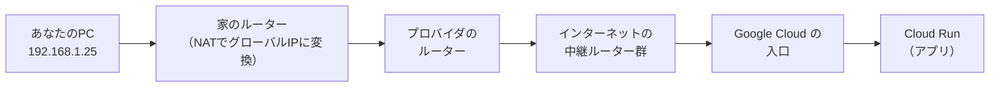

# 単元 2-1：IPアドレス、サブネットマスク、CIDR、ルーティング

> **この単元のゴール**
> データがネットワーク上でどうやって相手のコンピューターまで届くのかを、IPアドレスとルーティングの言葉で説明できるようになる。「`0.0.0.0/0` を許可する」設定がなぜ危険なのかを理解する。

---

## 【概念の解説】

### 1. IPアドレス：ネットワーク上の「住所」

ネットワークにつながる機器には、それぞれ **IPアドレス** という番号が割り当てられます（現在主流の IPv4 の場合）。

```text
192.168.1.25
```

見た目は「0〜255 の数字 × 4つ」ですが、コンピューターの中では **32桁の2進数（0と1）** です。

```text
192      .168      .1        .25
11000000 .10101000 .00000001 .00011001
```

データは「**パケット**」という小さな小包に分割され、各パケットに「宛先IPアドレス」と「送信元IPアドレス」が書かれて送られます。郵便の封筒に宛先と差出人を書くのと同じです。

### 2. ネットワーク部とホスト部：住所の「町名」と「番地」

IPアドレスは2つの部分に分かれます。

| 部分 | 意味 | 住所でいうと |
|---|---|---|
| **ネットワーク部** | どのネットワーク（区画）に属するか | 〇〇町 1丁目 |
| **ホスト部** | そのネットワーク内のどの機器か | 25番地 |

どこまでがネットワーク部かを示すのが **サブネットマスク** や **CIDR表記** です。

```text
192.168.1.25/24
              └─ 先頭24ビットがネットワーク部、という意味（CIDR表記）
```

`/24` はサブネットマスク `255.255.255.0` と同じ意味です。

```text
IPアドレス     11000000.10101000.00000001.00011001  (192.168.1.25)
サブネットマスク 11111111.11111111.11111111.00000000  (255.255.255.0)
               └──── ネットワーク部（24ビット）────┘└ホスト部┘
```

### 3. CIDR：範囲をまとめて表す書き方

CIDR表記は「**この範囲のIPアドレス全部**」を一言で表すのに使います。セキュリティ設定（第2章 2-5、第5章）で毎日のように出てくるので、ここで確実に押さえます。

| CIDR | 範囲 | 個数 | 実務での意味 |
|---|---|---|---|
| `203.0.113.10/32` | 203.0.113.10 の1つだけ | 1 | 「この1台だけ許可」 |
| `192.168.1.0/24` | 192.168.1.0 〜 192.168.1.255 | 256 | 小さなオフィスのネットワーク |
| `10.0.0.0/16` | 10.0.0.0 〜 10.0.255.255 | 65,536 | クラウド上の社内ネットワーク全体 |
| `0.0.0.0/0` | **すべてのIPアドレス** | 約43億 | **「インターネット上の誰でも」** |

覚え方：**`/` の後ろの数字が小さいほど範囲が広い**。`/32` は1個、`/0` は全世界。

### 4. プライベートIPとグローバルIP

IPv4 のアドレスは約43億個しかなく、世界中の機器に配るには足りません。そこで、**社内・家庭内だけで使ってよい範囲**が決められています。

| 種類 | 範囲 | 特徴 |
|---|---|---|
| **プライベートIP** | `10.0.0.0/8`、`172.16.0.0/12`、`192.168.0.0/16` | 組織の内側でのみ有効。インターネットからは直接届かない |
| **グローバルIP** | それ以外（一部の特殊用途を除く） | 世界で一意。インターネットから届く |

家庭や会社の PC は通常プライベートIP を持ち、インターネットに出るときはルーターが自分のグローバルIP に書き換えて代理で通信します。この書き換えを **NAT（Network Address Translation）** と呼びます。

> **プライベートIPしか持たない機器には、インターネット側から直接つなぎに来ることができない。** これは強力な防御になります。第2章 2-5 で、DB にグローバルIPを持たせない設計（プライベートネットワーク）として活用します。

### 5. ルーティング：小包をバケツリレーで届ける

宛先が自分と**同じネットワーク内**なら、パケットは直接届けられます。**別のネットワーク**宛なら、**ルーター**に渡します。ルーターは「この宛先なら、次はこっちのルーターに渡せ」という **ルーティングテーブル** を持っていて、パケットをバケツリレーのように次々と転送します。



PC のルーティングテーブルは、たいてい次の2行だけです。

```text
宛先              次に渡す相手
192.168.1.0/24   直接届ける（同じネットワーク）
0.0.0.0/0        192.168.1.1（家のルーター）← デフォルトゲートウェイ
```

`0.0.0.0/0` は「**それ以外の全部**」という意味で、ここでも出てきます。どのルールにも当てはまらない宛先は、デフォルトゲートウェイに任せるわけです。

各ルーターは**宛先だけを見て**次に渡します。途中のルーターは小包の中身を見る必要はありませんが、**暗号化されていなければ中身を見ることもできる**という点を覚えておいてください（第2章 2-4 の HTTPS につながります）。

### 6. セキュリティの視点：「送信元IP」による制限と、その限界

サーバーやDBの設定では、「**どの送信元IPからの接続を許可するか**」をCIDRで指定します。

```text
許可: 203.0.113.10/32   ← 顧客オフィスの固定IPだけ
許可: 0.0.0.0/0         ← 全世界から誰でも
```

DB を `0.0.0.0/0` に公開すると、世界中の攻撃者が自動スキャンツールで見つけて、パスワードの総当たりを始めます。インターネットに公開されたDBポートは、**公開から数分〜数時間でスキャンされる**のが現実です。

ただし、送信元IPによる制限は万能ではありません。

- 許可したオフィスのPCがウイルスに感染すれば、その許可を悪用される
- 固定IPのない環境（自宅・スマホ）からは使えない

だからこそ「IP制限 ＋ 認証 ＋ 暗号化」の**多層防御**（第5章）が必要になります。

---

## 【実務・ビジネスとの結びつき】

### これが理解できていないと起きること

| 現場の症状 | 根本原因 |
|---|---|
| 「DB にランサムウェア（データを人質にとる攻撃）を仕掛けられた」 | 「接続できないから」と DB の許可設定を `0.0.0.0/0` にしていた |
| 「本社と支店のネットワークをつないだら通信できなくなった」 | 両拠点が同じ `192.168.1.0/24` を使っていて、宛先が区別できない |
| 「クラウドの社内ネットワークが足りなくなった」 | 最初にCIDRを狭く（`/28` など）設計しすぎた |
| 「テレワークで社員がシステムに入れない」 | オフィスの固定IPだけ許可していて、自宅からの経路を設計していなかった |

### 顧客のどの課題を解決するか

- 中小企業では、kintone や Excel で管理していたデータを「とりあえずネットに公開されたサーバー」に置いてしまう例が少なくない。**「誰がどこからアクセスできるか」をCIDRで設計し、説明できる**ことは大きな差別化になる。
- 「オフィスからだけ使える」「テレワークでも安全に使える」といった顧客の要望を、**ネットワーク構成に翻訳できる**ようになる。

---

## 【理解度チェック課題】

**Q1.**
`10.0.1.0/24` と `10.0.0.0/16` は、それぞれ何個のIPアドレスを含みますか。また、`10.0.1.50` はどちらの範囲にも含まれますか。

**Q2.**
プライベートIPアドレスしか持たないDBサーバーに、インターネット上の攻撃者が直接接続できないのはなぜですか。ルーティングの観点から説明してください。

**Q3.**
DB の接続許可設定で `0.0.0.0/0` を指定することの意味と危険性を説明してください。また、オフィスからだけ接続を許可したい場合、どう設定しますか。

---

## 【顧客向け言語化トレーニング】

専門用語（IPアドレス、CIDR、ルーティング等）を使わずに答えてください。

**演習1**
> 社長「新しいデータベースって、インターネットから見えちゃうの？ ハッカーに見つかったりしない？」

**演習2**
> 担当者「前の業者さんに"IP制限をかけてあるので安全です"と言われたんですが、それだけで大丈夫なんですか？」

<details>
<summary>💡 回答のヒント（考えてから開く）</summary>

- 演習1：「住所が外部に公開されていない建物」「社内の人しか入れない奥の部屋」のたとえで、DB をインターネットから直接たどり着けない場所に置く設計を説明する。「見えないので、そもそも見つからない」がポイント。
- 演習2：IP制限は「受付で社員証の会社名だけ確認している」状態。否定せず「有効な対策の1つ」と認めたうえで、「社員証を盗まれたら通れてしまう」ので、本人確認（認証）や通信の暗号化と組み合わせる必要があると伝える。前の業者を悪く言わないこと。

</details>

---

回答は [`answers/chapter-02/01.md`](../answers/chapter-02/01.md) に記入してください。
