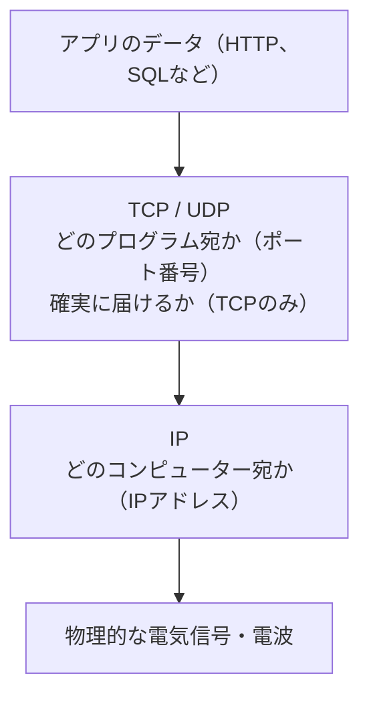
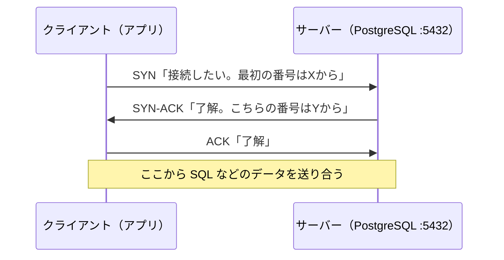

# 単元 2-2：TCP / UDP とポート番号

> **この単元のゴール**
> IPアドレスで「どのコンピューターか」まで届いたデータが、その中の「どのプログラム」に、どうやって「確実に」届けられるのかを説明できるようになる。

---

## 【概念の解説】

### 1. IP だけでは足りない2つのこと

単元2-1の IP は「どのコンピューター宛か」を決めて、バケツリレーで届ける仕組みでした。しかし IP には2つの弱点があります。

1. **届いたかどうか保証しない。** 途中のルーターが混雑していれば、パケットは捨てられることがある。順番が入れ替わることもある。
2. **コンピューターの中の「どのプログラム宛か」が分からない。** 1台のサーバーでは Web サーバー・DB・SSH など複数のプログラムが同時に通信を待っている。

これを解決するのが、IP の上に乗る **TCP** と **UDP** です。

このように役割ごとに層を重ねる考え方を **プロトコルの階層化** と呼びます。上の層は下の層の細かい事情を知らなくても通信できます。

### 2. ポート番号：建物の中の「部屋番号」

IPアドレスが建物の住所だとすると、**ポート番号**は部屋番号です（0〜65535）。サーバー上のプログラムは、特定のポート番号で接続を待ち受けます（**listen** する）。

| ポート | 待ち受けているもの | 公開してよいか |
|---|---|---|
| 22 | SSH（サーバーの遠隔操作） | **原則インターネットに公開しない** |
| 80 | HTTP（暗号化なしの Web） | HTTPS へ転送する用途のみ |
| 443 | HTTPS（暗号化された Web） | 公開する Web サービスはここ |
| 5432 | **PostgreSQL** | **絶対に公開しない** |
| 3306 | MySQL | 絶対に公開しない |
| 6379 | Redis | 絶対に公開しない |

**「IPアドレス＋ポート番号」の組で、通信の相手のプログラムが一意に決まります。** 例えば `10.0.2.5:5432` は「10.0.2.5 のマシンの、PostgreSQL」です。

接続する側（クライアント）のポートは、OS が空いている番号（49152〜65535 など）を自動で割り当てます。単元1-2の `ps` の出力にあった `10.0.1.5(51234)` の `51234` がそれです。

### 3. TCP：確実に・順番通りに届ける

TCP は、信頼性のない IP の上で「**確実に・順番通りに・抜けなく**」届けるための仕組みです。

#### 3ウェイハンドシェイク（接続の開始）

データを送る前に、3回のやり取りで「お互いに通信できること」を確認します。

#### 番号付けと再送

TCP は送るデータに**通し番号（シーケンス番号）**を振ります。受け取った側は「ここまで受け取った（ACK）」と返事をします。返事が来なければ送った側は**再送**します。順番が入れ替わって届いても、番号を見て並べ直します。

この仕組みのおかげで、アプリ（PostgreSQL や Laravel）は「データが欠けるかも」と心配せずに済みます。その代わり、

- 接続の確立に往復が必要（単元1-1の表のとおり、**遠いサーバーとの往復は高くつく**）
- パケットが失われると、再送を待つ間すべてが止まる

というコストを払っています。

### 4. UDP：速さ優先で「送りっぱなし」

UDP は、ポート番号による宛先の振り分けだけを行い、**確認も再送もしません**。

| | TCP | UDP |
|---|---|---|
| 届いた確認 | する | しない |
| 順番の保証 | する | しない |
| 接続の確立 | 必要（3ウェイハンドシェイク） | 不要 |
| 速さ・軽さ | 遅め | 速い |
| 主な用途 | Web、DB、メール、ファイル転送 | DNS（次の単元）、動画通話、オンラインゲーム |

**データの抜けが許されない業務データの通信は、基本的にすべて TCP** です。

### 5. セキュリティの視点：開いているポートは「入口」

ポートを待ち受けているということは、**そのポートに接続してきた相手の話を聞く**ということです。

**ポートスキャン**：攻撃者は、インターネット上の IP アドレスに片っ端から接続を試み、「どのポートが開いているか」を調べます。5432 が開いていれば「PostgreSQL がある」と分かり、パスワードの総当たりや、その DB のバージョンの既知の脆弱性を試してきます。

**SYN フラッド攻撃**：3ウェイハンドシェイクの最初の SYN だけを大量に送りつけ、サーバーに「返事待ち」の状態を大量に抱えさせて、正規の接続を受け付けられなくする攻撃です。DoS（サービス妨害）攻撃の古典的な手口で、第5章で対策を扱います。

> **鉄則：インターネットに公開するポートは、必要最小限（通常は 443 だけ）にする。DB のポートは外に開けない。**

---

## 【実務・ビジネスとの結びつき】

### これが理解できていないと起きること

| 現場の症状 | 根本原因 |
|---|---|
| 「DB に知らない国から大量のログイン試行が来ている」 | 5432 番ポートをインターネットに公開していた |
| 「サーバーに SSH で総当たり攻撃され、乗っ取られた」 | 22 番ポートを全世界に公開し、パスワード認証を許可していた |
| 「海外リージョンのDBにつないだら、1画面の表示に何秒もかかる」 | 1画面で数十回 SQL を発行。1回ごとに太平洋往復の待ち時間が積み重なった |
| 「データ同期が途中で切れて、一部だけ反映された」 | 長時間の TCP 接続が途中で切断されることを想定した設計（再実行・やり直し）がなかった（第4章） |

### 顧客のどの課題を解決するか

- 「インターネットに開いている入口（ポート）は 443 の1つだけです」と、**攻撃を受けうる面を最小化した構成**を具体的に説明できる。
- 「なぜ DB は東京リージョンに置くのか」を、遅延（往復回数 × 距離）の観点から根拠を持って説明できる。

---

## 【理解度チェック課題】

**Q1.**
1台のサーバーで nginx（443番）と PostgreSQL（5432番）が動いています。外部から届いたパケットが、どちらのプログラムに渡されるかは何で決まりますか。

**Q2.**
TCP はどのような仕組みで「データが確実に・順番通りに届く」ことを保証していますか。また、その代償は何ですか。

**Q3.**
DB サーバーの 5432 番ポートをインターネットに公開していると、DB のパスワードが十分に強力でも危険だと言えるのはなぜですか。2つ以上の理由を挙げてください。

---

## 【顧客向け言語化トレーニング】

専門用語（ポート、TCP、プロトコル等）を使わずに答えてください。

**演習1**
> 社長「セキュリティ診断の会社から"不要なポートが開いています"って指摘されたんだけど、どういうこと？ そんなに大事？」

**演習2**
> 担当者「データベースのサーバーを、料金が安いアメリカのデータセンターに置いたらダメなんですか？」

💡 回答のヒント（考えてから開く）

- 演習1：「建物に裏口・通用口がいくつも開いていて、それぞれに受付係が座っている状態」。入口が多いほど見張る場所が増え、どこか1つに弱点があれば入られる。「お客様が使う正面玄関1つだけにして、他は壁にしましょう」と提案につなげる。
- 演習2：「1回の画面表示で何十回も倉庫に書類を取りに行く。倉庫が隣のビルなら一瞬だが、海外なら1往復ごとに時間がかかる」。料金差より体感速度の悪化と、データの保管場所（法務、第7章）の論点があることを伝える。

---

回答は [`answers/chapter-02/02.md`](../answers/chapter-02/02.md) に記入してください。
