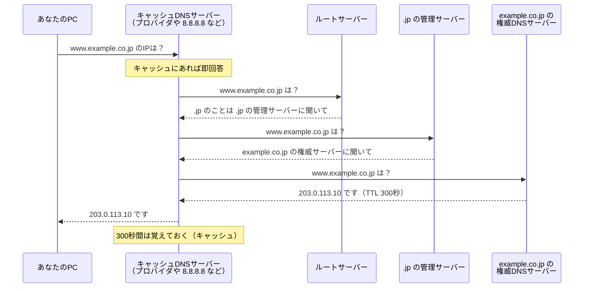

# 単元 2-3：DNS（ドメイン名の仕組み）

> **この単元のゴール**
> `example.co.jp` のような名前が、どうやって IP アドレスに変換されるのかを説明できるようになる。DNS の設定・管理ミスが、サイト乗っ取りやなりすましメールにつながる理由を理解する。

---

## 【概念の解説】

### 1. DNS は「インターネットの電話帳」

単元2-1で、通信には IP アドレスが必要だと学びました。しかし人間が `203.0.113.10` を覚えるのは大変です。そこで `www.example.co.jp` のような **ドメイン名** を使い、通信の直前に IP アドレスへ変換します。この変換の仕組みが **DNS（Domain Name System）** です。

ブラウザに URL を入力したとき、HTTP の通信より**前に**、必ず DNS の問い合わせが行われています。

### 2. 名前解決の流れ

DNS の情報は1か所に集まっているのではなく、**階層ごとに分担して管理**されています。

| 登場人物 | 役割 |
|---|---|
| **キャッシュDNSサーバー** | PC の代わりに問い合わせを走り回り、結果を一定時間覚えておく |
| **ルートサーバー** | 「.jp」「.com」などの担当者を知っている |
| **TLDサーバー** | 「.jp」の中の各ドメインの担当者を知っている |
| **権威DNSサーバー** | そのドメインの**正解**を持っている。ドメインの所有者が管理する |

DNS の問い合わせは小さく、速さが重要なので、単元2-2で学んだ **UDP** が主に使われます。

### 3. 主なレコード（電話帳の項目）

権威DNSサーバーには、ドメインごとに次のような **レコード** が登録されています。

| レコード | 意味 | 例 |
|---|---|---|
| **A** | 名前 → IPv4アドレス | `www.example.co.jp → 203.0.113.10` |
| **AAAA** | 名前 → IPv6アドレス | |
| **CNAME** | 名前 → 別の名前（別名） | `app.example.co.jp → xxx.a.run.app` |
| **MX** | このドメイン宛のメールの受け取り先 | `example.co.jp → Google Workspace のメールサーバー` |
| **TXT** | 自由なテキスト。ドメインの所有確認や、メールのなりすまし対策に使う | SPF、DMARC など |

### 4. TTL：キャッシュの有効期限

各レコードには **TTL（Time To Live）** という「覚えておいてよい秒数」がついています。

- TTL が長い（例：86400秒＝1日）→ 問い合わせが減り速いが、**変更が世界に行き渡るまで最大1日かかる**
- TTL が短い（例：300秒＝5分）→ 変更がすぐ反映されるが、問い合わせが増える

サーバー移行のときは、**数日前に TTL を短くしておき、切り替え後に戻す**のが定石です。

### 5. セキュリティの視点：DNS を握られたら、すべてを握られる

DNS は「名前を信じて接続する」仕組みです。つまり、**DNS の回答を偽られたら、利用者は気づかずに偽物のサーバーへ接続してしまいます。**

| 脅威 | 何が起きるか | 主な原因 |
|---|---|---|
| **ドメイン管理アカウントの乗っ取り** | 攻撃者がレコードを書き換え、本物そっくりの偽サイトへ誘導。メールも横取り | 管理画面のパスワード使い回し、2段階認証なし |
| **ドメインの更新忘れ** | 期限切れになったドメインを第三者に取得され、サイトやメールを乗っ取られる | 担当者の退職、更新の通知先が古いメールアドレス |
| **サブドメインの乗っ取り** | 使わなくなったクラウドサービスを指す CNAME が残っていて、攻撃者がそのサービス名を取得し、自社サブドメインで偽ページを公開 | 不要レコードの放置 |
| **なりすましメール** | 自社ドメインを名乗るメールを第三者が送信できてしまう | SPF / DKIM / DMARC（TXTレコード等）の未設定 |
| **キャッシュポイズニング** | キャッシュDNSサーバーに偽の回答を覚えさせる | DNS の古い実装。DNSSEC で対策 |

最初の3つは、技術というより **「ドメインを誰が・どのアカウントで管理しているか」という管理の問題** です。

ここで次の単元（HTTPS）への伏線です。DNS を偽られて偽サーバーに接続しても、**HTTPS の証明書チェックがあれば、ブラウザは「このサイトは本物ではない」と警告できます。** DNS 単体では守り切れない部分を、別の層が補っているのです。

---

## 【実務・ビジネスとの結びつき】

### これが理解できていないと起きること

| 現場の症状 | 根本原因 |
|---|---|
| 「会社のサイトとメールが突然使えなくなった」 | ドメインの更新期限切れ。通知が退職者のメールに届いていた |
| 「取引先に、うちを名乗った詐欺メールが届いた」 | SPF / DMARC 未設定で、自社ドメインのなりすましを防げなかった |
| 「サーバーを移行したのに、一部の人だけ古いサイトが見える」 | TTL が長く、古い IP アドレスがキャッシュに残っていた |
| 「ドメインの設定を変えたいが、誰も管理画面に入れない」 | 前の制作会社のアカウントで取得されていた |

### 顧客のどの課題を解決するか

- 中小企業では「**ドメインを誰が持っているか分からない**」「前の業者のアカウントのまま」というケースが非常に多い。ヒアリング時に確認すべき重要項目であり、**提案の入口（信頼獲得）**になる。
- 新しいデータ基盤を構築する際、`data.顧客ドメイン` のようなサブドメインを使うことになる。DNS の設定・引き継ぎ・管理ルールまで提案できると、「作って終わり」の業者との差別化になる。

---

## 【理解度チェック課題】

**Q1.**
ブラウザで `https://www.example.co.jp` を開いたとき、HTTP の通信が始まる前に起きている DNS の問い合わせの流れを、登場人物（キャッシュDNSサーバー、権威DNSサーバー等）を使って説明してください。

**Q2.**
サーバー移行の際、事前に TTL を短くしておくのはなぜですか。

**Q3.**
攻撃者がある会社のドメイン管理アカウントを乗っ取った場合、どんな被害が起こりえますか。2つ以上挙げてください。

---

## 【顧客向け言語化トレーニング】

専門用語（DNS、レコード、TTL、ドメイン管理等）を使わずに答えてください。

**演習1**
> 社長「会社のホームページのアドレス（ドメイン）って、昔ホームページを作ってくれた業者さんに任せっぱなしなんだけど、何か問題ある？」

**演習2**
> 担当者「うちの会社の名前で、取引先に怪しいメールが届いたそうなんです。うちが何かされたんですか？」

💡 回答のヒント（考えてから開く）

- 演習1：ドメインは「会社の看板と住所の登記」のようなもの。他人名義のままだと、その業者が廃業・連絡不通になったとき、看板の掛け替えもできず、最悪は看板ごと失う。「名義と管理の鍵を御社の手元に戻す」提案につなげる。
- 演習2：まず相手を安心させる（必ずしも侵入されたわけではない）。「封筒の差出人欄には誰でも好きな名前を書ける。本物の差出人かを受け取った側が確認できる仕組みを、御社のドメインに設定できる」と説明する。

