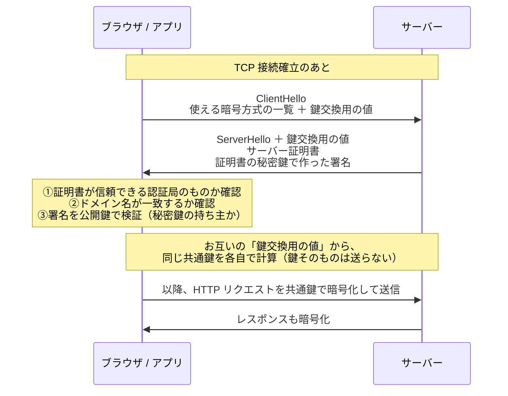

# 単元 2-4：HTTP / HTTPS と TLS 暗号化の仕組み

> **この単元のゴール**
> Web や API の通信（HTTP）の中身を読めるようになり、HTTPS（TLS）が「何を」「どうやって」守っているのか、そして「何は守っていないのか」を説明できるようになる。

---

## 【概念の解説】

### 1. HTTP：テキストでやり取りする「依頼書」と「回答書」

ブラウザや Laravel アプリが API を呼ぶとき、TCP 接続（単元2-2）の上で **HTTP** という形式のテキストを送り合います。

**リクエスト（依頼書）**

```http
POST /api/customers HTTP/1.1
Host: data.example.co.jp
Authorization: Bearer eyJhbGciOi...（認証トークン）
Content-Type: application/json

{"name": "山田商店", "phone": "03-1234-5678"}
```

**レスポンス（回答書）**

```http
HTTP/1.1 201 Created
Content-Type: application/json

{"id": 1234, "name": "山田商店"}
```

| 要素 | 意味 |
|---|---|
| **メソッド** | 何をしたいか。`GET`（取得）、`POST`（作成）、`PUT` / `PATCH`（更新）、`DELETE`（削除） |
| **パス** | 何に対して（`/api/customers`） |
| **ヘッダー** | 付帯情報。認証情報（`Authorization`、`Cookie`）もここに入る |
| **ボディ** | 本文。送るデータそのもの |
| **ステータスコード** | 結果。`2xx` 成功、`3xx` 転送、`4xx` 依頼側の問題（401 未認証、403 権限なし、404 なし、429 送りすぎ）、`5xx` サーバー側の問題 |

HTTP は **ステートレス**（1回ごとに完結し、前のやり取りを覚えていない）です。そのため「ログイン済みであること」は、毎回のリクエストに **Cookie やトークンを添える**ことで伝えます。

> **つまり、ヘッダーの中の Cookie やトークンを盗まれたら、その人になりすませる。**

### 2. 暗号化なしの HTTP で起きること

単元2-1で学んだとおり、パケットは多くのルーターを経由して届きます。HTTP はただのテキストなので、

- 経路上の誰か（公衆Wi-Fiの運営者、乗っ取られたルーター）が**中身を読める**（盗聴）
- 中身を**書き換えて**届けられる（改ざん）
- そもそも通信相手が**本物か分からない**（なりすまし、単元2-3の DNS 偽装と組み合わされると致命的）

これら3つをまとめて解決するのが **TLS**（Transport Layer Security）で、HTTP を TLS で包んだものが **HTTPS** です。

| TLS が守るもの | 仕組み |
|---|---|
| **機密性**（盗聴されない） | 暗号化 |
| **完全性**（改ざんされない） | 改ざん検知の仕組み付きの暗号方式 |
| **真正性**（相手が本物） | サーバー証明書 |

### 3. 2種類の暗号を組み合わせる

TLS は性質の違う2種類の暗号を使い分けます。

| | 共通鍵暗号 | 公開鍵暗号 |
|---|---|---|
| 鍵 | 暗号化と復号に**同じ鍵** | **公開鍵**（誰に配ってもよい）と**秘密鍵**（本人だけが持つ）のペア |
| 速さ | **速い**（AES など。CPU に専用命令がある） | 遅い |
| 弱点 | 鍵を相手に安全に渡す方法がない | 大量のデータの暗号化には向かない |

TLS の発想は、「**最初に公開鍵の技術を使って相手を確認しつつ、共通鍵を安全に共有する。以降の大量のデータは速い共通鍵で暗号化する**」というものです。

### 4. TLS ハンドシェイク（TLS 1.3 の概略）



ポイント：

- **鍵交換**：両者が「鍵交換用の値」を出し合うと、**通信を盗み見ている第三者には計算できない共通鍵**を、両者だけが計算できる（ディフィー・ヘルマン鍵交換という数学的な仕組み）。共通鍵そのものはネットワークを流れない。
- **証明書**：「このドメインの持ち主はこの公開鍵の持ち主です」と、**認証局（CA）** が保証した電子的な身分証。ブラウザや OS には、信頼できる認証局の一覧があらかじめ入っている。
- **署名**：サーバーは証明書に対応する**秘密鍵**で署名を作り、本物であることを証明する。偽サーバーは秘密鍵を持っていないので署名を作れない。

これにより、単元2-3の DNS 偽装で偽サーバーに誘導されても、**偽サーバーは正しい証明書と秘密鍵を持っていないので、ブラウザが警告を出せる**のです。

> だからこそ、**サーバーの秘密鍵が漏れることは致命的**です。単元1-1の Heartbleed で秘密鍵がメモリから盗まれたことが大問題になったのは、このためです。

### 5. HTTPS が守らないもの

HTTPS は「**通信の途中**」を守る仕組みです。次のものは守りません。

| 守らないもの | 例 |
|---|---|
| サーバーに届いた後のデータ | DB に保存されたデータ、ログ、バックアップ（第3章・第5章） |
| サーバー側のプログラムの欠陥 | SQL インジェクションなど（第5章）。攻撃も HTTPS で暗号化されて届く |
| 相手が「悪意のある本物」の場合 | 詐欺サイトでも HTTPS 証明書は取れる。**鍵マーク＝安全なサイト、ではない** |
| 端末そのもの | ウイルスに感染した PC では、暗号化前・復号後のデータを盗める |

### 6. HTTP 以外にも TLS を使う

TLS は HTTP 専用ではありません。**アプリから DB への接続**にも使えます。PostgreSQL では接続時の `sslmode` 設定で制御します。

| sslmode | 意味 |
|---|---|
| `disable` | 暗号化しない |
| `require` | 暗号化するが、**サーバーが本物かは確認しない** |
| `verify-full` | 暗号化し、証明書とホスト名も確認する（推奨） |

「暗号化しているから大丈夫」ではなく、**相手の確認まで行っているか**が重要です。

---

## 【実務・ビジネスとの結びつき】

### これが理解できていないと起きること

| 現場の症状 | 根本原因 |
|---|---|
| 「社外の Wi-Fi から管理画面にログインしたら、アカウントを乗っ取られた」 | 管理画面が HTTP で、Cookie を盗聴された |
| 「証明書の期限切れで、ある朝から全員がシステムに入れなくなった」 | 証明書の自動更新を設定していなかった |
| 「HTTPS にしてあるのに顧客情報が漏れた」 | 漏洩経路は通信ではなく、サーバー側の脆弱性や DB の設定だった |
| 「API キーが URL に含まれていて、ログやブラウザの履歴から漏れた」 | 認証情報を URL のクエリに入れていた（ヘッダーに入れるべき） |

### 顧客のどの課題を解決するか

- 経営者からの「通信は暗号化されていますか？」という質問に、**「はい」で終わらせず、「通信の暗号化に加えて、保存データと権限も守ります」と多層で答えられる**ようになる。
- SaaS（kintone / HubSpot）の API をつなぐとき、トークンの扱い方（ヘッダーで送る、ログに出さない）を正しく設計できる（第4章・第5章で実装）。

---

## 【理解度チェック課題】

**Q1.**
TLS が守る3つの性質（機密性・完全性・真正性）について、それぞれ「守られていないと何が起きるか」を1つずつ挙げてください。

**Q2.**
TLS では、なぜ公開鍵暗号と共通鍵暗号の両方を使うのですか。それぞれの役割を説明してください。

**Q3.**
「うちのシステムは HTTPS 対応なので、セキュリティは万全です」という主張の問題点を、HTTPS が守らないものを挙げて説明してください。

---

## 【顧客向け言語化トレーニング】

専門用語（HTTPS、TLS、暗号化、証明書等）を使わずに答えてください。

**演習1**
> 社長「ブラウザのアドレス欄に鍵のマークが出てるサイトは安全なんだよね？」

**演習2**
> 担当者「データを送るときって"暗号化"されるんですよね？ 具体的に何が守られるんですか？」

<details>
<summary>💡 回答のヒント（考えてから開く）</summary>

- 演習1：鍵マークは「封筒が封をされていて、宛先の会社が実在することが確認できている」という意味。「その会社が誠実かどうか」までは保証しない。詐欺会社でも封筒に封はできる。
- 演習2：「中身の見えない頑丈な封筒で送り、途中で開けられたら分かる。さらに届け先が本物の相手かを確認してから渡す」。そのうえで「届いた後の金庫の管理は別の対策で守ります」と補足すると、多層防御の説明につながる。

</details>
