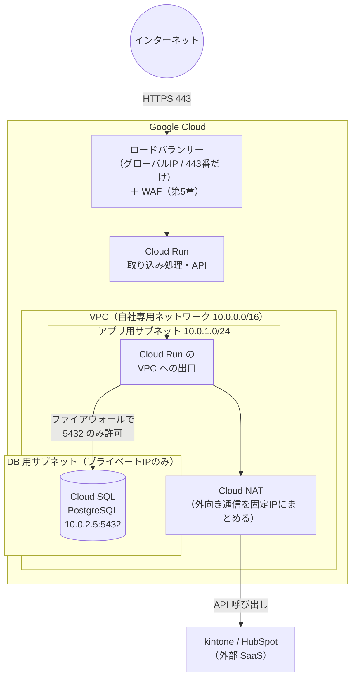

# 単元 2-5：ファイアウォール、ロードバランサー、VPC（プライベートネットワーク）

> **この単元のゴール**
> 第2章の知識を組み合わせて、「DB をインターネットから隔離し、入口を1か所に絞る」ネットワーク構成を設計・説明できるようになる。

---

## 【概念の解説】

### 1. ファイアウォール：パケットの「関所」

**ファイアウォール** は、通過しようとするパケットを見て、ルールに従って**通すか捨てるか**を決める仕組みです。判断材料は、これまでの単元で学んだ情報です。

| 判断材料 | 学んだ単元 |
|---|---|
| 送信元 IP アドレス（CIDR） | 2-1 |
| 宛先 IP アドレス | 2-1 |
| プロトコル（TCP / UDP） | 2-2 |
| 宛先ポート番号 | 2-2 |
| 方向（入ってくる：インバウンド / 出ていく：アウトバウンド） | |

ルールの例：

```text
優先度  方向     送信元              宛先ポート   動作
100    受信    0.0.0.0/0          TCP 443     許可   ← Web の入口は誰でも
200    受信    10.0.1.0/24        TCP 5432    許可   ← DB はアプリ用ネットワークからだけ
65535  受信    0.0.0.0/0          すべて        拒否   ← それ以外は全部拒否（既定）
```

**「原則すべて拒否し、必要なものだけ許可する」**（デフォルト拒否）が鉄則です。逆の「原則許可し、危ないものだけ拒否する」では、想定外の入口が必ず残ります。

現代のファイアウォールは **ステートフル** です。内側から外に出ていった通信の「返事」は自動的に通してくれるので、返りの通信用に穴を開ける必要はありません。

### 2. VPC：クラウドの中に作る「自社専用の敷地」

**VPC（Virtual Private Cloud）** は、クラウド事業者の巨大なネットワークの中に作る、**自分専用の論理的なネットワーク**です。単元2-1のプライベートIPアドレスの範囲を使い、その中をさらに **サブネット**（区画）に分けます。



この構成の守りのポイント：

- **DB はプライベートIPしか持たない。** インターネットからは経路そのものが存在しない（単元2-1）。
- **インターネットからの入口はロードバランサーの 443 番だけ**（単元2-2）。
- DB への通信は、VPC 内のファイアウォールで「アプリからの 5432 番だけ」に絞る。
- 外部 SaaS への通信は **Cloud NAT** を通すことで、**送信元IPを固定**できる。kintone などの SaaS 側で「この IP からの API 呼び出しだけ許可する」という制限をかけられるようになる。

### 3. ロードバランサー：入口の「受付係」

**ロードバランサー（LB）** は、外部からのリクエストを受け取り、背後の複数のサーバーに**振り分ける**装置です。もともとの目的は負荷分散ですが、現在は入口として多くの役割を担います。

| 役割 | 内容 |
|---|---|
| **負荷分散** | リクエストを複数のサーバーに分散。1台が壊れても止まらない |
| **ヘルスチェック** | 背後のサーバーが正常か定期的に確認し、異常なサーバーには振り分けない |
| **TLS の終端** | HTTPS の復号をここで行い、証明書の管理を一元化する |
| **防御の取り付け場所** | WAF（第5章）や DoS 対策を、入口1か所にまとめて適用できる |

> **入口を1か所に集めると、守る場所も1か所に集中できる。** これがロードバランサーをセキュリティの観点から使う最大の理由です。

### 4. 多層防御の全体像

第1章・第2章で学んだ防御を、外側から並べるとこうなります。

| 層 | 防御 | 単元 |
|---|---|---|
| ネットワークの入口 | 公開するのは 443 番だけ。WAF で攻撃パターンを遮断 | 2-2, 2-5, 5章 |
| 通信経路 | TLS で暗号化・相手確認 | 2-4 |
| ネットワーク内部 | DB はプライベートIPのみ。ファイアウォールで通信元を限定 | 2-1, 2-5 |
| サーバー / コンテナ | 一般ユーザーで実行。メモリ上限 | 1-2, 1-4 |
| ファイル | 最小限のパーミッション | 1-3 |
| DB | ユーザー権限分離、行レベルセキュリティ、暗号化 | 3章 |

**どれか1つの層が破られても、次の層で止める。** これが **多層防御（Defense in Depth）** です。

---

## 【実務・ビジネスとの結びつき】

### これが理解できていないと起きること

| 現場の症状 | 根本原因 |
|---|---|
| 「開発中に一時的に DB を公開して、そのまま忘れていた」 | デフォルト拒否ではなく、例外の許可ルールを放置した |
| 「kintone 側で IP 制限をかけたら、データ連携が止まった」 | 取り込み処理の送信元IPが固定されていなかった（Cloud NAT 未設定） |
| 「サーバー1台の故障で、全社の業務が止まった」 | ロードバランサーとヘルスチェックによる冗長化がなかった |
| 「攻撃対策をサーバーごとにバラバラに設定していて、漏れがあった」 | 入口を1か所に集約していなかった |

### 顧客のどの課題を解決するか

- この単元の構成図は、そのまま**提案書のセキュリティ構成図の土台**になる。「データの金庫（DB）は外から住所すら分からない場所にあり、正面玄関は1つだけ、そこに警備員（WAF）を置いています」と説明できる。
- kintone の IP 制限など、**顧客がすでに使っている SaaS のセキュリティ設定を強化しながら連携できる**ことは、現場を壊さない提案の重要な要素。

---

## 【理解度チェック課題】

**Q1.**
ファイアウォールのルール設計で「デフォルト拒否」が推奨されるのはなぜですか。「デフォルト許可」の場合に起きやすい問題とあわせて説明してください。

**Q2.**
上の構成図で、DB（Cloud SQL）にインターネット上の攻撃者が直接接続を試みた場合、どの時点で、なぜ失敗しますか。

**Q3.**
取り込み処理の外向き通信を Cloud NAT 経由にして送信元IPを固定すると、セキュリティ上どんなメリットがありますか。

---

## 【顧客向け言語化トレーニング】

専門用語（ファイアウォール、VPC、ロードバランサー等）を使わずに答えてください。

**演習1**
> 社長「で、結局うちのデータはどうやって守られるの？ 30秒で説明して。」

**演習2**
> 担当者「もしハッカーに一部を突破されたら、全部のデータが盗まれちゃうんですか？」

<details>
<summary>💡 回答のヒント（考えてから開く）</summary>

- 演習1：30秒なので3点に絞る。「①データの金庫は外から場所すら分からない奥の部屋に置く ②建物の入口は1つだけにして警備員を置く ③金庫を開けられるのは決められたシステムだけ」。構成図を1枚見せながら話す前提で練習する。
- 演習2：「玄関・部屋のドア・金庫と、何重にも鍵がかかっている。1つ破られても次で止まる」。そのうえで「万が一に備えて、誰がいつ何をしたかの記録とバックアップも取っています」と、検知・復旧の層まで触れると説得力が増す。

</details>

---

回答は [`answers/chapter-02/05.md`](../answers/chapter-02/05.md) に記入してください。
