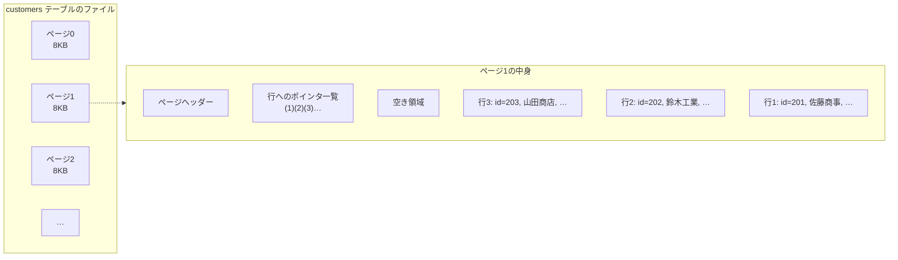
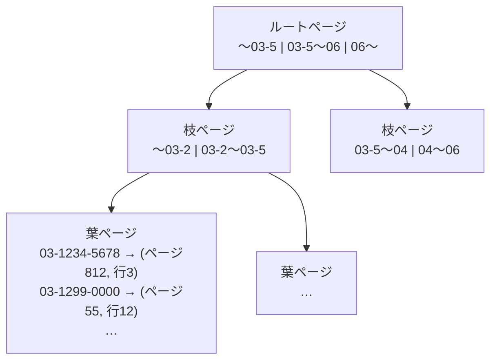

# 単元 3-1：RDB のアーキテクチャ（テーブル、ページ、インデックス、B-tree、WAL）

> **この単元のゴール**
> PostgreSQL がデータを「どこに」「どんな形で」保存し、「どうやって速く探し」「どうやって停電でも失わないか」を、第1章のハードウェアの知識と結びつけて説明できるようになる。

---

## 【概念の解説】

### 1. テーブルの正体は「8KB のページを並べたファイル」

単元1-3で「DB のテーブルも最終的にはファイル」と学びました。PostgreSQL では、1つのテーブルは `/var/lib/postgresql/.../base/` 以下のファイルとして保存され、その中身は **8KB のページ** がずらっと並んだものです。



- 1ページに、行（PostgreSQL では **タプル** と呼ぶ）が数十〜数百件入る。
- 単元1-1で見たとおり、**DB はページ単位で SSD とメモリの間を往復する**。
- 行の位置は「ページ番号＋ページ内の何番目か」で表される。これを **TID（タプルID）** と呼ぶ。

### 2. インデックスがないと「全ページを読む」しかない

```sql
SELECT * FROM customers WHERE phone = '03-1234-5678';
```

このとき、`phone` で探すための手がかりがなければ、PostgreSQL は**テーブルの全ページを先頭から順に読み**、1行ずつ条件に合うか確かめるしかありません。これを **シーケンシャルスキャン（Seq Scan）** と呼びます。

- 10万行（約数千ページ）なら一瞬
- 1億行（約数百万ページ ＝ 数十GB）なら、メモリに乗り切らず SSD から読み続けることになり、**数十秒〜数分**

### 3. B-tree インデックス：本の「索引」

**インデックス** は、特定の列の値から、その行の場所（TID）を素早く引くための別ファイルです。PostgreSQL の標準は **B-tree** という木構造です。



- 値が**並び順に整理**されているので、ルートから枝をたどるだけで目的の値にたどり着ける。
- 1ページにたくさんの「目次」が入るので、**1億行でも木の高さは4〜5段程度**。つまり**数ページ読むだけ**で見つかる。
- 葉ページには「値 → TID」が書かれていて、そこからテーブル本体の該当ページを1つ読む。

| | シーケンシャルスキャン | インデックススキャン |
|---|---|---|
| 1億行から1件探す | 数百万ページを読む | 数ページを読む |
| 向いている場面 | テーブルの大部分を読むとき | ごく一部の行を探すとき |

**インデックスの代償**：

- 行を追加・更新するたびに、インデックスも更新する必要がある（**書き込みが遅くなる**）
- インデックス自体がストレージとメモリを使う

だから「全部の列にインデックスを張る」のは間違いで、**検索条件・結合条件・並び替えに使う列に絞って張る**のが原則です（単元3-4）。

実際にどちらの方法で検索しているかは、`EXPLAIN` で確認できます。

```sql
EXPLAIN SELECT * FROM customers WHERE phone = '03-1234-5678';
-- インデックスがない場合
-- Seq Scan on customers  (cost=0.00..2041.00 rows=1 width=64)
--   Filter: (phone = '03-1234-5678'::text)

-- インデックスがある場合
-- Index Scan using idx_customers_phone on customers  (cost=0.42..8.44 rows=1 width=64)
--   Index Cond: (phone = '03-1234-5678'::text)
```

### 4. WAL：「先に日記をつけてから」本体を書き換える

単元1-1で、「更新はまずメモリ上のページで行われる。停電したら消える」という問題を見ました。かといって、更新のたびにテーブル本体のページ（SSD 上のあちこちに散らばっている）を書き込むのは遅すぎます。

PostgreSQL の解決策が **WAL（Write-Ahead Log：先行書き込みログ）** です。

```mermaid
sequenceDiagram
    participant App as アプリ
    participant PG as PostgreSQL
    participant MEM as メモリ（共有バッファ）
    participant WAL as WAL ファイル（SSD）
    participant DATA as テーブル本体（SSD）

    App->>PG: UPDATE ... ; COMMIT;
    PG->>MEM: ページを書き換える
    PG->>WAL: 「ページ812の行3をこう変えた」と追記
    PG->>WAL: fsync（確実にディスクへ）
    PG-->>App: COMMIT 完了
    Note over MEM,DATA: 後でまとめて（チェックポイント）
    MEM->>DATA: 書き換わったページを本体に反映
```

ポイント：

- **COMMIT の時点で SSD に書き込まれているのは WAL だけ。** テーブル本体はまだ古いままでよい。
- WAL は**ファイルの末尾に追記するだけ**なので、散らばったページを書くより圧倒的に速い。
- 停電した場合、再起動時に **WAL を読み直して、本体に反映されていなかった変更をやり直す**（リカバリ）。
- 一定間隔で、メモリ上の変更済みページをまとめて本体に書き出す。これを **チェックポイント** と呼ぶ。

WAL にはもう1つの重要な使い道があります。

- **レプリケーション**：WAL を別のサーバーに送って再生すれば、同じ内容のコピー（レプリカ）を作れる
- **ポイントインタイムリカバリ（PITR）**：バックアップ＋WAL を再生すれば、「昨日の14時32分の状態」に戻せる（第7章）
- **変更データキャプチャ（CDC）**：WAL を読めば「何が変わったか」を外部に流せる。BigQuery への同期で使う（第6章）

### 5. 更新しても古い行はすぐには消えない（MVCC と VACUUM）

PostgreSQL は `UPDATE` のとき、**元の行を上書きせず、新しい行を追加し、古い行に「無効」の印をつけます。** これは、更新の最中でも他の人が古い行を読めるようにするための仕組み（**MVCC**、次の単元で詳しく扱う）です。

そのため、更新・削除を繰り返すと、無効になった行（**デッドタプル**）がページの中に溜まっていきます。これを掃除するのが **VACUUM** で、通常は自動（autovacuum）で動いています。

> **セキュリティの視点**：`DELETE` した顧客データは、VACUUM されるまでファイル上に残っています。さらに WAL、バックアップ、レプリカにも残ります。「削除したから消えた」とは言えないのは、単元1-3のファイル削除と同じ構造です。

---

## 【実務・ビジネスとの結びつき】

### これが理解できていないと起きること

| 現場の症状 | 根本原因 |
|---|---|
| 「データが増えたら、検索画面が数十秒かかるようになった」 | 検索条件の列にインデックスがなく、シーケンシャルスキャンになっていた |
| 「インデックスを大量に張ったら、データ取り込みが遅くなった」 | 書き込みのたびに全インデックスを更新するコスト |
| 「更新が多いテーブルが、データ量の割にどんどん肥大化する」 | デッドタプルが溜まり、VACUUM が追いついていない |
| 「障害で DB が落ちたが、復旧したら直前のデータまで残っていた」 | WAL のおかげ（これが正常な状態。Excel では起きない） |

### 顧客のどの課題を解決するか

- **Excel との決定的な違い**を説明できる。Excel は保存の途中で PC が落ちるとファイルが壊れることがあるが、DB は WAL によって「完了と返事したものは必ず残る」ことを保証する。
- 「データが増えても速さを保てる理由（インデックス）」と、「何かあっても特定の時点に戻せる理由（WAL ＋ バックアップ）」は、**経営者にとって分かりやすい導入メリット**になる。

---

## 【理解度チェック課題】

**Q1.**
1億行の `orders` テーブルで、`WHERE order_no = 'A-000123'` の検索が遅いとします。原因として考えられることと、その解決方法を、「ページ」「シーケンシャルスキャン」「B-tree」という言葉を使って説明してください。

**Q2.**
PostgreSQL が COMMIT のたびにテーブル本体のページを SSD に書かず、WAL だけを書くのはなぜですか。また、それでも停電でデータを失わないのはなぜですか。

**Q3.**
`DELETE FROM customers WHERE id = 1234;` を実行して COMMIT した後も、その顧客のデータが残っている可能性がある場所を、3つ以上挙げてください。

---

## 【顧客向け言語化トレーニング】

専門用語（インデックス、WAL、ページ等）を使わずに答えてください。

**演習1**
> 社長「データが10年分、何百万件にもなったら、さすがに遅くなるでしょ？」

**演習2**
> 担当者「入力中に停電したら、データベースって壊れないんですか？ Excelは前に壊れたことがあって…」

<details>
<summary>💡 回答のヒント（考えてから開く）</summary>

- 演習1：「分厚い電話帳でも、五十音順に並んでいて索引があれば、何ページあっても数回めくれば目的の人にたどり着ける」。ただし「索引をどこにつけるかの設計が重要で、そこが私たちの仕事です」と付け加えると価値が伝わる。
- 演習2：「データベースは、本体を書き換える前に必ず"何をしたか"の日記を先に書く。停電しても日記を読み直して、途中の作業を最後までやり直せる」。Excel の苦い経験に共感してから説明する。

</details>
