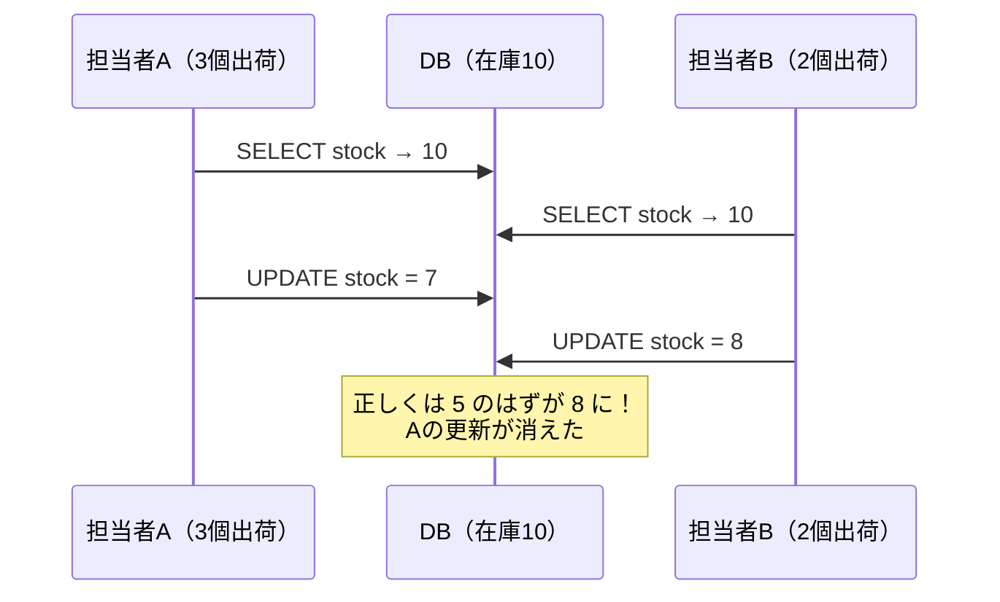
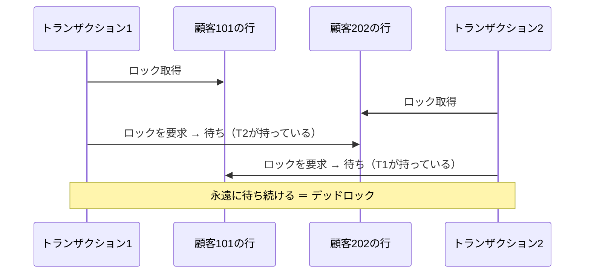

# 単元 3-2：トランザクション、ACID 特性、分離レベル、デッドロック

> **この単元のゴール**
> 「複数の処理をまとめて、全部成功か全部失敗かにする」トランザクションの意味と、複数人が同時に同じデータを触ったときに起きる問題・その防ぎ方を説明できるようになる。

---

## 【概念の解説】

### 1. トランザクション：「全部やる」か「何もしない」か

受注処理を考えます。1件の注文を登録するには、少なくとも次の2つを行う必要があります。

```sql
INSERT INTO orders (customer_id, product_id, qty) VALUES (101, 5, 3);  -- ①注文を記録
UPDATE products SET stock = stock - 3 WHERE id = 5;                   -- ②在庫を減らす
```

①が成功した直後にサーバーが落ちて②が実行されなかったら、**注文はあるのに在庫が減っていない**、という矛盾したデータが残ります。

これを防ぐのが **トランザクション** です。

```sql
BEGIN;
INSERT INTO orders (customer_id, product_id, qty) VALUES (101, 5, 3);
UPDATE products SET stock = stock - 3 WHERE id = 5;
COMMIT;   -- ここで初めて「確定」。途中で失敗したら ROLLBACK で全部なかったことに
```

Laravel では `DB::transaction(function () { ... });` がこれにあたります。

### 2. ACID 特性

トランザクションが守るべき4つの性質を、頭文字をとって **ACID** と呼びます。

| 性質 | 意味 | 支えている仕組み |
|---|---|---|
| **A**tomicity（原子性） | 全部成功か、全部なかったことになるか | WAL、ロールバック |
| **C**onsistency（一貫性） | ルール（制約）に反するデータは確定しない | 制約（単元3-4）：在庫がマイナスにならない、存在しない顧客IDを使えない等 |
| **I**solation（分離性） | 同時に動く他のトランザクションの途中経過に影響されない | MVCC、ロック |
| **D**urability（永続性） | COMMIT したら、停電しても消えない | WAL の fsync（単元3-1） |

> Excel には、この4つのどれも基本的に備わっていません。共有の Excel ファイルを複数人で同時に編集して「誰かの入力が消えた」経験があれば、それは主に **I（分離性）** がない状態です。

### 3. 同時実行の問題：「更新の消失」

在庫が 10 個ある商品に対して、2人の担当者がほぼ同時に出荷処理をしたとします。アプリが次のように作られていると問題が起きます。

```php
// アプリ側で「読んで、計算して、書く」
$stock = DB::select('SELECT stock FROM products WHERE id = 5')[0]->stock; // 10
DB::update('UPDATE products SET stock = ? WHERE id = 5', [$stock - 3]);
```



これを **更新の消失（Lost Update）** と呼びます。対策は3つあります。

| 対策 | 方法 | 向いている場面 |
|---|---|---|
| **① DB に計算させる** | `UPDATE products SET stock = stock - 3 WHERE id = 5 AND stock >= 3` | 単純な増減。最も簡単で確実 |
| **② 悲観的ロック** | `SELECT ... FOR UPDATE` で読んだ時点で行をロックし、他の人を待たせる | 読んでから複雑な判断をして更新する場合 |
| **③ 楽観的ロック** | `version` 列を持たせ、`UPDATE ... WHERE id = 5 AND version = 12` が0件なら「誰かが先に更新した」と判断してやり直す | 衝突がまれで、待たせたくない場合（画面での編集など） |

### 4. 分離レベル：どこまで他人の影響を遮断するか

完全に分離すると性能が落ちるため、DB は **分離レベル** を選べるようになっています。PostgreSQL の主な選択肢：

| 分離レベル | 見えるもの | PostgreSQL での扱い |
|---|---|---|
| **Read Committed** | 各 SQL の実行時点で**確定済み**のデータ。同じトランザクション内でも、2回読むと結果が変わりうる | **既定値** |
| **Repeatable Read** | トランザクション開始時点のスナップショット。何度読んでも同じ | 集計・レポート作成に向く |
| **Serializable** | 1つずつ順番に実行したのと同じ結果になることを保証。矛盾が起きそうなら片方をエラーにする | 厳密さが必要な処理。エラー時の再実行が必須 |

PostgreSQL は **MVCC（多版型同時実行制御）** という仕組みで分離を実現しています。単元3-1で見たように、更新時に古い行を残して新しい行を追加するので、**読む人は書いている人を待たずに、自分が見るべき時点の版の行を読める**のです。

> **読み取りは書き込みをブロックせず、書き込みは読み取りをブロックしない。** これが MVCC の最大の利点です。

### 5. デッドロック：お互いが相手を待ち続ける

ロックを使うと、別の問題が起きることがあります。



PostgreSQL はデッドロックを検知すると（既定では1秒待った後に検査）、**片方のトランザクションをエラーにして強制的にロールバック**します。データは壊れませんが、エラーになった側の処理は失敗します。

**デッドロックを減らす原則**：

1. **トランザクションを短くする**（トランザクション中に外部 API を呼ばない、ユーザーの入力を待たない）
2. **ロックを取る順番を揃える**（例：常に ID の小さい順に更新する）
3. **エラーになったら再実行する**設計にしておく

### 6. セキュリティ・障害対応の視点

- **トランザクションを使わない一括取り込み**は、途中で失敗すると「半分だけ取り込まれた」状態を残す。第4章のデータ取り込みでは、**バッチ単位でトランザクションを使う**ことが基本になる。
- 長時間開きっぱなしのトランザクションは、ロックを握り続けて他の処理を止め、さらに VACUUM（単元3-1）による掃除も妨げる。**「アイドル状態のまま開きっぱなしのトランザクション」を監視する**ことは運用の重要項目（第7章）。

---

## 【実務・ビジネスとの結びつき】

### これが理解できていないと起きること

| 現場の症状 | 根本原因 |
|---|---|
| 「在庫数がときどき実際と合わない」 | アプリ側で読んで計算して書く実装による、更新の消失 |
| 「データ取り込みが途中で失敗し、売上が二重計上された / 一部欠けた」 | トランザクションを使っていない。再実行時の考慮もない |
| 「夕方になると "deadlock detected" エラーが頻発する」 | トランザクションが長い、ロックの順番がバラバラ |
| 「月次集計の途中で入力されたデータが混ざり、数字が合わない」 | 集計を Read Committed で複数の SQL に分けて実行した |

### 顧客のどの課題を解決するか

- 「Excel の共有ファイルで誰かの入力が消える」「kintone と Excel で数字が合わない」という**データの不整合**は、中小企業で最も多い悩みの1つ。トランザクションによって「**同時に何人が入力しても、数字が狂わない**」ことを保証できるのは、DB 化の最大のメリットの1つ。

---

## 【理解度チェック課題】

**Q1.**
ACID の4つの性質のうち、「COMMIT した後に停電してもデータが残る」のはどれですか。また、それを実現している PostgreSQL の仕組みは何ですか。

**Q2.**
在庫を減らす処理で「更新の消失」を防ぐ方法を2つ挙げ、それぞれの SQL（または考え方）を示してください。

**Q3.**
デッドロックが発生するのはどんな状況ですか。また、デッドロックを減らすためにアプリ側でできる工夫を2つ挙げてください。

---

## 【顧客向け言語化トレーニング】

専門用語（トランザクション、ロック、ACID 等）を使わずに答えてください。

**演習1**
> 担当者「今は共有の Excel で在庫を管理していて、たまに数字がずれるんです。データベースにしたら本当に直るんですか？」

**演習2**
> 社長「データの取り込み中にエラーが起きたら、中途半端なデータが残っちゃうんじゃないの？」

<details>
<summary>💡 回答のヒント（考えてから開く）</summary>

- 演習1：「今は、2人が同じ帳簿をコピーしてそれぞれ書き込み、最後に片方で上書きしている状態」。データベースは「帳簿を書き換えている間は、他の人は少しだけ待つ」「引き算は帳簿係（DB）が1回ずつ確実にやる」と説明する。ただし「アプリの作り方次第」であることも正直に伝える。
- 演習2：「銀行振込と同じで、"引き落とし"と"入金"はセットでしか起きない。途中で失敗したら、両方なかったことになる」。そのうえで「やり直しても二重にならない設計にします」（第4章の冪等性）まで言えると強い。

</details>

---

回答は [`answers/chapter-03/02.md`](../answers/chapter-03/02.md) に記入してください。
