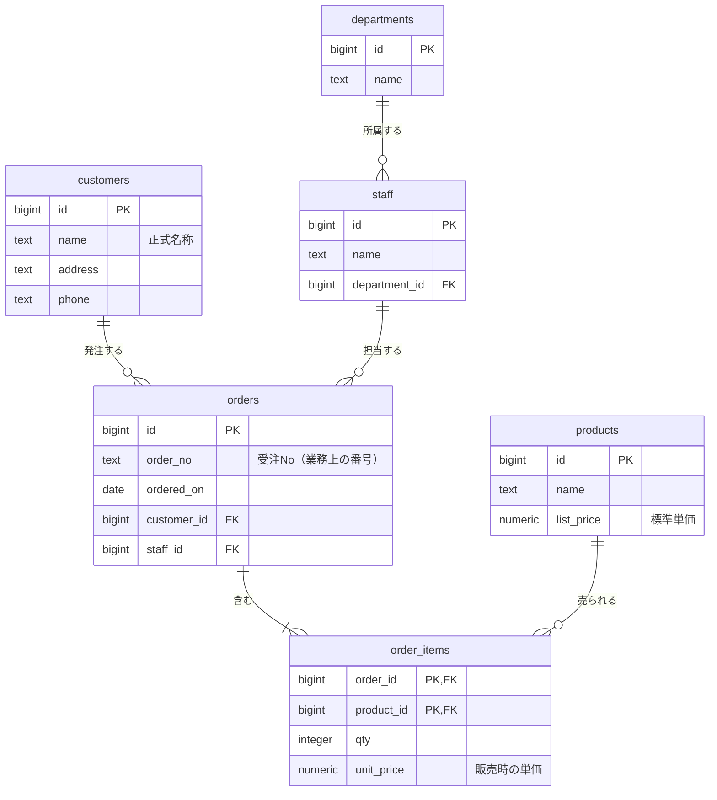

# 単元 3-3：論理設計（第1〜第3正規化）— Excel 台帳を正規化する

> **この単元のゴール**
> 顧客の現場にある「何でも1枚に書いてある Excel 台帳」を、矛盾が起きにくいテーブル群に分解（正規化）できるようになる。なぜ分けるのかを、起きる問題（更新異常）から説明できるようになる。

---

## 【概念の解説】

### 1. 出発点：よくある Excel の受注台帳

中小企業でよく見る「受注管理.xlsx」を想定します。

| 受注No | 受注日 | 顧客名 | 顧客住所 | 顧客電話 | 担当者 | 担当部署 | 商品1 | 単価1 | 数量1 | 商品2 | 単価2 | 数量2 | 合計 |
|---|---|---|---|---|---|---|---|---|---|---|---|---|---|
| 1001 | 2026/4/1 | 山田商店 | 東京都港区… | 03-1111-2222 | 佐藤 | 営業1課 | ボルトA | 120 | 100 | ナットB | 80 | 100 | 20000 |
| 1002 | 2026/4/3 | (株)山田商店 | 東京都港区… | 03-1111-2222 | 鈴木 | 営業2課 | ボルトA | 120 | 50 | | | | 6000 |
| 1003 | 2026/4/5 | 田中工業 | 大阪府… | 06-3333-4444 | 佐藤 | 営業1課 | ワッシャC | 30 | 200 | | | | 6000 |

人間が見るには分かりやすい表です。しかし、この形のままデータを溜めていくと、次の **更新異常** が起きます。

| 異常 | 具体例 |
|---|---|
| **更新時異常** | 山田商店が移転した。住所が書かれた**全部の行**を直さないと、行ごとに住所がバラバラになる |
| **挿入時異常** | 新しい顧客を登録したいが、まだ注文がない。受注No がないと行を作れない |
| **削除時異常** | 田中工業の唯一の注文（1003）をキャンセルで消したら、**田中工業の連絡先まで消えた** |
| **表記ゆれ** | 「山田商店」と「(株)山田商店」は同じ会社？ 集計すると別々に数えられる |
| **列の限界** | 商品が3つ以上の注文は？ 「商品3」列を増やす？ 10個なら？ |

**正規化** とは、こうした異常が起きないように、**「1つの事実は1か所にだけ書く」** ようにテーブルを分解していく手順です。

### 2. 第1正規形：1つのマスには1つの値、繰り返しをなくす

ルール：
- 1つのセルに複数の値を入れない（「ボルトA、ナットB」のような書き方をしない）
- 「商品1、商品2、商品3…」のような**繰り返しの列**をなくし、**行**に展開する

| 受注No | 受注日 | 顧客名 | 顧客住所 | … | 担当者 | 担当部署 | 商品 | 単価 | 数量 |
|---|---|---|---|---|---|---|---|---|---|
| 1001 | 2026/4/1 | 山田商店 | 東京都港区… | … | 佐藤 | 営業1課 | ボルトA | 120 | 100 |
| 1001 | 2026/4/1 | 山田商店 | 東京都港区… | … | 佐藤 | 営業1課 | ナットB | 80 | 100 |
| 1002 | 2026/4/3 | 山田商店 | 東京都港区… | … | 鈴木 | 営業2課 | ボルトA | 120 | 50 |

これで商品が何個でも対応できます。ただし、受注日や顧客情報が**さらに重複**しました。この表の各行を一意に特定するには「受注No ＋ 商品」の組み合わせが必要です（これを **複合主キー** と呼びます）。

> 「合計」列は消しました。単価×数量から**計算で求められる値は保存しない**のが原則です（保存すると、元の値と計算結果が食い違う可能性が生まれる）。

### 3. 第2正規形：キーの「一部」だけで決まる情報を分ける

主キーが「受注No ＋ 商品」のとき、各列が何によって決まるかを考えます。

| 列 | 何によって決まるか |
|---|---|
| 数量 | 受注No ＋ 商品（両方そろって初めて決まる） |
| 受注日、顧客名、担当者 | **受注No だけ**で決まる |
| 商品の標準単価 | **商品だけ**で決まる |

キーの**一部だけ**で決まる列（**部分関数従属**）を、別のテーブルに分けます。

- **受注**（受注No → 受注日、顧客、担当者）
- **受注明細**（受注No ＋ 商品 → 数量、販売単価）
- **商品**（商品 → 商品名、標準単価）

> **注意：販売単価は受注明細に残す。** 商品マスタの標準単価は将来値上げされるかもしれないが、「過去の注文がいくらで売れたか」は変わってはいけない。**「その時点の事実」を記録する列は、意図的に明細側に持つ**。正規化は機械的な作業ではなく、業務の意味を考える作業です。

### 4. 第3正規形：キー以外の列で決まる情報を分ける

受注テーブルを見ると、まだ問題があります。

| 受注No | 受注日 | 顧客名 | 顧客住所 | 担当者 | 担当部署 |
|---|---|---|---|---|---|

- 顧客住所は「受注No」ではなく「**顧客**」で決まる
- 担当部署は「受注No」ではなく「**担当者**」で決まる

このように、**主キー以外の列を経由して決まる列**（**推移的関数従属**）を、さらに分けます。

### 5. 完成形



これで最初の異常がすべて解消されます。

| 異常 | 解消のされ方 |
|---|---|
| 顧客が移転 | `customers` の1行を直すだけ |
| 注文のない顧客を登録 | `customers` に行を追加するだけ |
| 注文を削除 | `orders` / `order_items` を消しても、`customers` は残る |
| 表記ゆれ | 顧客は ID で参照するので、名前の書き方に依存しない |
| 商品数の上限 | `order_items` の行を増やすだけ |

元の Excel と同じ見た目の表が欲しいときは、`JOIN` でテーブルを結合して作ります。

```sql
SELECT o.order_no, o.ordered_on, c.name AS customer, s.name AS staff,
       d.name AS department, p.name AS product, i.unit_price, i.qty,
       i.unit_price * i.qty AS amount
FROM orders o
JOIN customers   c ON c.id = o.customer_id
JOIN staff       s ON s.id = o.staff_id
JOIN departments d ON d.id = s.department_id
JOIN order_items i ON i.order_id = o.id
JOIN products    p ON p.id = i.product_id;
```

### 6. 「保存のための形」と「見るための形」を分ける

正規化された形は、**データを正しく保存・更新する**のに適しています。一方、分析や集計では JOIN が多くなり、扱いにくくなります。

このカリキュラムの構成では、

- **PostgreSQL（OLTP）**：正規化した形で保存する ＝ **正となるデータ**
- **BigQuery（OLAP）**：分析しやすいように、あえて結合済み・重複ありの形に組み直す（**非正規化**、第6章）

と役割を分けます。**「Excel のような見やすい表」は捨てるのではなく、BigQuery や Looker Studio 側で再現する**のです。これが「現場の業務を壊さない」ための考え方でもあります。

---

## 【実務・ビジネスとの結びつき】

### これが理解できていないと起きること

| 現場の症状 | 根本原因 |
|---|---|
| 「顧客別売上を出したら、同じ会社が3社に分かれていた」 | 顧客名を文字列で各行に持ち、表記ゆれが発生 |
| 「値上げ後に過去の売上レポートの金額が変わった」 | 販売単価を明細に持たず、商品マスタの現在の単価で計算していた |
| 「kintone のアプリに項目を追加し続けた結果、誰も全体を把握できない」 | 1つのアプリに顧客・案件・請求を詰め込み、正規化されていない |
| 「Excel の列が200列を超え、商品10まで列がある」 | 繰り返しの列（第1正規形違反） |

### 顧客のどの課題を解決するか

- 「数字が合わない」「同じ顧客が何人もいる」「どれが最新か分からない」という、**現場の混乱の根本原因を構造的に説明し、解消できる**。これは提案の核になる。
- 実際の案件では、顧客の Excel / kintone を見せてもらい、**その場でこの単元の分解を口頭で説明できる**と、技術力の証明として非常に強い（第8章のヒアリング演習で練習します）。

---

## 【理解度チェック課題】

**Q1.**
最初の Excel 台帳で起きる「更新時異常」「挿入時異常」「削除時異常」を、それぞれ自分の言葉で具体例とともに説明してください。

**Q2.**
商品マスタに標準単価があるのに、受注明細にも販売単価を持たせるのはなぜですか。これは正規化の考え方に反していますか？

**Q3.**
次の「案件管理表」を第3正規形まで分解し、テーブル名と列を書き出してください。
`案件ID, 案件名, 顧客名, 顧客業種, 営業担当, 営業担当の電話, 見込み金額, ステータス`

---

## 【顧客向け言語化トレーニング】

専門用語（正規化、テーブル、主キー、マスタ等）を使わずに答えてください。

**演習1**
> 担当者「今のExcelは1枚で全部見られて便利なんです。データベースにしたらバラバラになって見づらくなりませんか？」

**演習2**
> 社長「顧客ごとの売上を出すと、いつも数字が合わないんだよ。なんで？」

<details>
<summary>💡 回答のヒント（考えてから開く）</summary>

- 演習1：見やすさを否定しない。「保管するときは、住所録・商品カタログ・注文伝票のように種類ごとに分けて1か所にしまう。見るときは、今と同じ1枚の表に自動で組み立てて表示する」。「保管の仕方」と「見せ方」を分けて説明するのがコツ。
- 演習2：実際に「山田商店」「(株)山田商店」「ヤマダ商店」の例を出す。「名前を毎回手書きしているので、人によって書き方が変わり、別のお客様として数えられている」。そのうえで「お客様に背番号をつけて管理します」と解決策を示す。

</details>
