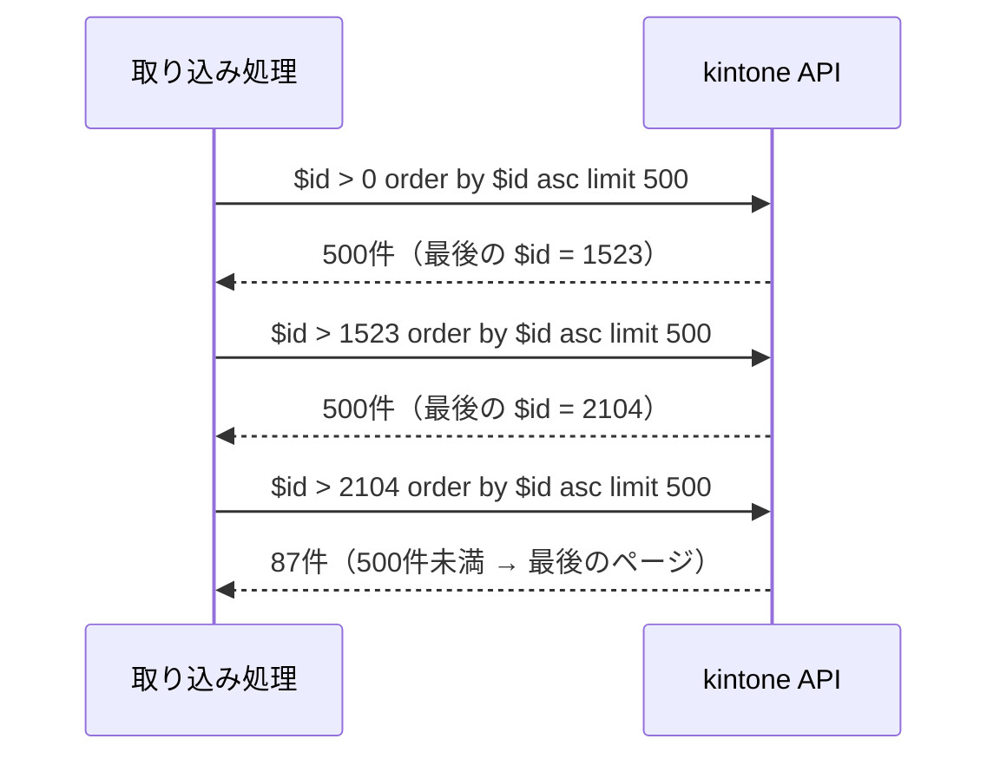

# 単元 4-1：SaaS API の基本（認証、ページネーション、レート制限、差分取得）

> **この単元のゴール**
> kintone や HubSpot などの SaaS から、**データを漏れなく・重複なく・相手に迷惑をかけずに**取ってくる処理を設計できるようになる。

---

## 【概念の解説】

### 1. SaaS API とは

kintone や HubSpot のデータは、普段は Web 画面から操作します。同じデータをプログラムから読み書きするための窓口が **API** です。ほとんどの SaaS は、単元2-4で学んだ **HTTP ＋ JSON** の形式（REST API）を提供しています。

```http
GET /k/v1/records.json?app=12&query=$id > 1000 order by $id asc limit 500 HTTP/1.1
Host: example.cybozu.com
X-Cybozu-API-Token: （APIトークン）
```

```json
{
  "records": [
    { "$id": { "value": "1001" }, "会社名": { "value": "山田商店" }, "更新日時": { "value": "2026-10-20T03:15:00Z" } },
    ...
  ]
}
```

取り込み処理がやることは、突き詰めると次の4つです。

1. **認証**して
2. **全件（または変わった分だけ）を、ページに分けて**取得し
3. **相手の制限を守りながら**、失敗したら再試行し
4. 自社 DB に **重複なく** 保存する（単元4-3）

### 2. 認証：API を呼ぶための「鍵」

| 方式 | 仕組み | 例 |
|---|---|---|
| **APIトークン / APIキー** | SaaS の管理画面で発行した文字列をヘッダーに付ける | kintone の APIトークン（アプリごと・権限ごとに発行） |
| **アクセストークン（OAuth 2.0 など）** | 利用者が許可した範囲（スコープ）だけ使えるトークン。有効期限があり、更新用トークンで再発行する | HubSpot のアプリ連携 |

鍵の扱いの原則（詳しくは第5章）：

- **必要最小限の権限で発行する。** 取り込みだけなら「閲覧」権限のみ。kintone の APIトークンは、アプリごとに「レコード閲覧」「追加」「編集」などを選んで発行できる。
- **コードや Git に書かない。** Secret Manager に保管し、実行時に読み込む。
- **URL のクエリに入れず、ヘッダーで送る**（単元2-4：URL はログや履歴に残る）。

### 3. ページネーション：一度に全部は取れない

SaaS の API は、1回のリクエストで返す件数に上限があります（例：kintone のレコード取得は 1回 500件まで）。そのため、何回かに分けて取得します。これを **ページネーション** と呼びます。方式は主に3つです。

| 方式 | 取り方 | 長所 | 短所 |
|---|---|---|---|
| **オフセット方式** | 「先頭から1000件飛ばして500件」 | 簡単 | 件数が増えると遅くなる。**取得中にデータが追加・削除されると、ずれて取りこぼし・重複が起きる**。kintone ではオフセットの上限が 10,000 |
| **シーク方式（キー指定）** | 「ID が 1500 より大きいものを ID 順に500件」 | 速い。件数が増えても性能が落ちない | 並び順のキー（ID など）が必要 |
| **カーソル方式** | SaaS 側が「続きの位置」を表す目印（カーソル / next トークン）を返す | SaaS 側が整合性を保ってくれる | カーソルの有効期限や同時作成数に制限がある（kintone は同時10個まで） |

kintone の開発者向けドキュメントでも、大量データの取得には**オフセットではなく、レコード ID 順のシーク方式かカーソル API** が推奨されています。



### 4. レート制限：相手のサーバーを守るルール

SaaS は多数の顧客が共用するサーバーです。1社が大量のリクエストを送ると他社に迷惑がかかるため、**レート制限** が設けられています。

| 制限の種類 | 例 |
|---|---|
| 同時リクエスト数 | kintone はドメインあたり同時 100 リクエストまで。超えた分はエラー。**同じ契約を使う他のプラグインや連携サービスも含めた合計**である点に注意 |
| 期間あたりのリクエスト数 | 1日あたり・10秒あたりなどの上限（SaaS・契約プランごとに異なる。必ず最新の公式ドキュメントで確認する） |

上限を超えると、多くの SaaS は **HTTP 429（Too Many Requests）** を返します。正しい対応は次のとおりです。

1. **`Retry-After` ヘッダーがあれば、その秒数待ってから再試行する**
2. なければ **指数バックオフ**：1秒 → 2秒 → 4秒 → 8秒… と待ち時間を倍にしながら再試行し、上限回数で諦める
3. 待ち時間に少しランダムな揺らぎ（**ジッター**）を加え、複数の処理が同時に再試行して再び混雑するのを避ける

> 429 や 5xx（相手側の一時的な障害）は**再試行すべき**エラー。一方、401（認証失敗）や 400（リクエストの誤り）は**何度試しても同じ**なので、再試行せずにアラートを出すべきエラーです。この区別ができていない取り込み処理は、障害時に SaaS に大量のリクエストを浴びせ続けます。

### 5. 差分取得：毎回全件取るのをやめる

データが数十万件になると、毎回全件を取るのは時間もリクエスト数も無駄です。そこで「**前回以降に更新されたものだけ**」を取ります。

```text
前回の取り込みで記録した「最終同期時刻」 = 2026-10-27 09:00:00
今回の問い合わせ: 更新日時 >= 2026-10-27 08:55:00   ← 5分の重なり（後述）
```

差分取得の注意点：

| 落とし穴 | 対策 |
|---|---|
| SaaS 側とこちらの時計のずれ、更新処理の途中で取得した場合の取りこぼし | 前回時刻より**少し前（例：5分前）から重ねて**取得する。重なった分は単元4-3の「重複しても壊れない保存」で吸収する |
| **削除されたレコードは「更新されたもの」として返ってこない** | 定期的（例：週1回の夜間）に全件の ID 一覧を取得して突き合わせる。または削除を通知する Webhook を使う（単元4-3） |
| 最終同期時刻を「処理開始時」に記録すると、処理中の更新を取りこぼす。「処理終了時」だと処理中の失敗で飛ばす | **取得できたデータの中の最大の更新日時**を、保存に成功した後に記録する |

### 6. SaaS のデータ構造と自社 DB の構造は違う

kintone の JSON は「フィールド名: { type, value }」という形で、日本語のフィールド名、サブテーブル（明細の繰り返し）、複数選択などを含みます。これを第3章で設計した正規化テーブルに**変換（マッピング）**するのが、取り込み処理の中心的な仕事です。

| kintone のフィールド | 自社 DB 側 |
|---|---|
| `$id`（レコード番号） | `customers.source_id` |
| `会社名`（文字列） | `customers.name`（表記の正規化、単元4-2） |
| `更新日時` | `customers.source_updated_at`（差分取得に使う） |
| サブテーブル `明細` | `order_items` の複数行 |
| ルックアップ（他アプリ参照） | 外部キー |

**フィールド名やフィールドの追加・変更は、現場の担当者が画面から自由にできてしまいます。** 取り込み処理は、想定外のフィールド構成を検知したら止まってアラートを出すようにしておくことが重要です（黙って空欄で取り込むと、データ欠損に気づけない）。

---

## 【実務・ビジネスとの結びつき】

### これが理解できていないと起きること

| 現場の症状 | 根本原因 |
|---|---|
| 「連携を入れたら、kintone の他のプラグインがエラーを出すようになった」 | 同時リクエスト数を使い切り、同じドメインの他の連携を巻き込んだ |
| 「件数が1万件を超えた頃から、一部のデータが取り込まれていない」 | オフセット方式の上限・取得中のずれ |
| 「kintone で削除したはずの顧客が、BigQuery のレポートに残っている」 | 差分取得のみで、削除の検知をしていなかった |
| 「現場がフィールド名を変えたら、その列が全部空欄で取り込まれていた」 | フィールド構成の変化を検知していなかった |
| 「APIトークンが漏れ、全アプリのデータを書き換えられた」 | 管理者権限のトークンを使い、コードに直書きしていた |

### 顧客のどの課題を解決するか

- 「**今の kintone / HubSpot はそのまま使い続けてよい**。裏側で自動的に自社 DB に集約する」という提案は、現場の抵抗が最も少ない導入方法。それを支えるのがこの単元の技術。
- SaaS の契約プラン・API の制限を事前に確認し、「この件数・この頻度なら、追加費用なく連携できる」と**見積もりの根拠**を示せる。

---

## 【理解度チェック課題】

**Q1.**
オフセット方式のページネーションで大量データを取得しているとき、取得の途中で他の人がレコードを追加・削除すると何が起きますか。シーク方式ではなぜ起きにくいのですか。

**Q2.**
API が HTTP 429 を返したときと、HTTP 401 を返したときで、取り込み処理はそれぞれどう振る舞うべきですか。理由とともに答えてください。

**Q3.**
「更新日時が前回の同期時刻以降のレコードだけを取る」差分取得の弱点を2つ挙げ、それぞれの対策を答えてください。

---

## 【顧客向け言語化トレーニング】

専門用語（API、ページネーション、レート制限、差分取得等）を使わずに答えてください。

**演習1**
> 担当者「kintone は今のまま使えるんですか？ 入力の仕方が変わると現場が嫌がるので…」

**演習2**
> 社長「データの連携って、リアルタイムじゃないの？ 1日数回だと古いデータになっちゃうんじゃない？」

<details>
<summary>💡 回答のヒント（考えてから開く）</summary>

- 演習1：「入力画面・操作は一切変わりません。夜間や数時間おきに、システムが裏側でデータをコピーして整理し直すだけ」。ただし「フィールドの名前を変えるときだけ一声かけてほしい」という運用ルールもセットで伝えると誠実。
- 演習2：「経営判断に使う数字は、数時間おきでも十分なことが多い。リアルタイムにするほどコストと壊れやすさが増える」。そのうえで「本当に即時性が必要な情報（例：受注の発生通知）だけ、即時連携にする」という使い分けを提案する（単元4-3）。

</details>
