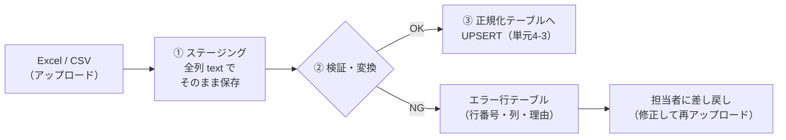

# 単元 4-2：Excel / CSV の取り込み（文字コード、名寄せ、表記ゆれ、バリデーション）

> **この単元のゴール**
> 現場の Excel / CSV という「人間向けに作られたデータ」を、機械が扱える正しいデータに変換する工程を設計できるようになる。取り込めないデータを黙って捨てず、見える形で差し戻す仕組みを作れるようになる。

---

## 【概念の解説】

### 1. Excel は「データベース」ではなく「紙の代わり」

Excel は自由度が高い分、同じ「顧客リスト」でも作る人によって形がまったく違います。取り込み処理が直面する典型的な問題を整理します。

| 分類 | 問題の例 |
|---|---|
| **ファイル形式** | `.xlsx` / `.xls` / `.csv` が混在。CSV の文字コードが Shift_JIS だったり UTF-8 だったり |
| **表の構造** | タイトル行・空行・合計行がある。セル結合。1シートに複数の表。見出しが2段 |
| **値の形式** | 日付が `2026/4/1`・`R8.4.1`・`4月1日`・Excel の内部数値 `46113` で混在 |
| **値の欠損** | 郵便番号・電話番号の**先頭の 0 が消えている**（`03-...` → `3-...`、`0012345` → `12345`） |
| **表記ゆれ** | `(株)山田商店` / `株式会社山田商店` / `山田商店` / `ﾔﾏﾀﾞ商店`、全角・半角の混在、余計な空白 |
| **意味の揺れ** | 「済」「〇」「done」「1」がすべて「完了」の意味 |

### 2. 文字コード：「文字化け」の正体

単元1-1で、コンピューターの中はすべて0と1だと学びました。文字も、**どの数値をどの文字に対応させるか**という約束事（**文字コード**）に従って数値として保存されています。

| 文字コード | 特徴 |
|---|---|
| **UTF-8** | 世界標準。PostgreSQL・BigQuery・Web はこれが基本 |
| **Shift_JIS（実際には Windows の CP932）** | 日本の Windows 環境の古くからの標準。**Excel で CSV 保存すると、今でもこちらになることが多い** |

Shift_JIS のファイルを UTF-8 だと思って読むと、文字化けします。さらに厄介なのが、**Shift_JIS にない文字**（一部の旧字体や「髙」「﨑」などの機種依存文字の扱い）です。

取り込み処理の原則：

1. **文字コードを推測に頼らず、取り込み仕様として決める**（例：「UTF-8（BOM付き）の CSV で書き出してください」）
2. 推測が必要な場合も、変換に失敗した行は**エラーとして記録**し、黙って置換文字（`?`）にしない
3. 内部ではすべて UTF-8 に統一する

### 3. Excel の「親切」が引き起こす事故

Excel は、入力された値を**勝手に解釈して変換**します。

| 入力 | Excel が変換した結果 | 失われたもの |
|---|---|---|
| `0312345678` | `312345678` | 電話番号の先頭の 0 |
| `1-2` | `1月2日`（日付） | 番地 |
| `001234` | `1234` | 商品コードの桁 |
| `1234567890123456789` | `1.23457E+18` | 長い ID の下の桁（**元に戻せない**） |

一度変換されて保存されたファイルからは、元の値を復元できない場合があります。**取り込み処理側の工夫だけでは限界があり、「現場での書き出し方」を手順書として渡す**ことも、プロとしての重要な仕事です。

### 4. 取り込みの基本構成：ステージング → 検証 → 正規化

第3章のハンズオンで体験した構成を、本番用に整理します。

| 段階 | 目的 |
|---|---|
| **① ステージング** | 元のデータを**加工せずに**保存する。何か問題が起きたとき、「元のファイルに何が書いてあったか」をいつでも確認できる |
| **② 検証・変換** | 型変換（文字列 → 日付・数値）、必須チェック、形式チェック、表記の正規化、名寄せ |
| **③ 正規化テーブル** | 第3章で設計した、制約付きのテーブルに保存する |
| **エラー行** | 取り込めなかった行を、理由とともに保存する。**黙って捨てない** |

> **全件エラーにするか、エラー行だけ除いて取り込むか**は、業務によって決める。売上データのように「一部だけ取り込まれると合計が狂う」ものは、1行でもエラーがあれば全体を取り込まない（トランザクション、単元3-2）方が安全です。

### 5. 表記の正規化と名寄せ

**表記の正規化**（機械的に揃えられるもの）：

| 処理 | 例 |
|---|---|
| 前後の空白・改行の除去 | `" 山田商店 "` → `山田商店` |
| **Unicode 正規化（NFKC）** | 全角英数字・半角カナを揃える。`ＡＢＣ１２３` → `ABC123`、`ﾔﾏﾀﾞ` → `ヤマダ` |
| 法人格の統一 | `(株)` `（株）` `㈱` `株式会社` を統一（または比較用に除去した列を別に持つ） |
| 電話番号 | ハイフン・括弧を除去した数字だけの列を比較用に持つ |

**名寄せ**（同じ実体かどうかの判定）は、機械的に決めきれないことが多い作業です。

| 判定の材料 | 強さ |
|---|---|
| 法人番号（国税庁が全法人に付番した13桁の番号） | 非常に強い。可能なら取得しておく |
| 電話番号・メールアドレス | 強い。ただし代表番号の共有、変更がありうる |
| 正規化した会社名 ＋ 住所 | 中程度 |
| 会社名だけ | 弱い。同名の別会社がある |

実務では、**確実に一致するものは自動で統合し、怪しいものは「統合候補」として人間に確認してもらう**仕組みにするのが現実的です。

### 6. セキュリティの視点

**アップロードされたファイルは「信頼できない入力」**です。

| リスク | 対策 |
|---|---|
| 巨大なファイル・大量の行による処理の停止（DoS） | ファイルサイズ・行数の上限を設ける |
| 拡張子を偽ったファイル | 拡張子ではなく中身で形式を判定する。マクロ付きファイル（`.xlsm`）は受け付けない |
| 一時ファイルの置きっぱなし | 処理後に削除する。置き場所は公開ディレクトリの外（単元1-3） |
| **CSV インジェクション** | DB のデータを CSV に**書き出す**とき、`=` `+` `-` `@` で始まる値は Excel で数式として実行されうる。書き出し時に先頭に `'` を付けるなどして無害化する |

最後の CSV インジェクションは見落とされがちです。攻撃者が問い合わせフォームの「会社名」に `=HYPERLINK("http://悪意のあるサイト", "クリック")` のような値を入れておくと、**社員がその CSV を Excel で開いたときに**仕掛けが動きます。取り込みだけでなく、書き出しの際にも注意が必要です。

---

## 【実務・ビジネスとの結びつき】

### これが理解できていないと起きること

| 現場の症状 | 根本原因 |
|---|---|
| 「取り込んだ顧客の電話番号が全部 `3-xxxx` になっている」 | Excel が先頭の 0 を削除していた。書き出し手順を指導していなかった |
| 「取り込みは成功と表示されたのに、件数が足りない」 | エラー行を黙ってスキップしていた |
| 「同じ会社が3社ずつ登録されている」 | 表記の正規化・名寄せをしていない |
| 「顧客名が `?????` になっている」 | 文字コードの誤認識 |

### 顧客のどの課題を解決するか

- 中小企業の多くは、「**過去10年分の Excel**」という資産と負債を抱えている。これを正しく取り込めるかどうかは、データ基盤の価値（過去との比較分析ができるか）を大きく左右する。
- 初期の**データ移行・クレンジング作業**は、それ自体が独立した見積もり項目になる。この単元の作業量を見積もれることは、ビジネスとして重要。

---

## 【理解度チェック課題】

**Q1.**
取り込み処理で、Excel / CSV のデータを直接正規化テーブルに入れず、いったん「全列 text のステージングテーブル」に保存するのはなぜですか。2つ以上の理由を挙げてください。

**Q2.**
次の3つの値を正規化・名寄せの観点からどう扱いますか。「同じ会社」と判定してよいか、判定するために何が必要かも答えてください。
`(株)ヤマダ商店`、`株式会社 山田商店`、`ﾔﾏﾀﾞ商店`

**Q3.**
CSV インジェクションとはどんな攻撃ですか。データを「取り込むとき」ではなく「書き出すとき」に注意が必要なのはなぜですか。

---

## 【顧客向け言語化トレーニング】

専門用語（文字コード、正規化、名寄せ、バリデーション等）を使わずに答えてください。

**演習1**
> 担当者「過去10年分の Excel があるんですけど、全部入れられますか？ ファイルによって形がバラバラなんですけど…」

**演習2**
> 社長「取り込みでエラーが出たら、どうなるの？ 現場は IT に詳しくないから、エラーとか言われても困るんだけど。」

💡 回答のヒント（考えてから開く）

- 演習1：「入れられます」と安請け合いしない。「まず何ファイルか見せていただき、形ごとに分類して、自動で入れられるもの・手直しが必要なもの・入れる価値が低いものに分けてご提案します」。過去データの量と状態が、費用と期間を決めることを伝える。
- 演習2：「何行目のどの欄が、なぜダメだったか」を、普段の言葉で一覧にして返す仕組みにすると伝える。例：「15行目の"受注日"が日付になっていません（"4月上旬"と書かれています）」。現場の人が自分で直せる形にすることがポイント。

