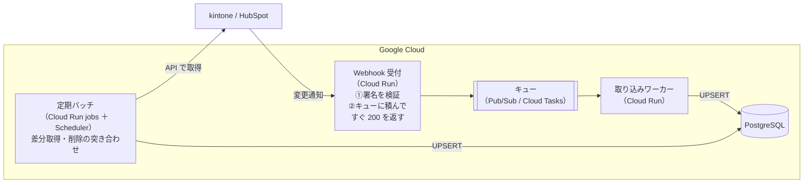
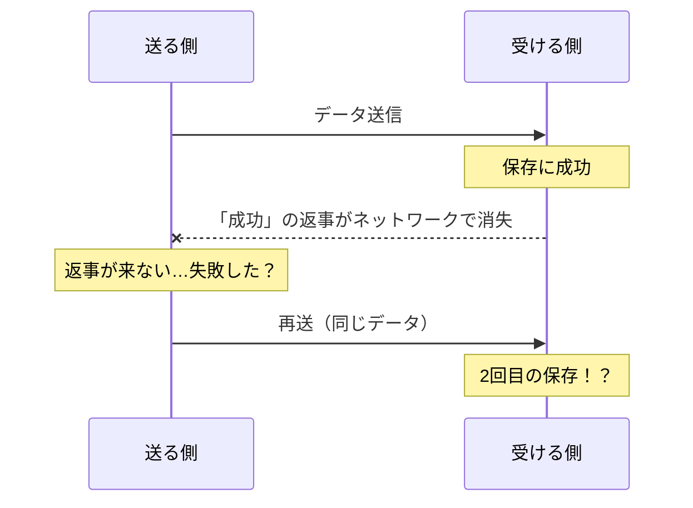

# 単元 4-3：Webhook とバッチの使い分け、冪等性（同じデータを2回受けても壊れない設計）

> **この単元のゴール**
> 「定期的に取りに行く」バッチと「変更があったら通知が来る」Webhook の違いと使い分けを説明できるようになる。ネットワークや処理が途中で失敗しても、**やり直すだけで正しい状態に戻る**取り込み処理を設計できるようになる。

---

## 【概念の解説】

### 1. データを集める2つの方法

| | バッチ（ポーリング） | Webhook |
|---|---|---|
| 仕組み | こちらから**定期的に取りに行く**（例：毎日 6時・12時・18時） | SaaS 側でデータが変わったら、**SaaS がこちらの URL に通知を送ってくる** |
| たとえ | 郵便受けを1日3回見に行く | 荷物が届いたらインターホンが鳴る |
| 鮮度 | 次の実行まで遅れる | ほぼ即時 |
| 取りこぼし | 差分取得の設計次第（単元4-1） | **通知が届かないことがある**（こちらのサーバー停止中、SaaS 側の送信失敗） |
| 公開するもの | なし（こちらから外に出ていくだけ） | **インターネットから呼べる受付 URL が必要**（第5章の対策が必須） |
| 負荷 | 一定のタイミングに集中 | 変更の多さに比例して不規則 |

### 2. 実務での答え：「Webhook ＋ 定期バッチ」の組み合わせ

Webhook は速いが、**届かない可能性がある**。バッチは遅いが、**確実に追いつける**。そこで多くの場合、両方を組み合わせます。



- **Webhook**：変更を即時に反映する「速い経路」
- **定期バッチ**：Webhook の取りこぼしや削除を拾う「確実な経路」。安全網

ここで重要なのは、**同じデータが2つの経路から、何度も届く**ことです。だから次の「冪等性」が必須になります。

### 3. Webhook 受付は「受け取ったらすぐ返事」

Webhook を送る側（SaaS）は、通常、数秒以内に返事（HTTP 200）が返ってこないと「失敗」とみなし、**再送**します。受付で DB への保存まで同期的に行うと、

- DB が混んでいて遅れる → タイムアウト → SaaS が再送 → さらに混む
- こちらの処理中のエラーで 500 を返す → 再送のたびに同じエラー

という悪循環に陥ります。そこで受付の仕事は、

1. **本物の SaaS からの通知か検証する**（署名の検証。第5章で詳しく扱う）
2. 通知の中身を**キューに積む**
3. **すぐに 200 を返す**

だけにします。実際の保存はキューから取り出したワーカーが、自分のペースで行います。ワーカーが失敗した場合、キューが**自動で再試行**してくれます。何度も失敗するメッセージは「デッドレターキュー」という別の置き場に移し、人間が調査します。

### 4. 「少なくとも1回」届く世界

ネットワーク越しのシステムでは、「**ちょうど1回だけ**届ける」ことは、原理的に非常に困難です。



送る側からは「届かなかった」のか「届いたが返事が消えた」のか区別できません。だから安全側に倒して再送します。その結果、多くの仕組み（Webhook、キュー、再試行するバッチ）は **「少なくとも1回は届ける（at-least-once）」** という保証になります。

> **重複して届くことは「異常」ではなく「前提」。** 受け取る側が、重複しても壊れないように作る必要があります。

### 5. 冪等性：何回やっても結果が同じ

**冪等（べきとう）** とは、「**1回やっても、10回やっても、結果が同じ**」という性質です。

| 冪等でない処理 | 冪等な処理 |
|---|---|
| 「売上に1件追加する」→ 2回実行すると2件になる | 「kintone のレコード #1023 の内容で、自社 DB の該当行を作る、なければ作る・あれば上書きする」→ 何回実行しても1件 |
| 「在庫を3減らす」 | 「在庫を7にする」（ただし、順番の問題に注意。後述） |

PostgreSQL では、**UPSERT**（なければ INSERT、あれば UPDATE）で実現します。単元3-4で設定した `UNIQUE (source, source_id)` 制約がここで効きます。

```sql
INSERT INTO customers (source, source_id, name, phone, source_updated_at)
VALUES ('kintone', '1023', '山田商店', '03-1111-2222', '2026-10-27 09:15:00+09')
ON CONFLICT (source, source_id) DO UPDATE
SET name              = EXCLUDED.name,
    phone             = EXCLUDED.phone,
    source_updated_at = EXCLUDED.source_updated_at,
    updated_at        = now()
WHERE customers.source_updated_at < EXCLUDED.source_updated_at;  -- ← 古いデータで上書きしない
```

最後の `WHERE` 句が重要です。

### 6. 順番の逆転：古い通知が後から届く

Webhook やキューは、**送られた順番に届くとは限りません。**

```text
09:00 電話番号を A に変更 → 通知①
09:01 電話番号を B に変更 → 通知②
届いた順番：② → ①   （①が再送で遅れた）
単純に上書きすると、最終的に A になってしまう（正しくは B）
```

対策は、**データ自体に「いつの時点の内容か」を持たせ、それより古いデータでは上書きしない**ことです。上の SQL の `WHERE customers.source_updated_at < EXCLUDED.source_updated_at` がそれにあたります。

もう1つの方法は、「**通知の中身は信じず、通知は"変わったよ"という合図としてだけ使い、最新の内容を API で取り直す**」ことです。少しリクエストは増えますが、順番の問題を根本的に避けられます。

### 7. 削除の扱い

| 方法 | 内容 |
|---|---|
| 削除の Webhook を受ける | SaaS が削除通知を送ってくれる場合 |
| 定期的な全件突き合わせ | 週1回などに、SaaS 側の全レコード ID 一覧を取り、自社 DB にあって SaaS にない ID を「削除済み」にする |
| **論理削除** | 自社 DB では行を物理的に消さず、`deleted_at` に日時を入れる。過去の売上分析の整合性が保て、誤削除からも戻せる |

---

## 【実務・ビジネスとの結びつき】

### これが理解できていないと起きること

| 現場の症状 | 根本原因 |
|---|---|
| 「同じ受注が2件ずつ登録されていて、売上が二重計上されていた」 | 再送・再実行を想定せず、INSERT だけで保存していた（冪等でない） |
| 「Webhook 受付が落ちていた1時間分のデータが、永遠に欠けている」 | 定期バッチによる安全網がなかった |
| 「顧客の電話番号が、ときどき古い番号に戻る」 | 順番の逆転を考慮せず、届いた順に上書きした |
| 「月末に変更が集中すると、Webhook のタイムアウトが多発し、SaaS 側で連携が停止された」 | 受付で同期的に重い処理をしていた |

### 顧客のどの課題を解決するか

- 「**連携が止まっても、復旧後に再実行するだけで正しい状態に戻る**」設計は、保守運用のコストと夜間の緊急対応を劇的に減らす。保守契約の価格設定・品質に直結する。
- 「受注は即時、その他は1日数回」のように、**業務の必要性に応じて鮮度とコストのバランスを提案できる**。

---

## 【理解度チェック課題】

**Q1.**
Webhook だけでデータ連携をすると、どんな問題が起こりえますか。定期バッチと組み合わせることで、何が解決されますか。

**Q2.**
「冪等性」とは何ですか。取り込み処理で冪等性が必要になる理由を、「少なくとも1回届く」という性質と結びつけて説明してください。

**Q3.**
本文の UPSERT 文の最後にある `WHERE customers.source_updated_at < EXCLUDED.source_updated_at` は、どんな問題を防ぐためのものですか。具体的な例で説明してください。

---

## 【顧客向け言語化トレーニング】

専門用語（Webhook、冪等性、キュー等）を使わずに答えてください。

**演習1**
> 社長「システム同士の連携って、途中で失敗したらデータがおかしくなるんでしょ？ 前に入れたツールでそれで困ったんだよね。」

**演習2**
> 担当者「kintone で入力したら、すぐに分析画面に反映されるようにできますか？」

<details>
<summary>💡 回答のヒント（考えてから開く）</summary>

- 演習1：前のツールでの苦労に共感したうえで、「同じ伝票を何回受け取っても、二重には登録されない作り方をしている。失敗したら、もう一度やり直すだけで正しい状態に戻る」と説明する。「電車の自動改札が、同じ切符を2回通しても2回分は引かない」ようなたとえも使える。
- 演習2：「できます」と言う前に、「すぐ反映されないと困る業務は何か」を聞き返す。即時にするほど仕組みが複雑になりコストも増えることを伝え、「受注の発生は即時通知、分析画面は数時間おきの更新」のような使い分けを提案する。

</details>

---

回答は [`answers/chapter-04/03.md`](../answers/chapter-04/03.md) に記入してください。
