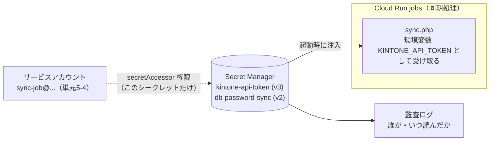

# 単元 5-2：通信経路の保護（WAF、ゼロトラスト、シークレット管理）

> **この単元のゴール**
> 入口での攻撃の遮断（WAF）、「社内だから安全」に頼らないアクセス制御（ゼロトラスト）、パスワードや APIキーの安全な保管（シークレット管理）を、Google Cloud の構成として説明・設計できるようになる。

---

## 【概念の解説】

### 1. WAF：HTTP の中身を見る警備員

単元2-5のファイアウォールは、**IP アドレスとポート番号**でパケットを判断しました。しかし、SQL インジェクション（単元5-1）は、許可された 443 番ポートへの、正しい形の HTTPS リクエストの**中身**に仕込まれています。ファイアウォールでは見分けられません。

**WAF（Web Application Firewall）** は、HTTP リクエストの中身（URL、ヘッダー、本文）を検査して、攻撃のパターンを遮断する仕組みです。

| 層 | 見るもの | 止められるもの |
|---|---|---|
| ファイアウォール（単元2-5） | IP アドレス、ポート | 開けていないポートへの接続、許可していない送信元 |
| **WAF** | HTTP の中身 | SQLi・XSS などの典型的な攻撃パターン、特定の国からのアクセス、過剰なリクエスト |
| アプリ（単元5-1） | 業務の意味 | 認可の不備、業務ルール違反 |

Google Cloud では **Cloud Armor** が WAF にあたり、ロードバランサー（単元2-5）に取り付けます。

```text
Cloud Armor のルールの例
- OWASP の攻撃パターンに一致するリクエストを拒否（SQLi、XSS など、あらかじめ用意されたルール）
- 同じ IP から 1分間に 100 回を超えるリクエストは一定時間ブロック（レート制限）
- 管理画面のパスは、顧客オフィスの IP からのみ許可
```

**WAF の限界**：

- **既知のパターン**しか止められない。認可の不備（BOLA）は、リクエストとしては完全に正常なので止められない
- 誤検知がある。正規の入力（例：SQL を説明する記事の本文）を止めてしまうことがある。最初は「検知のみ（プレビュー）」モードで様子を見てから遮断に切り替える

> **WAF はアプリの脆弱性対策の「代わり」ではなく、「保険」です。**

**Cloud Run の注意点**：Cloud Run のサービスには、既定で `https://xxx.a.run.app` という公開 URL が付きます。ロードバランサーと Cloud Armor を前に置いても、**この URL に直接アクセスされたら WAF を素通り**されます。Cloud Run の「上り（ingress）」設定を「内部とロードバランサー経由のみ」にして、裏口を閉じる必要があります。

### 2. ゼロトラスト：「社内だから信用する」をやめる

従来のセキュリティは、**境界型** と呼ばれる考え方でした。

```text
【境界型】
  社外（危険）  |ファイアウォール / VPN|  社内（安全）
  → 一度社内ネットワークに入れば、たいていのシステムにアクセスできる
```

この考え方には、現代では大きな弱点があります。

- テレワーク・クラウドの普及で、「社内」の境界があいまいになった
- VPN 機器そのものの脆弱性が攻撃の入口になる事件が相次いでいる
- 1台の PC がウイルスに感染すると、社内ネットワーク全体に被害が広がる（横展開）

**ゼロトラスト** は、「**どこからのアクセスであっても信用せず、毎回、"誰が"・"どの端末で"・"何に" アクセスしようとしているかを確認する**」という考え方です。

| | 境界型 | ゼロトラスト |
|---|---|---|
| 判断の基準 | どのネットワークにいるか | **誰か（ID）**、端末の状態、アクセス先 |
| 認証のタイミング | 社内に入るとき1回 | **アクセスのたびに** |
| 侵入されたときの被害 | 社内全体に広がりやすい | アクセスを許可された範囲に限定される |

Google Cloud では **IAP（Identity-Aware Proxy）** を使うと、社内向けの管理画面などに「Google アカウントでログインし、許可された人だけ通す」関所を、VPN なしで設けられます。

> ゼロトラストは製品の名前ではなく**考え方**です。このカリキュラムで学んできた「DB はアプリからの接続だけ許可」「アプリは最小権限のロールで接続」「サービスごとに別の権限」（単元5-4）も、すべてゼロトラストの考え方の実践です。

### 3. シークレット管理：鍵をどこにしまうか

**シークレット** とは、DB のパスワード、kintone の APIトークン、Webhook の署名用の秘密鍵など、**漏れたら困る情報**の総称です。

**やってはいけない保管場所**

| 場所 | 問題 |
|---|---|
| ソースコードに直書き | Git の履歴に永遠に残る。コードを見られる人全員に漏れる |
| `.env` ファイルを Git にコミット | 同上 |
| コンテナイメージの中 | イメージを取得できる人全員に漏れる |
| 共有スプレッドシート、チャット | 誰がいつ見たか分からない。退職者も見られる |

**Secret Manager を使う**

Google Cloud の **Secret Manager** は、シークレットを暗号化して保管し、**誰（どのサービス）が読めるかを IAM で制御**し、**いつ誰が読んだかを監査ログに残す**サービスです。



Cloud Run では、Secret Manager のシークレットを**環境変数やファイルとして注入する**設定ができます。第4章の `sync.php` は環境変数から読む作りになっているので、**コードを変えずに**、本番では Secret Manager から値を渡せます。

**ローテーション（定期的な交換）**

- シークレットには **バージョン** があり、新しい値を追加して切り替え、古い値を無効化できる
- 漏洩の疑いがあるときは、**すぐに新しい値を発行して古い値を無効化する**（単元5-1）
- 定期的な交換を運用に組み込む。交換が怖くてできない状態（どこで使われているか分からない）こそが危険

---

## 【実務・ビジネスとの結びつき】

### これが理解できていないと起きること

| 現場の症状 | 根本原因 |
|---|---|
| 「WAF を入れたのに、他社のデータを閲覧されていた」 | WAF は認可の不備を止められない。アプリ側の対策が抜けていた |
| 「WAF を設定したのに、攻撃が素通りしていた」 | Cloud Run の公開 URL に直接アクセスされていた（裏口が開いていた） |
| 「VPN 機器の脆弱性から侵入され、社内の全サーバーが暗号化された」 | 境界型の防御だけに頼り、内部での権限分離がなかった |
| 「退職した外注エンジニアが、まだ kintone のトークンを持っている」 | シークレットをチャットで共有し、ローテーションしていなかった |

### 顧客のどの課題を解決するか

- 中小企業では、パスワードや APIキーが「担当者の頭の中」「付箋」「共有 Excel」にあることが珍しくない。**シークレットを一元管理し、退職・委託終了時に確実に無効化できる**仕組みは、内部不正・情報漏洩対策として経営者に分かりやすい価値がある。
- VPN の更新・保守に悩んでいる企業には、IAP によるゼロトラスト型のアクセスが、**コストと安全性の両面で**提案材料になる。

---

## 【理解度チェック課題】

**Q1.**
ファイアウォールと WAF は、それぞれ何を見て通信を判断しますか。WAF でも防げない攻撃を、単元5-1の中から1つ挙げて理由を説明してください。

**Q2.**
「境界型」のセキュリティの弱点を2つ挙げ、ゼロトラストの考え方がそれをどう補うか説明してください。

**Q3.**
kintone の APIトークンを Secret Manager に保管する場合、「ソースコードに書く」「.env ファイルに書いてサーバーに置く」と比べて、どんな点が優れていますか。3つ以上挙げてください。

---

## 【顧客向け言語化トレーニング】

専門用語（WAF、ゼロトラスト、シークレット、ローテーション等）を使わずに答えてください。

**演習1**
> 社長「うちは VPN を入れてるから、社外から入られることはないと思ってるんだけど。」

**演習2**
> 担当者「システムのパスワードって、今は Excel の一覧で管理してるんですけど、まずいですか？ 便利なんですけど…」

<details>
<summary>💡 回答のヒント（考えてから開く）</summary>

- 演習1：VPN は「会社の敷地の門」。門は有効だが、門を一度通れば中を自由に歩ける作りだと、門の鍵を盗まれたとき・門自体が壊されたときに全部が危ない。「部屋ごとに社員証をかざす仕組み」を加えるイメージで、ゼロトラストを説明する。VPN を否定しない。
- 演習2：「全部の部屋の合鍵を1冊のノートにまとめて、机の上に置いている状態」。そのノートを見た人・コピーした人を後から追えない。「鍵は専用の金庫に入れ、システムだけが必要な鍵を取り出せるようにする。誰がいつ取り出したかも記録される」と代替案を示す。

</details>

---

回答は [`answers/chapter-05/02.md`](../answers/chapter-05/02.md) に記入してください。
