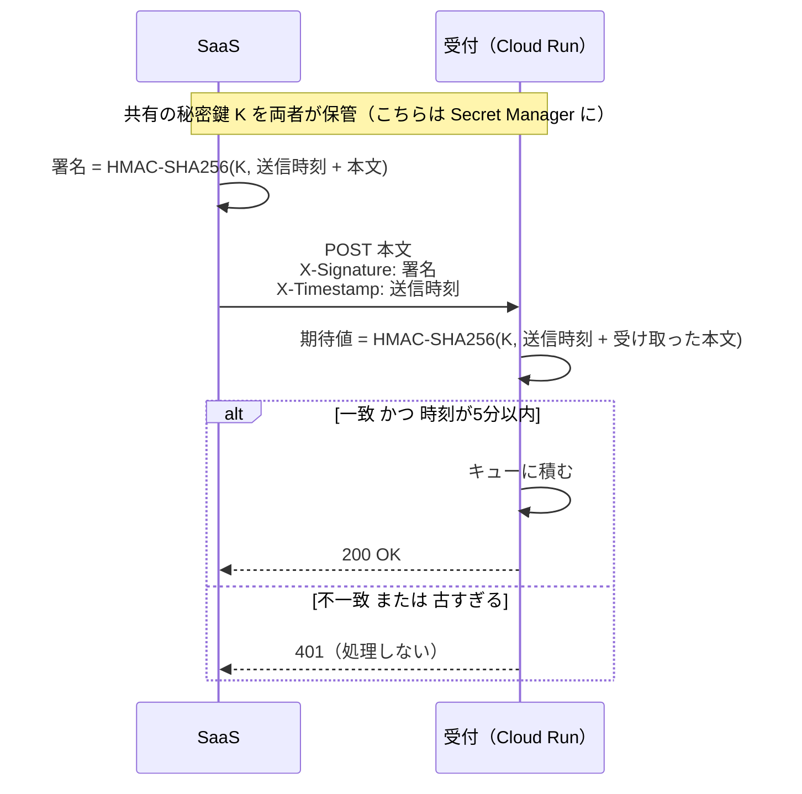
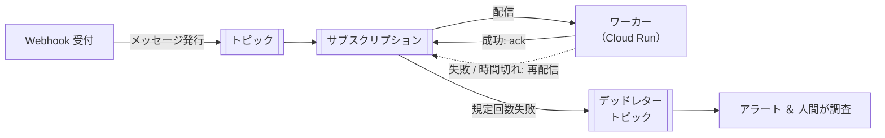

# 単元 5-3：SaaS Webhook 受信時の署名検証と、非同期キュー処理の耐障害性

> **この単元のゴール**
> インターネットに公開せざるを得ない Webhook の受付を、「偽の通知」「盗み見た通知の再送」から守れるようになる。キューを使った処理が、障害時にどう振る舞うべきかを設計できるようになる。

---

## 【概念の解説】

### 1. Webhook の受付 URL は「誰でも叩ける」

単元4-3で、Webhook には「インターネットから呼べる受付 URL が必要」だと学びました。つまり、

```text
POST https://data.example.co.jp/webhooks/hubspot
```

という URL は、**HubSpot だけでなく、URL を知った誰でも**呼び出せます。何の対策もしなければ、攻撃者は次のことができます。

| 攻撃 | 内容 |
|---|---|
| **偽の通知** | 「受注 #9999 が 1,000 万円で成立した」という偽データを送りつけ、DB と BigQuery のレポートを汚染する |
| **リプレイ（再送）攻撃** | 過去に盗み見た本物の通知を、何度も送り直す |
| **DoS** | 大量の通知を送りつけて、キューと DB を詰まらせる |

URL を推測されにくくする（長いランダムな文字列を含める）のは気休めにはなりますが、URL はログなどから漏れうるので、それだけでは不十分です。

### 2. HMAC 署名：「本物の送り主」であることの証明

多くの SaaS は、Webhook に **署名** を付けて送ってきます。代表的な方式が **HMAC** です。

**仕組み**

1. 事前に、SaaS とこちらだけが知る **共有の秘密鍵**（Webhook シークレット）を決めておく
2. SaaS は、送る本文（と送信時刻など）を秘密鍵と組み合わせて **ハッシュ値（署名）** を計算し、ヘッダーに付けて送る
3. こちらは、受け取った本文から同じ計算をし、**ヘッダーの署名と一致するか**確かめる



秘密鍵 K を知らない攻撃者は、正しい署名を計算できません。また、本文を1文字でも書き換えると署名が一致しなくなるので、**改ざんも検知**できます。

**送信時刻を署名に含め、古すぎるものを拒否する**ことで、盗み見た通知を後から再送するリプレイ攻撃も防げます（時刻を書き換えると署名が合わなくなる）。

### 3. 実装上の落とし穴

署名検証は、実装の細部を間違えると簡単に無意味になります。

```php
<?php
// Webhook 受付の署名検証（考え方の例。ヘッダー名や署名の作り方は SaaS ごとに異なる）
$secret    = getenv('WEBHOOK_SECRET');                 // Secret Manager から注入
$rawBody   = file_get_contents('php://input');         // ① 生の本文を使う
$timestamp = $_SERVER['HTTP_X_TIMESTAMP'] ?? '';
$signature = $_SERVER['HTTP_X_SIGNATURE'] ?? '';

// ② 時刻のチェック（リプレイ対策）
if (!ctype_digit($timestamp) || abs(time() - (int)$timestamp) > 300) {
    http_response_code(401);
    exit;
}

$expected = hash_hmac('sha256', $timestamp . $rawBody, $secret);

// ③ 比較は hash_equals（一定時間比較）
if (!hash_equals($expected, $signature)) {
    http_response_code(401);
    exit;
}

// ④ 検証できてから、初めて中身を解釈する
$event = json_decode($rawBody, true);
// → キューに積んで、すぐに 200 を返す（単元4-3）
```

| ポイント | 間違えると |
|---|---|
| ① **生の本文**で計算する | JSON を一度デコードして再エンコードすると、空白やキーの順番が変わり、正しい通知でも署名が合わなくなる。そこで「合わないからチェックを外す」という最悪の対応につながる |
| ② **時刻をチェックする** | リプレイ攻撃を防げない |
| ③ **`hash_equals` で比較する** | `==` や `===` は、先頭から1文字ずつ比べて違ったらすぐ終わる。応答時間のわずかな差から、署名を1文字ずつ推測される（**タイミング攻撃**）おそれがある |
| ④ **検証前に中身を使わない** | 偽の通知の内容でログを書いたり DB を検索したりすると、それ自体が攻撃の入口になる |

> **SaaS によって、署名の有無・方式・ヘッダー名は異なります。** 必ずその SaaS の公式ドキュメントで仕様を確認してください。署名の仕組みがない SaaS の場合は、推測困難なトークンを URL や独自ヘッダーに含める、送信元 IP アドレスで制限する（SaaS が送信元を公開している場合）、**通知の中身は信じず、合図としてだけ使い、最新の内容を API で取り直す**（単元4-3）、といった代替策を組み合わせます。

### 4. キュー処理の耐障害性

単元4-3で、Webhook の受付は「検証して、キューに積んで、すぐ返す」構成にしました。キューの先のワーカーで障害が起きたとき、どう振る舞うべきかを整理します。

Google Cloud の **Pub/Sub** を例にします。



| 仕組み | 意味 |
|---|---|
| **ack（確認応答）** | ワーカーが「処理し終わった」と返すと、メッセージはキューから消える |
| **再配信** | 決められた時間内に ack が返らなければ、同じメッセージがもう一度配信される → **重複は前提**（単元4-3の冪等性が必須） |
| **再試行の間隔** | すぐに再配信すると、障害中の DB にさらに負荷をかける。間隔を空ける（指数バックオフ）設定にする |
| **デッドレターキュー** | 何度やっても失敗するメッセージ（データの不備など。「毒メッセージ」と呼ぶ）を別の置き場に移す。これがないと、**同じメッセージが永遠に再配信され、他のメッセージの処理を妨げる** |

**ワーカーの失敗を2種類に分ける**のは、単元4-1の API の再試行と同じ考え方です。

| 失敗の種類 | 例 | 対応 |
|---|---|---|
| 一時的な失敗 | DB の一時的な接続断、SaaS API の 429 | ack せずに再配信を待つ |
| 恒久的な失敗 | 必須項目の欠落、想定外の形式 | エラーを記録して ack する（または規定回数でデッドレターへ）。何度やっても成功しない |

---

## 【実務・ビジネスとの結びつき】

### これが理解できていないと起きること

| 現場の症状 | 根本原因 |
|---|---|
| 「BigQuery の売上レポートに、存在しない巨額の受注が載っていた」 | Webhook の署名検証をしておらず、偽の通知を受け入れた |
| 「署名検証を入れたら正しい通知まで弾かれたので、検証を外した」 | 生の本文ではなく、デコード後の値で署名を計算していた |
| 「1件の不正なデータのせいで、その後の全データの同期が止まっていた」 | デッドレターキューがなく、毒メッセージが再配信され続けた |
| 「DB 障害の復旧直後に、溜まっていた再試行が殺到して、また DB が落ちた」 | 再試行の間隔・同時実行数を制御していなかった |

### 顧客のどの課題を解決するか

- 「即時連携」を求める顧客に対して、**即時性と安全性・安定性を両立した構成**を提案できる。
- 「連携が止まったら、誰がどう気づいて、どう復旧するか」まで設計に含めることで、保守運用の品質を具体的に示せる（第7章につながる）。

---

## 【理解度チェック課題】

**Q1.**
HMAC 署名によって、Webhook のどんな攻撃を防げますか。また、送信時刻を署名に含めてチェックすることで、追加で何を防げますか。

**Q2.**
署名検証のコードで、受け取った JSON を `json_decode` してから `json_encode` し直した文字列で署名を計算すると、何が起きますか。

**Q3.**
キュー処理で「デッドレターキュー」がないと、どんな問題が起きますか。また、ワーカーの失敗を「一時的」と「恒久的」に分けて扱う理由を説明してください。

---

## 【顧客向け言語化トレーニング】

専門用語（Webhook、署名、キュー等）を使わずに答えてください。

**演習1**
> 社長「外部のサービスから自動でデータが送られてくるって、なりすましとか大丈夫なの？」

**演習2**
> 担当者「もし途中で1件だけおかしなデータが送られてきたら、全部止まっちゃうんですか？」

<details>
<summary>💡 回答のヒント（考えてから開く）</summary>

- 演習1：「送り主と私たちだけが知っている"合言葉"で、手紙に封印（割印）を押してもらっている。封印が合わない手紙や、日付が古すぎる手紙は開封せずに捨てる」。合言葉自体も金庫（Secret Manager）で管理していると付け加える。
- 演習2：「おかしな1件は、別の"保留箱"によけて、残りは止めずに処理を続ける。保留箱に入ったものは担当者に通知され、内容を確認して直してから流し直す」。止めないことと、見逃さないことの両立を伝える。

</details>

---

回答は [`answers/chapter-05/03.md`](../answers/chapter-05/03.md) に記入してください。
