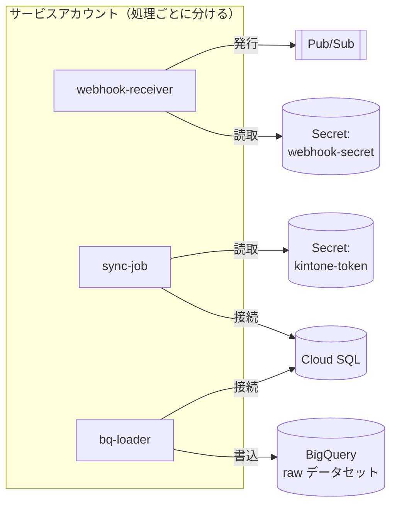

# 単元 5-4：クラウドの権限管理（IAM、最小権限、サービスアカウント）

> **この単元のゴール**
> Google Cloud 上で「誰が（人・プログラム）」「何に」「何をできるか」を設計できるようになる。クラウドでの情報漏洩の主な原因である「権限の与えすぎ」と「鍵の漏洩」を防ぐ構成を説明できるようになる。

---

## 【概念の解説】

### 1. IAM：クラウドの「誰が・何に・何をできるか」

第1章ではOSのユーザーとパーミッション、第3章では DB のロールを学びました。クラウドにも同じ考え方の仕組みがあり、Google Cloud では **IAM（Identity and Access Management）** と呼びます。

IAM の設定は、次の3つの組み合わせです。

| 要素 | 意味 | 例 |
|---|---|---|
| **プリンシパル（誰が）** | 人のアカウント、グループ、サービスアカウント（プログラム用） | `tanaka@example.co.jp`、`sync-job@project.iam.gserviceaccount.com` |
| **ロール（何をできるか）** | 権限の束 | `roles/cloudsql.client`（Cloud SQL に接続できる） |
| **リソース（何に）** | プロジェクト、特定のデータセット、特定のシークレットなど | `kintone-api-token` というシークレット |

```text
「sync-job（プログラム）」に、「kintone-api-token（シークレット）」の
「secretAccessor（読み取り）」ロールを与える
```

### 2. ロールの種類と「基本ロール」の危険性

| 種類 | 例 | 使い方 |
|---|---|---|
| **基本ロール** | オーナー、編集者、閲覧者 | プロジェクト全体に対する非常に広い権限。**本番環境のプログラムには使わない** |
| **事前定義ロール** | `roles/bigquery.dataViewer`、`roles/secretmanager.secretAccessor` | サービスごとに用意された、用途別の権限。**基本はこれを使う** |
| **カスタムロール** | 自分で権限を選んで作る | 事前定義ロールでも広すぎる場合 |

「編集者」ロールは、プロジェクト内のほぼすべてのリソースを作成・変更・削除できます。開発中に「とりあえず動かすために編集者を付ける」と、そのまま本番に残り、**プログラムが乗っ取られたときにプロジェクト全体が危険にさらされます。** 単元1-2の「root で動かすアプリ」と同じ構造です。

### 3. サービスアカウント：プログラム専用の ID

人ではなく、Cloud Run などで動く**プログラムに与える ID** を **サービスアカウント** と呼びます。このカリキュラムの構成では、処理ごとに別のサービスアカウントを作ります。

| サービスアカウント | 使う処理 | 与えるロール（主なもの） |
|---|---|---|
| `webhook-receiver` | Webhook 受付 | Pub/Sub トピックへの発行、Webhook シークレットの読み取り |
| `sync-job` | 取り込み処理（第4章） | Cloud SQL への接続、kintone トークン・DB パスワードの読み取り |
| `bq-loader` | BigQuery への同期（第6章） | Cloud SQL への接続、**特定のデータセット**への書き込み、BigQuery ジョブの実行 |
| `dashboard-viewer` | Looker Studio の参照用（必要な場合） | **分析用データセット**の読み取りのみ |



処理ごとに分けておけば、例えば Webhook 受付が乗っ取られても、攻撃者は kintone のトークンを読めず、DB にも接続できません。

**権限は、できるだけ狭いリソースに対して与える**ことも重要です。「プロジェクト全体の BigQuery の編集者」ではなく、「`raw` データセットの編集者」のように与えます。

### 4. サービスアカウントキーを作らない

サービスアカウントには、JSON 形式の **キーファイル** を発行する機能があります。このファイルを持っていれば、**どこからでも、そのサービスアカウントになりすませます。** パスワードと同じく漏洩のリスクがあり、実際に GitHub への誤コミットなどで多くの事故が起きています。

| 場面 | キーファイルの代わりに |
|---|---|
| Cloud Run で動くプログラム | Cloud Run にサービスアカウントを**割り当てる**だけで、キーなしで認証される（Google Cloud が内部で短命のトークンを自動発行） |
| 開発者の PC から操作 | 開発者自身の Google アカウントで `gcloud auth login`。必要なら一時的にサービスアカウントの権限を借りる（なりすまし） |
| GitHub Actions からデプロイ | **Workload Identity 連携**：GitHub が発行する一時的な証明を Google Cloud が検証し、短命のトークンを発行する。キーファイル不要 |

> **「長期間有効な鍵を、ファイルとして持ち歩かない」**。これがクラウドの権限管理で最も効果の大きい原則の1つです。

### 5. 人のアカウントの管理

| 原則 | 内容 |
|---|---|
| **多要素認証（MFA）を必須にする** | パスワードが漏れても、それだけではログインできない |
| **個人ではなくグループに権限を付ける** | `data-admins@example.co.jp` グループに権限を付け、人の入れ替えはグループのメンバー変更で行う。退職者の権限の消し忘れを防ぐ |
| **本番環境の強い権限は、普段は持たせない** | 必要なときだけ申請して一時的に付与する |
| **本番と開発でプロジェクトを分ける** | 開発用の緩い権限や設定ミスが、本番データに影響しないようにする |

### 6. 監査ログ：誰が何をしたか

Google Cloud の **Cloud Audit Logs** には、「誰が、いつ、どのリソースに対して、どんな管理操作をしたか」が記録されます（IAM の変更、シークレットへのアクセス、データセットの作成など）。データへのアクセスの記録（データアクセスログ）は、サービスによっては明示的に有効にする必要があります。単元3-5の DB の監査ログと合わせて、**インシデントのときに範囲を特定する材料**になります。

---

## 【実務・ビジネスとの結びつき】

### これが理解できていないと起きること

| 現場の症状 | 根本原因 |
|---|---|
| 「取り込み処理の脆弱性から、BigQuery の全データとバックアップを消された」 | プログラムにプロジェクトの「編集者」ロールを付けていた |
| 「GitHub に上げたキーファイルから侵入された」 | サービスアカウントキーを作成・保管していた |
| 「委託先との契約終了後も、委託先の担当者が本番環境にアクセスできた」 | 個人アカウントに直接権限を付け、削除漏れがあった |
| 「誰がシークレットを読んだのか分からない」 | 共有アカウントを使っていた。監査ログを確認できる体制がなかった |

### 顧客のどの課題を解決するか

- 委託開発で多いのが、「**業者が顧客のクラウド環境の全権限を持ったまま**」という状態。権限を役割ごとに分け、契約終了時に確実に外せる設計にすることは、顧客の安心と、業者としての誠実さの証明になる。
- 「顧客のクラウド環境を、顧客の所有物として正しく引き渡せる」ことは、**ベンダーロックインを嫌う経営者への強い訴求点**になる（第8章）。

---

## 【理解度チェック課題】

**Q1.**
取り込み処理（Cloud Run jobs）のサービスアカウントに、プロジェクトの「編集者」ロールを付けることの危険性を説明してください。代わりにどう権限を設計しますか。

**Q2.**
サービスアカウントのキーファイル（JSON）を使わずに、Cloud Run 上のプログラムや GitHub Actions が Google Cloud に認証できる仕組みを、それぞれ説明してください。

**Q3.**
Webhook 受付・取り込み処理・BigQuery 同期の3つの処理で、サービスアカウントを1つにまとめず、別々に作るのはなぜですか。

---

## 【顧客向け言語化トレーニング】

専門用語（IAM、サービスアカウント、ロール等）を使わずに答えてください。

**演習1**
> 社長「システムを作ってもらった後、そちらの会社がうちのデータを勝手に見られたりしないの？」

**演習2**
> 社長「担当者が辞めたとき、何をすればいいの？ 前に辞めた人のアカウントがまだ残ってるかもしれないんだけど。」

<details>
<summary>💡 回答のヒント（考えてから開く）</summary>

- 演習1：正直に答える。「構築・保守の作業に必要な範囲の鍵だけをお預かりし、その鍵を誰がいつ使ったかは御社側で確認できる記録に残る。契約が終われば、御社の操作一つで鍵を無効にできる」。所有者は顧客であり、業者は「合鍵を借りている」立場だと明確にする。
- 演習2：「人に直接鍵を渡すのではなく、"営業部"や"管理者"といった役割に鍵を渡し、人はその役割に入れたり外したりする。辞めた人を役割から外せば、すべての鍵が一度に無効になる」。現状の棚卸し（残っているアカウントの確認）を最初の作業として提案する。

</details>
