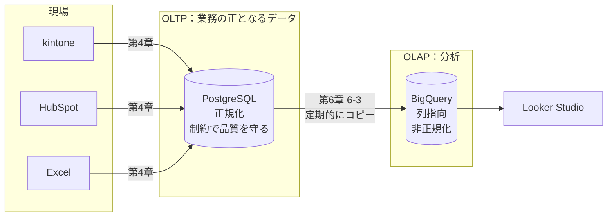

# 単元 6-1：OLTP と OLAP の違い（なぜ本番 RDB で集計してはいけないか）

> **この単元のゴール**
> 「業務を回すための DB」と「分析するための DB」がなぜ別物なのかを、ストレージ上のデータの並べ方から説明できるようになる。PostgreSQL と BigQuery の2つを使う構成の必然性を、顧客に説明できるようになる。

---

## 【概念の解説】

### 1. 2種類の仕事

データベースへの問い合わせは、大きく2種類に分かれます。

| | OLTP（オンライントランザクション処理） | OLAP（オンライン分析処理） |
|---|---|---|
| 例 | 「受注 #1023 を登録する」「山田商店の電話番号を変える」 | 「過去3年の月別・商品別の売上推移」「営業担当ごとの受注率」 |
| 1回に扱う行数 | **数行** | **数百万〜数億行** |
| 1回に使う列数 | その行の**ほぼ全列** | 何十列もあるうちの**数列だけ**（日付・商品・金額など） |
| 頻度 | 1秒に何十〜何千回 | 1日に数回〜数百回 |
| 求められること | 速い応答、正確な更新（ACID） | 大量データの高速な集計 |
| 担当 | **PostgreSQL**（第3章） | **BigQuery**（この章） |

### 2. データの並べ方の違い：行指向と列指向

単元3-1で、PostgreSQL は「行」をページにまとめて保存すると学びました。これを **行指向（ロー指向）** と呼びます。

```text
【行指向】ページに「行」がまるごと並ぶ
ページ1: [1001, 2026-04-01, 山田商店, ボルトA, 120, 100, 東京都…, 佐藤, …]
         [1002, 2026-04-03, 田中工業, ナットB,  80,  50, 大阪府…, 鈴木, …]
         …
```

1件の注文を読む・書くには理想的です。1ページ読めば、その行の全列がそろいます。

しかし「**全期間の金額の合計**」を求めたい場合はどうでしょう。必要なのは「金額」の列だけなのに、行指向では**全ページを読み、毎行の全列を読み飛ばしながら**金額だけを拾うことになります。

**列指向（カラム指向）** のストレージは、データを**列ごとにまとめて**保存します。

```text
【列指向】列ごとに別々に保存
受注No:   [1001, 1002, 1003, 1004, …]
受注日:   [2026-04-01, 2026-04-03, …]
顧客名:   [山田商店, 田中工業, 山田商店, …]
金額:     [12000, 4000, 6000, …]       ← 合計を出すなら、ここだけ読めばよい
住所:     […]
```

| | 行指向（PostgreSQL） | 列指向（BigQuery） |
|---|---|---|
| 1行をまるごと読む・書く | **得意** | 苦手（列ごとのファイルを全部触る） |
| 少数の列を大量の行にわたって集計 | 苦手（不要な列も読む） | **得意**（必要な列だけ読む） |
| 圧縮 | 普通 | **よく効く**（同じ列には似た値が並ぶ。「東京都」が何万回も続く等） |

単元1-1の教訓、「**遅さの正体の大半はデータを待っている時間**」を思い出してください。列指向は、**そもそも読む量を減らす**ことで、集計を桁違いに速くします。

### 3. なぜ本番の PostgreSQL で集計してはいけないのか

「PostgreSQL でも `GROUP BY` は書けるし、データが少ないうちは速い。わざわざ BigQuery を使う必要はあるのか？」という疑問は当然です。答えは、**速さだけの問題ではない**ということです。

本番 DB で重い集計を走らせると、これまでの単元で学んだ仕組みが、すべて悪い方向に働きます。

| 起きること | 仕組み | 学んだ単元 |
|---|---|---|
| **業務画面が遅くなる** | 集計が大量のページを読み込み、普段の業務で使うページを**メモリ（共有バッファ）から追い出す**。業務の検索が SSD 読み出しになる | 1-1, 3-1 |
| **CPU とディスクを奪い合う** | 1つの大きな集計が CPU コアとディスクの帯域を長時間使う | 1-2 |
| **テーブルが肥大化する** | 長時間のトランザクション（集計の SELECT も含む）が続く間、VACUUM が古い行を掃除できない | 3-1, 3-2 |
| **接続数を圧迫する** | BI ツールが多数の接続を張りっぱなしにする | 1-2 |
| **分析担当に本番データへの広い権限が必要になる** | 個人情報を含むテーブルを、分析のために広く公開してしまう | 3-5 |

さらに、分析には**本番 DB にないデータ**も必要になります。

- kintone、HubSpot、Excel、会計ソフトなど**複数のデータ源を横断**した分析
- 本番 DB では消した・上書きした**過去の状態**（例：先月末時点の顧客ランク）

> **本番 DB は「業務を止めないこと」が最優先。分析は、別の場所にコピーしたデータで行う。** これが OLTP と OLAP を分ける根本的な理由です。

### 4. 正規化と非正規化

第3章では、データを**正規化**して、1つの事実を1か所に書くようにしました。更新の矛盾を防ぐためです。

分析用のデータベースでは、逆に **非正規化**（あらかじめ結合して、重複を許した横長の表にする）することがよくあります。

| | OLTP（PostgreSQL） | OLAP（BigQuery） |
|---|---|---|
| 更新 | 頻繁 | ほとんどない（追記・定期的な入れ替え） |
| 正規化 | **する**（更新の矛盾を防ぐ） | **あえて崩す**（JOIN を減らして集計を速く・簡単にする） |
| データの形 | 細かく分かれたテーブル群 | 分析しやすい横長の表、スター・スキーマ（単元6-4） |

分析用のデータはほとんど更新しないので、「更新時の矛盾」というデメリットが小さく、「JOIN が減って速く・分かりやすくなる」メリットが勝つのです。単元3-3の最後で述べた「**保存のための形と、見るための形を分ける**」が、ここで実現されます。

### 5. このカリキュラムの全体像（再掲）



---

## 【実務・ビジネスとの結びつき】

### これが理解できていないと起きること

| 現場の症状 | 根本原因 |
|---|---|
| 「経営会議の前に役員が分析画面を開くと、現場の受注入力が固まる」 | BI ツールが本番 DB を直接集計していた |
| 「月次の集計バッチの後、半日ほどシステム全体が遅い」 | 集計がメモリ上のキャッシュを押し流した |
| 「先月末時点の在庫が分からない」 | 本番 DB は最新の値で上書きされ、過去の状態が残っていない |
| 「kintone の案件と会計ソフトの売上を突き合わせるのに、毎月2日かかっている」 | データ源ごとにバラバラで、横断して分析する場所がない |

### 顧客のどの課題を解決するか

- 「**現場の業務を止めずに、経営者が好きなだけデータを見られる**」状態は、この2層構成によって初めて実現する。提案の中心となる価値。
- 「なぜデータベースを2つも使うのか（コストが増えるのでは）」という質問に、本番業務の安定性・分析の速さ・権限の分離の3点から答えられる。

---

## 【理解度チェック課題】

**Q1.**
行指向と列指向のストレージの違いを説明し、「1億件の注文の、月別売上合計」を求める場合に列指向が有利な理由を、ディスクから読むデータ量の観点で説明してください。

**Q2.**
本番の PostgreSQL で重い集計を実行すると、業務システムにどんな悪影響が出ますか。第1章・第3章で学んだ仕組みを使って、2つ以上説明してください。

**Q3.**
第3章では「正規化すべき」と学んだのに、BigQuery では非正規化した横長の表を作ることがあります。矛盾しているようにも見えますが、なぜそれでよいのですか。

---

## 【顧客向け言語化トレーニング】

専門用語（OLTP、OLAP、列指向、正規化等）を使わずに答えてください。

**演習1**
> 社長「データベースを2つ使うってことは、費用も2倍でしょ？ 1つにまとめられないの？」

**演習2**
> 担当者「今のシステムでも集計の画面はあるんですけど、それじゃダメなんですか？」

<details>
<summary>💡 回答のヒント（考えてから開く）</summary>

- 演習1：「お店の"レジ"と"経営分析の資料室"を分けるイメージ」。レジの横で大量の帳簿を広げて分析すると、お客様の会計が遅れる。分析用は使った分だけの課金で、中小企業の規模なら月数百〜数千円程度に収まることが多い（必ず見積もりで示す）。「2倍」ではないことを具体的な数字で伝える（第7章のコスト見積もり）。
- 演習2：今の集計画面を否定しない。「その画面は、そのシステムの中のデータしか見られない」「重い集計をすると入力中の人に影響する可能性がある」の2点を、現状の困りごと（他のデータと合わせたい、過去と比べたい）と結びつけて伝える。

</details>

---

回答は [`answers/chapter-06/01.md`](../answers/chapter-06/01.md) に記入してください。
