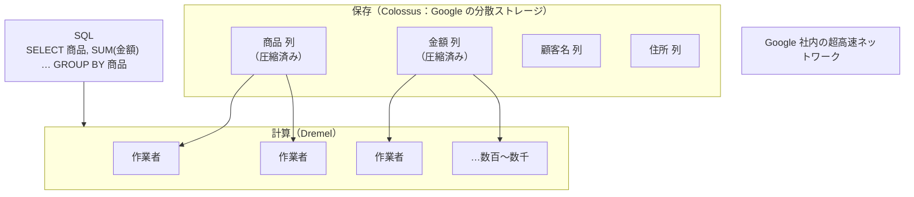

# 単元 6-2：BigQuery のアーキテクチャ（カラム型ストレージ、スキャン課金）

> **この単元のゴール**
> BigQuery が「サーバーを用意せずに、大量データを数秒で集計できる」仕組みと、**「読んだデータ量で課金される」**料金体系を理解し、コストを予測・制御できるようになる。

---

## 【概念の解説】

### 1. BigQuery はサーバーを持たない DWH

**DWH（データウェアハウス）** は、分析のためにデータを集めて保管する場所です。BigQuery は Google Cloud が提供する DWH で、最大の特徴は **サーバーの管理が一切不要（サーバーレス）** なことです。

| | PostgreSQL（Cloud SQL） | BigQuery |
|---|---|---|
| 事前に決めるもの | CPU 数・メモリ量・ディスク容量 | **何もない**（データを入れて SQL を投げるだけ） |
| 起動していない時間の費用 | かかる（常時起動） | **保存しているデータ量の分だけ**（クエリ費用はかからない） |
| 処理能力 | 選んだサイズで頭打ち | 問い合わせのたびに、必要なだけの計算資源が自動で割り当てられる |

### 2. 仕組み：保存と計算を分ける

BigQuery の内部は、大きく2つに分かれています。



- **保存**：データは単元6-1の**列指向**の形式で、圧縮して分散ストレージに保存される
- **計算**：SQL を受け取ると、処理を細かく分割し、**数百〜数千の作業者（スロット）に並列で配る**。各作業者が担当分を集計し、最後に結果をまとめる
- 保存と計算が分離しているので、データが増えても計算資源を独立して増やせる

単元1-2の「1台の CPU のコアを取り合う」世界とは対照的に、「**問い合わせのたびに大量の作業者を一時的に借りる**」世界です。

### 3. 料金の仕組み：「読んだ量」で払う

BigQuery の料金は主に2つです（オンデマンド料金の場合）。

| 費目 | 何に対して | 目安（執筆時点の公式価格。最新は必ず公式ページで確認） |
|---|---|---|
| **クエリ（計算）** | **クエリが読み込んだデータ量** | 1 TiB あたり約 6.25 ドル。**毎月 1 TiB までは無料** |
| **ストレージ（保存）** | 保存しているデータ量 | 1 GiB あたり月 約 0.02 ドル。90日間更新のないデータは約半額。**毎月 10 GiB までは無料** |

最も重要なのは、**クエリ料金が「結果の行数」でも「処理時間」でもなく、「スキャンした（読み込んだ）列のデータ量」で決まる**ことです。

```sql
-- ✗ 全列を読む：テーブルが 100 GiB なら 100 GiB 分の課金
SELECT * FROM sales.orders LIMIT 10;

-- ✓ 必要な列だけ：日付と金額の列が合計 5 GiB なら 5 GiB 分の課金
SELECT ordered_on, amount FROM sales.orders;
```

| 間違えやすいポイント | 実際 |
|---|---|
| 「`LIMIT 10` にすれば安い」 | **基本的に安くならない。** LIMIT は結果を絞るだけで、読み込む量は変わらない |
| 「`WHERE` で絞れば安い」 | パーティション（後述）の列で絞らない限り、**読み込む量は変わらない** |
| 「`SELECT *` でも結果が少なければ安い」 | 全列を読むので高い。**`SELECT *` は BigQuery では避ける** |
| 「中身を見るだけでも課金される」 | 管理画面の「プレビュー」機能は無料 |

**計算例**：100 GiB の注文テーブルに対して、`SELECT *` を含むダッシュボードを社員 20 人が毎日 5 回開く場合

```text
100 GiB × 20人 × 5回 × 22営業日 = 220,000 GiB ≒ 215 TiB / 月
(215 − 1) TiB × 6.25 ドル ≒ 1,340 ドル / 月
```

必要な列だけを読み、日付のパーティションで直近だけに絞って、1回あたり 2 GiB にできれば：

```text
2 GiB × 20 × 5 × 22 = 4,400 GiB ≒ 4.3 TiB → (4.3 − 1) × 6.25 ≒ 21 ドル / 月
```

**同じ見た目のダッシュボードでも、設計次第で費用が数十倍変わります。** これは提案・保守の腕の見せ所です。

### 4. パーティションとクラスタリング：読む量をさらに減らす

| 機能 | 仕組み | 効果 |
|---|---|---|
| **パーティション** | テーブルを日付（または整数の範囲）ごとに**物理的に分けて**保存する | `WHERE ordered_on >= '2026-10-01'` と書くと、**該当する日付の区画しか読まない**（プルーニング） |
| **クラスタリング** | パーティション内のデータを、指定した列（最大4列）の値の順に**並べて**保存する | `WHERE customer_id = 101` のような絞り込みで、読む範囲を減らせる |

```sql
CREATE TABLE sales.orders
(
  order_id     INT64,
  ordered_on   DATE,
  customer_id  INT64,
  product_id   INT64,
  amount       NUMERIC
)
PARTITION BY ordered_on          -- 日付ごとに区画を分ける
CLUSTER BY customer_id;          -- 区画の中を顧客 ID 順に並べる
```

単元3-1の B-tree インデックスと目的は似ていますが、BigQuery にはそうしたインデックスがない代わりに、**「そもそも読む区画を減らす」**ことで速さとコストを両立します。

### 5. コストの事故を防ぐ仕組み

| 仕組み | 内容 |
|---|---|
| **ドライラン** | クエリを実行せずに、読み込む量を見積もる。管理画面では、クエリを書くと右上に「このクエリを実行すると ○○ GB 処理されます」と表示される |
| **課金される最大バイト数**（`maximum_bytes_billed`） | クエリごとに上限を設定し、超えるクエリは実行前にエラーにする |
| **パーティションフィルタの必須化** | パーティション列での絞り込みがないクエリを拒否する設定 |
| **プロジェクト・ユーザーごとの割り当て上限** | 1日あたりに読み込める量の上限を設定する |
| **予算アラート** | 月の利用額が一定額を超えたら通知する（第7章） |

### 6. データの置き場所と権限

BigQuery のデータは、**プロジェクト → データセット → テーブル** の階層で管理します。

| 設定 | 推奨 |
|---|---|
| **データセットのロケーション** | `asia-northeast1`（東京）。日本の顧客データを国内に置く（第7章の法務・顧客の安心）。**作成後に変更できない**ので最初に決める |
| **データセットの分け方** | 用途ごとに分ける：`raw`（取り込んだまま）、`staging`（整形済み）、`mart`（分析用）（単元6-3） |
| **権限** | データセット単位で IAM を設定する（単元5-4）。ダッシュボードを見る人には `mart` の閲覧権限だけ |
| **細かい制御** | 特定の列だけを隠す **列レベルのアクセス制御（ポリシータグ）**、行ごとに見せる範囲を変える **行レベルのアクセスポリシー**、他のデータセットの必要な部分だけを公開する **承認済みビュー** |

第3章の PostgreSQL で行った「ロール分離・ビュー・行レベルセキュリティ」と同じ考え方を、BigQuery でも実現できるということです。

---

## 【実務・ビジネスとの結びつき】

### これが理解できていないと起きること

| 現場の症状 | 根本原因 |
|---|---|
| 「BigQuery の請求が、想定の数十倍になった」 | `SELECT *` を含むダッシュボードが、全期間・全列を毎回スキャンしていた |
| 「`LIMIT 100` を付けて節約したつもりが、費用が変わらない」 | LIMIT は読み込む量を減らさない |
| 「データセットを米国に作ってしまい、後から東京に移すのに作り直しが必要になった」 | ロケーションは作成後に変更できない |
| 「ダッシュボード用に共有したら、個人情報の列まで見えていた」 | データセットの権限が粗く、列レベルの制御をしていなかった |

### 顧客のどの課題を解決するか

- 中小企業のデータ量（数GB〜数百GB）であれば、**正しく設計すれば BigQuery の費用は月数ドル〜数十ドル程度**に収まることが多い。「大企業向けの高い仕組み」という誤解を、具体的な計算で解ける。
- 一方で、**設計を誤ると青天井になりうる**ことを理解していることが、プロとしての信頼につながる。上限設定・予算アラートまで含めて提案する。

---

## 【理解度チェック課題】

**Q1.**
BigQuery のクエリ料金は何によって決まりますか。`SELECT * FROM orders LIMIT 10` が安くならない理由を説明してください。

**Q2.**
200 GiB の注文テーブル（全期間 5 年分）があります。経営ダッシュボードは「直近 3 か月の、日付・商品・金額」しか使いません。読み込む量を減らすために、テーブル設計とクエリでできる工夫を2つ以上挙げてください。

**Q3.**
BigQuery のデータセットのロケーションを、最初に慎重に決める必要があるのはなぜですか。日本の中小企業の案件では、どこを選ぶべきですか。

---

## 【顧客向け言語化トレーニング】

専門用語（BigQuery、スキャン、パーティション等）を使わずに答えてください。

**演習1**
> 社長「使った分だけ払う仕組みって、いくらかかるか分からなくて怖いんだけど。」

**演習2**
> 社長「Google のサービスってことは、うちのデータを Google に見られたり、海外に置かれたりしないの？」

<details>
<summary>💡 回答のヒント（考えてから開く）</summary>

- 演習1：不安を受け止めたうえで3点。①御社のデータ量なら、試算では月○○円程度（具体的な数字を事前に計算して持っていく） ②1回の問い合わせごと・1か月ごとに「これ以上は使わない」上限を設定できる ③一定額を超えたら自動で通知が来る。「電気代と同じで使った分だけだが、ブレーカーと見守りのお知らせを付けておく」たとえが使える。
- 演習2：データの保管場所は「東京のデータセンター」と指定でき、変更されないこと。Google が利用者のデータを勝手に閲覧・利用しない旨は契約条件に定められていること（具体的な条項は公式の利用規約・データ処理条件を確認して示す）。誰がアクセスできるかは御社が決め、記録も残ることを伝える。断定的な保証はせず、根拠となる資料を示す姿勢が大切。

</details>

---

回答は [`answers/chapter-06/02.md`](../answers/chapter-06/02.md) に記入してください。
