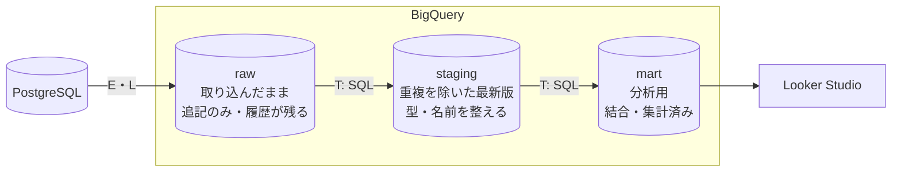
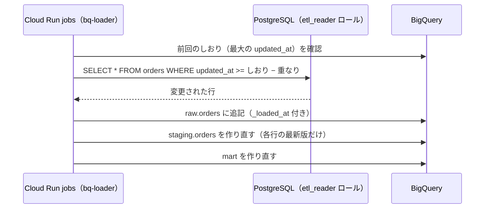

# 単元 6-3：データパイプライン設計（RDB → BigQuery、ELT の考え方）

> **この単元のゴール**
> PostgreSQL のデータを BigQuery に「定期的に・漏れなく・安く」流し込む方法を、複数の選択肢から顧客の状況に合わせて選べるようになる。データを段階的に整える「層」の設計ができるようになる。

---

## 【概念の解説】

### 1. ETL と ELT

データを分析基盤に運ぶ処理は、3つの工程からなります。

| 工程 | 意味 |
|---|---|
| **E**xtract（抽出） | データ源から取り出す |
| **T**ransform（変換） | 整形・結合・集計する |
| **L**oad（格納） | 分析基盤に入れる |

| | ETL | ELT |
|---|---|---|
| 順番 | 取り出す → **変換してから** → 入れる | 取り出す → **そのまま入れて** → BigQuery の中で SQL で変換する |
| 変換する場所 | 専用のサーバー・ツール | **DWH（BigQuery）自身** |
| 変換ロジックを直したいとき | 取り込みからやり直し | **入れてある元データから SQL を再実行するだけ** |
| 主流になった理由 | 昔は DWH の計算資源が高価だった | BigQuery のように計算資源が安く強力になった |

このカリキュラムでは **ELT** を基本にします。理由は、

- 変換を **SQL で書ける**（プログラミングスクールで教える立場からも、引き継ぎやすい）
- 元のデータが BigQuery に残っているので、**集計の定義が変わっても過去にさかのぼって作り直せる**
- 変換のための追加サーバーが不要

### 2. データの「層」を分ける

BigQuery の中で、データを段階的に整えていきます。データセット（単元6-2）を層ごとに分けます。



| 層 | 中身 | 誰が触るか |
|---|---|---|
| **raw** | PostgreSQL から取り出したデータを**加工せず追記**。取り込み日時（`_loaded_at`）を付ける。同じ行が何度も入ってよい | 取り込み処理だけ |
| **staging** | raw から**各行の最新版だけ**を取り出し、列名・型を整えたもの | 変換処理だけ |
| **mart** | 業務の言葉で整理された分析用の表（単元6-4のスター・スキーマ、ダッシュボード用の横長の表） | ダッシュボード、分析担当 |

第4章の「ステージング → 正規化テーブル」と同じ考え方です。**元データを残しておくことで、何か問題が起きたときに「どの時点で、何が入ってきたか」を必ず確認でき、やり直せる**のです。

### 3. PostgreSQL → BigQuery の同期方法

主な選択肢は3つです。

| 方式 | 仕組み | 長所 | 短所 | 向いている顧客 |
|---|---|---|---|---|
| **A. 連携クエリ ＋ スケジュールクエリ** | BigQuery から Cloud SQL に直接 SQL を投げる機能（`EXTERNAL_QUERY`）を、定期実行する | **コードが不要**。設定だけで始められる | 実行のたびに本番 DB に問い合わせが飛ぶ。ネットワーク・接続設定に制約がある（構成によって要確認） | データ量が少なく、1日1〜数回の更新で十分 |
| **B. バッチ処理（自作）** | Cloud Run jobs で、PostgreSQL から「前回以降に更新された行」を取り出し、BigQuery に格納する | **柔軟**。第4章と同じ考え方・同じ技術で作れる。負荷やタイミングを細かく制御できる | コードの保守が必要 | 標準的な案件。このカリキュラムの基本形 |
| **C. CDC（Datastream）** | PostgreSQL の WAL（単元3-1）を読み、**変更をほぼリアルタイムで** BigQuery に流すマネージドサービス | **ほぼ即時**。本番 DB への問い合わせ負荷が小さい | 論理レプリケーションの設定が必要。費用が他より高くなりやすい | 即時性が本当に必要、またはデータ量が多い |

**中小企業の最初の構成としては、A か B から始め、必要になったら C を検討する**のが現実的です。即時性は、多くの経営判断では必要ありません（単元4-1の演習2を思い出してください）。

### 4. 方式 B の流れ



ポイントは、第4章の取り込みで学んだことが**そのまま使える**ことです。

- **差分取得のしおりと重なり**（単元4-1）：`updated_at` を使う。単元3-4で全テーブルに `updated_at` を付けたのはこのため
- **重複を前提にする**（単元4-3）：raw には同じ行が何度入ってもよい。staging で最新版だけを選ぶ
- **削除**：PostgreSQL 側を**論理削除**（`deleted_at`）にしておけば、「削除された」という変更も `updated_at` の更新として BigQuery に届く。物理削除だと差分取得では気づけない（単元4-1と同じ問題）
- **権限**：PostgreSQL には読み取り専用の `etl_reader`、BigQuery には `raw` データセットへの書き込みだけを持つ `bq-loader`（単元3-5・5-4）

### 5. 「最新版だけ」を取り出す SQL

raw に同じ注文が何度も入っていても、staging では各注文の最新版を1行だけにします。

```sql
-- staging.orders を raw.orders から作り直す
CREATE OR REPLACE TABLE staging.orders
PARTITION BY ordered_on
AS
SELECT
  id            AS order_id,
  order_no,
  ordered_on,
  customer_id,
  staff_id,
  status,
  updated_at
FROM raw.orders
WHERE TRUE
QUALIFY ROW_NUMBER() OVER (PARTITION BY id ORDER BY updated_at DESC, _loaded_at DESC) = 1;
```

- `ROW_NUMBER() OVER (PARTITION BY id ORDER BY updated_at DESC)`：注文 ID ごとに、更新日時の新しい順に番号を振る
- `QUALIFY ... = 1`：その番号が 1 の行（＝最新版）だけを残す
- 単元4-3の「古いデータで上書きしない」と同じ考え方を、SQL の集合演算で実現しています

データ量が大きくなり、毎回すべてを作り直すのが高くつくようになったら、`MERGE` 文で**変わった行だけを更新する**方式に切り替えます。

```sql
MERGE staging.orders AS t
USING (
  SELECT * FROM raw.orders
  WHERE _loaded_at >= TIMESTAMP_SUB(CURRENT_TIMESTAMP(), INTERVAL 1 DAY)
  QUALIFY ROW_NUMBER() OVER (PARTITION BY id ORDER BY updated_at DESC) = 1
) AS s
ON t.order_id = s.id
WHEN MATCHED AND s.updated_at > t.updated_at THEN
  UPDATE SET status = s.status, customer_id = s.customer_id, updated_at = s.updated_at
WHEN NOT MATCHED THEN
  INSERT (order_id, order_no, ordered_on, customer_id, staff_id, status, updated_at)
  VALUES (s.id, s.order_no, s.ordered_on, s.customer_id, s.staff_id, s.status, s.updated_at);
```

### 6. パイプラインの品質チェック

パイプラインは「エラーで止まる」より「**黙って間違ったデータを作る**」方が怖いものです。毎回の実行後に、最低限次をチェックします。

| チェック | 例 |
|---|---|
| **鮮度** | `mart` の最新の日付が、今日（または昨日）になっているか |
| **件数の突き合わせ** | PostgreSQL の件数と staging の件数（削除済みを除く）が一致するか |
| **必須項目** | 主キーや金額が NULL になっていないか |
| **一意性** | staging で同じ ID が2行以上ないか |
| **妥当性** | 売上合計が前日比で極端に変化していないか |

これらの変換とチェックを、SQL ファイルとして管理し、依存関係の順に実行してくれるツールとして、Google Cloud の **Dataform** や、広く使われている **dbt** があります。案件の規模が大きくなったら導入を検討します。

---

## 【実務・ビジネスとの結びつき】

### これが理解できていないと起きること

| 現場の症状 | 根本原因 |
|---|---|
| 「BigQuery の売上が、同じ注文の分だけ二重に計上されている」 | raw に入った重複を、staging で除いていなかった |
| 「PostgreSQL で削除した顧客が、ダッシュボードに残り続ける」 | 物理削除のため、差分取得で削除を検知できない |
| 「集計の定義を変えたら、過去の数字と比較できなくなった」 | 変換後のデータしか残しておらず、元データから作り直せない |
| 「3日前から同期が止まっていたのに、誰も気づかなかった」 | 鮮度チェックとアラートがない |

### 顧客のどの課題を解決するか

- 「ダッシュボードの数字が正しいと、どうやって保証するのか」という、経営者が最も気にする点に、層の設計と品質チェックで答えられる。
- 「最初は簡単な方式で安く始め、必要に応じて強化できる」という**段階的な提案**ができる。初期費用を抑えたい中小企業に合う。

---

## 【理解度チェック課題】

**Q1.**
ETL と ELT の違いを説明し、BigQuery を使う場合に ELT が選ばれることが多い理由を2つ挙げてください。

**Q2.**
raw・staging・mart の3層に分ける目的を説明してください。raw に同じ注文が3回入っていても問題ないのはなぜですか。

**Q3.**
PostgreSQL から BigQuery への同期方式として、「連携クエリ」「自作バッチ」「CDC（Datastream）」のどれを選ぶか、次の2社それぞれについて理由とともに答えてください。
- (a) 社員20名、データは数GB、経営会議は週1回
- (b) EC事業で1日数万件の注文、在庫状況を数分以内にダッシュボードに反映したい

---

## 【顧客向け言語化トレーニング】

専門用語（ETL、パイプライン、同期、層等）を使わずに答えてください。

**演習1**
> 社長「ダッシュボードの数字って、本当に合ってるの？ どうやって確かめるの？」

**演習2**
> 社長「リアルタイムで数字が見られるようにしてほしいんだけど。」

<details>
<summary>💡 回答のヒント（考えてから開く）</summary>

- 演習1：「毎回、元のデータの件数と分析側の件数を自動で照らし合わせ、ずれていたら担当者に通知が来る」「元のデータはそのまま保管しているので、数字に疑問があれば、いつでも元までさかのぼって確認できる」。経理の"突き合わせ"と同じことを自動でやっていると伝える。
- 演習2：「リアルタイム」の意味を確認する。「どの数字が、どれくらいの遅れなら困りますか？」と聞き返す。多くの場合、「朝の会議までに前日分」で十分だったり、「受注の発生だけ即時に知りたい」だったりする。即時にするほど費用が上がることを、選択肢と金額で示す。

</details>

---

回答は [`answers/chapter-06/03.md`](../answers/chapter-06/03.md) に記入してください。
