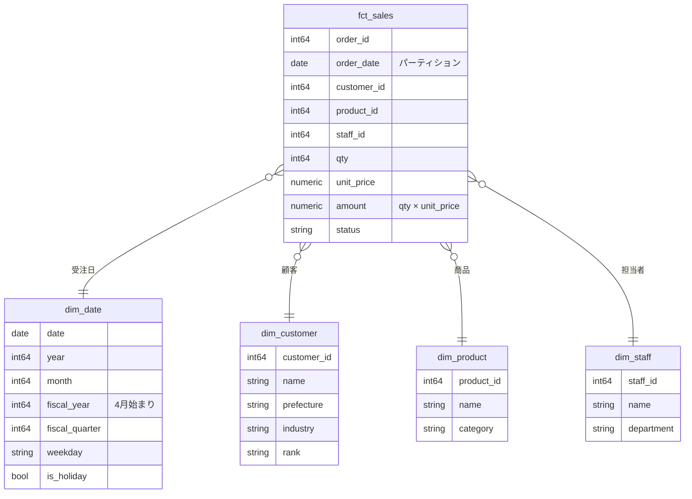

# 単元 6-4：分析用テーブル設計（スター・スキーマ、粒度、指標の定義）

> **この単元のゴール**
> 経営者の「知りたいこと」から逆算して、分析しやすく・数字の食い違いが起きにくい分析用テーブル（mart）を設計できるようになる。

---

## 【概念の解説】

### 1. 分析は「指標」と「切り口」でできている

経営者の質問を分解すると、ほとんどが次の形をしています。

> 「**[切り口]** ごとの **[指標]** を、**[期間]** で見たい」

| 経営者の質問 | 指標（数えるもの） | 切り口（分けるもの） |
|---|---|---|
| 「今月の売上は商品別にどう？」 | 売上金額 | 商品、月 |
| 「営業担当ごとの受注件数の推移は？」 | 受注件数 | 担当者、週 |
| 「どの地域の顧客の客単価が高い？」 | 客単価 | 都道府県 |

分析用のテーブル設計は、この2つを分けて整理するところから始まります。

| 種類 | 中身 | 例 |
|---|---|---|
| **ファクト（事実）** | 数えたり合計したりする**出来事の記録**。行数が多い | 受注明細、入金、問い合わせ |
| **ディメンション（切り口）** | 出来事を分類する**属性**。行数は比較的少ない | 顧客、商品、担当者、日付 |

### 2. スター・スキーマ

ファクトを中心に、ディメンションを周りに配置した形を **スター・スキーマ**（星形）と呼びます。



第3章の正規化（細かく分割）と比べると、**ディメンションは1段階だけ**で、その中は非正規化されています（例：`dim_staff` に部署名を直接持たせ、部署テーブルとの JOIN を不要にしている）。

| 正規化（OLTP） | スター・スキーマ（OLAP） |
|---|---|
| 更新の矛盾を防ぐため、細かく分ける | 分析のしやすさのため、**ファクト1つ ＋ ディメンション1段**に整理する |
| JOIN が何段にもなる | JOIN はファクトとディメンションの1段だけ |

### 3. 「粒度」を最初に決める

ファクトテーブルで最も重要な設計判断は **粒度（グレイン）**：「**1行が何を表すか**」です。

| 粒度 | 1行が表すもの | できる分析 | できない分析 |
|---|---|---|---|
| 受注明細 | 1注文の1商品 | 商品別・顧客別・日別、すべて可能 | — |
| 受注 | 1注文 | 顧客別・日別の件数と金額 | **商品別の分析ができない** |
| 日次集計 | 1日の合計 | 日別の推移 | 顧客別も商品別もできない |

**原則は「できるだけ細かい粒度で持つ」**ことです。細かいデータからは集計できますが、集計済みのデータから細かい内訳は復元できません。BigQuery なら、細かい粒度のまま持っても集計は十分速く、費用もパーティションで抑えられます（単元6-2）。

> **粒度が混ざったテーブルは、数字の事故の温床です。** 例えば「受注」単位の行に「明細」単位の金額を結合すると、1注文に3商品ある場合に受注件数が3倍に数えられます。

### 4. 日付ディメンション：日本企業ならではの切り口

日付は、ほぼすべての分析で使う最重要の切り口です。`dim_date` に、カレンダーの属性をあらかじめ持たせておきます。

| 列 | 理由 |
|---|---|
| 年・月・週・曜日 | 基本の集計単位 |
| **会計年度・四半期** | 日本の企業は**4月始まり**が多い。「2026年度」は 2026年4月〜2027年3月。毎回 SQL で計算させると、人によって定義がずれる |
| 祝日フラグ・営業日フラグ | 「営業日あたりの売上」「前年同曜日比」 |

```sql
-- 4月始まりの会計年度
CASE WHEN EXTRACT(MONTH FROM date) >= 4
     THEN EXTRACT(YEAR FROM date)
     ELSE EXTRACT(YEAR FROM date) - 1 END AS fiscal_year
```

### 5. 指標の定義を「1か所」にする

中小企業でよく起きるのが、「**営業部の売上と経理部の売上が合わない**」問題です。原因の多くは、技術ではなく**定義の違い**です。

| 論点 | 例 |
|---|---|
| いつの売上か | 受注日？ 出荷日？ 請求日？ 入金日？ |
| キャンセルは | 含める？ 除く？ キャンセル日に減らす？ |
| 金額は | 税込？ 税抜？ 値引き後？ 送料は？ |
| 返品は | マイナスの売上？ 別の指標？ |

これらの定義は、**ダッシュボードの各グラフで個別に計算させず、mart の段階で1か所に決めて列として持たせる**のが原則です。

```sql
-- mart.fct_sales（例）：売上の定義をここで1回だけ決める
SELECT
  i.order_id,
  o.ordered_on                         AS order_date,
  o.customer_id,
  i.product_id,
  o.staff_id,
  i.qty,
  i.unit_price,
  i.qty * i.unit_price                 AS amount,           -- 税抜・値引き後の販売単価ベース
  o.status,
  o.status != 'cancelled'              AS is_valid_sale     -- 売上に数えるかどうか
FROM staging.order_items i
JOIN staging.orders o ON o.order_id = i.order_id
WHERE o.deleted_at IS NULL;
```

そして、定義を**文書にして顧客と合意**します。「この数字は何か」を誰に聞かれても同じ答えが返せることが、ダッシュボードが信頼される条件です。

### 6. ダッシュボード用の「横長の表」

Looker Studio などの BI ツールでは、スター・スキーマを毎回 JOIN させるより、**ファクトにディメンションの属性を結合済みの横長の表**を1つ用意した方が、扱いやすく、速く、費用も読みやすいことがあります。

```sql
CREATE OR REPLACE TABLE mart.sales_wide
PARTITION BY order_date
CLUSTER BY product_category, customer_prefecture
AS
SELECT
  f.order_date, d.fiscal_year, d.fiscal_quarter, d.month,
  c.name AS customer_name, c.prefecture AS customer_prefecture, c.rank AS customer_rank,
  p.name AS product_name, p.category AS product_category,
  s.name AS staff_name, s.department,
  f.qty, f.amount, f.is_valid_sale
FROM mart.fct_sales f
JOIN mart.dim_date     d ON d.date        = f.order_date
JOIN mart.dim_customer c ON c.customer_id = f.customer_id
JOIN mart.dim_product  p ON p.product_id  = f.product_id
JOIN mart.dim_staff    s ON s.staff_id    = f.staff_id;
```

**注意：横長の表には、ダッシュボードに必要な列だけを入れる。** 電話番号や住所の詳細など、個人情報の列は入れない（単元3-5・6-2の権限設計と合わせる）。

### 7. 過去の状態をどう扱うか

顧客ランクが「B → A」に変わったとき、**過去の売上は「A ランクの顧客の売上」として数えるべきか、「当時は B ランクだった」として数えるべきか**。分析の目的によって答えが変わります。

| 方式 | 内容 |
|---|---|
| 上書き | ディメンションは常に最新の値。過去もすべて最新のランクで集計される |
| 履歴を持つ | ランクが変わるたびに、ディメンションに「有効期間」付きの新しい行を追加する。当時のランクで集計できる |

後者は **SCD（Slowly Changing Dimension：ゆっくり変化するディメンション）** と呼ばれる設計手法の一種です。最初は上書きで始め、顧客から「当時の状態で見たい」という要望が出た項目だけ履歴を持たせる、という段階的な進め方が現実的です。そのためにも、raw 層に履歴を残しておく（単元6-3）ことが効いてきます。

---

## 【実務・ビジネスとの結びつき】

### これが理解できていないと起きること

| 現場の症状 | 根本原因 |
|---|---|
| 「ダッシュボードの受注件数が、実際の3倍になっている」 | 受注単位と明細単位の粒度が混ざった JOIN |
| 「営業会議と経理の売上の数字が毎月合わない」 | 売上の定義（日付・キャンセル・税）が統一されていない |
| 「年度の集計が、1〜12月で区切られている」 | 4月始まりの会計年度を考慮していない |
| 「商品別の分析をしたいと言われたが、受注単位でしかデータを持っていない」 | 粒度を粗くしすぎた |

### 顧客のどの課題を解決するか

- 「**数字が合わない**」「**会議の前に数字をそろえるのに何時間もかかる**」という、多くの中小企業が抱える悩みを、指標の定義の一元化で解消できる。これは技術以上に価値の大きい成果になりうる。
- 指標の定義を顧客と一緒に決めるプロセスは、**顧客の業務を深く理解する機会**であり、追加提案（他部署のデータ連携など）にもつながる。

---

## 【理解度チェック課題】

**Q1.**
「ファクト」と「ディメンション」の違いを説明し、自分の身近な業務（例：スクールの受講管理）で、それぞれ2つずつ例を挙げてください。

**Q2.**
ファクトテーブルの「粒度」を受注明細単位ではなく、受注単位（1注文1行）にした場合、どんな分析ができなくなりますか。また、粒度の異なるテーブルを JOIN したときに起きる数字の事故の例を挙げてください。

**Q3.**
「売上」の指標を、ダッシュボードの各グラフでそれぞれ計算するのではなく、mart のテーブルで1か所に定義すべき理由を説明してください。売上の定義を決めるときに顧客と合意すべき論点を3つ挙げてください。

---

## 【顧客向け言語化トレーニング】

専門用語（ファクト、ディメンション、粒度、mart 等）を使わずに答えてください。

**演習1**
> 社長「営業部長が言う売上と、経理が出す売上がいつも違うんだよ。どっちが正しいの？」

**演習2**
> 社長「とりあえず、全部のデータを見られるようにしておいてよ。何を見たいかは後で考えるから。」

<details>
<summary>💡 回答のヒント（考えてから開く）</summary>

- 演習1：「どちらも、それぞれの定義では正しい可能性が高い」。営業は受注日、経理は請求日や入金日で数えていることが多い。「会社として、どの場面でどの売上を使うかを一度決めて、ダッシュボードには名前を分けて両方載せる（"受注ベース売上"・"請求ベース売上"）」という解決策を提案する。
- 演習2：否定せず、「細かいデータはすべて保管しておくので、後から何でも作れます」と安心させたうえで、「最初の画面は、社長が毎週必ず確認したい数字3〜5個に絞りましょう」と提案する。何でも載った画面は誰にも見られなくなる。具体的な質問（「毎週月曜の朝、何を確認したいですか？」）で引き出す。

</details>

---

回答は [`answers/chapter-06/04.md`](../answers/chapter-06/04.md) に記入してください。
