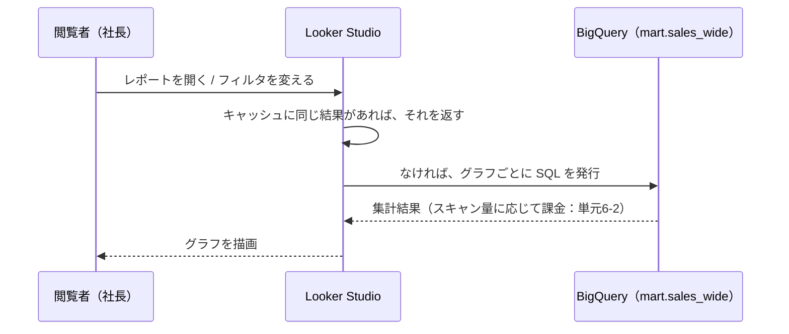

# 単元 6-5：Looker Studio で経営ダッシュボードを構築する

> **この単元のゴール**
> BigQuery の分析用テーブルを Looker Studio につなぎ、経営者が「毎週見たくなる」ダッシュボードを設計できるようになる。共有設定によるデータ漏洩とコストの事故を防げるようになる。

---

## 【概念の解説】

### 1. Looker Studio とは

**Looker Studio**（旧 Google データポータル）は、Google が提供する無料の BI（ビジネスインテリジェンス）ツールです。ブラウザ上で、BigQuery などのデータにつないで、グラフや表を並べたダッシュボードを作り、共有できます。

| 要素 | 意味 |
|---|---|
| **データソース** | どのデータに、**誰の権限で**つなぐかの設定 |
| **レポート** | グラフや表を並べたページ（ダッシュボード） |
| **ディメンション / 指標** | 単元6-4と同じ。グラフの「切り口」と「数える値」 |
| **フィルタ / 期間設定** | 見る人が画面上で絞り込める仕組み |

### 2. データの流れと、費用が発生する場所



Looker Studio 自体は無料でも、**グラフ1つ・フィルタの操作1回ごとに BigQuery への問い合わせが発生しうる**ことを忘れてはいけません。単元6-2の計算例のとおり、設計次第で費用が大きく変わります。

| 費用を抑える工夫 | 内容 |
|---|---|
| **横長の表（mart）につなぐ** | raw や staging に直接つながない。必要な列だけの表にする（単元6-4） |
| **パーティション列で期間を絞る** | レポートの既定の期間を「直近3か月」などにする |
| **データの更新頻度（キャッシュ）** | データソースの「データの鮮度」設定。BigQuery 側の更新が1日1回なら、Looker Studio が毎回問い合わせる必要はない |
| **事前に集計したテーブル** | 毎日数百人が見るような重いグラフは、日次集計テーブルを別に作っておく |

### 3. 「誰の権限でデータを読むか」：最も重要な設定

データソースには **データの認証情報** という設定があり、2つの選択肢があります。

| 設定 | 動き | 長所 | 注意点 |
|---|---|---|---|
| **オーナーの認証情報** | レポートを見る人全員が、**データソースを作った人の権限**で BigQuery を読む | 閲覧者は BigQuery の権限を持たなくてよい。共有が簡単 | **レポートを見られる人＝そのデータを見られる人**になる。共有範囲がそのままデータの公開範囲。BigQuery の費用はオーナー側のプロジェクトに付く |
| **閲覧者の認証情報** | 見る人**それぞれの権限**で BigQuery を読む | BigQuery 側の権限設定（列・行レベルの制御を含む）がそのまま効く | 閲覧者全員に BigQuery の権限（とプロジェクトの利用権限）が必要 |

**オーナーの認証情報で作ったレポートを「リンクを知っている全員」に共有すると、URL を知った社外の人も、そのデータを見られてしまいます。** URL はメールの転送やチャットへの貼り付けで簡単に広がります。

**安全な共有の原則**：

- 共有は「**特定のユーザー・グループ**」か「**自社ドメインのユーザーのみ**」にする
- 「リンクを知っている全員」は使わない
- 見せる範囲を部署ごとに変えたい場合は、**閲覧者の認証情報 ＋ BigQuery の行レベルのアクセスポリシー**、または部署ごとに別のデータソース（別の mart）を用意する
- オーナーは個人ではなく、**組織で管理するアカウント**にしておく（担当者が退職するとレポートが壊れる・管理できなくなる）

### 4. 経営ダッシュボードの設計

技術的にグラフを並べるのは簡単です。難しいのは、**見る人が意思決定に使える**ダッシュボードにすることです。

**原則1：見る人と、見たあとの行動を決める**

| 見る人 | 頻度 | 見たあとの行動 | 必要な画面 |
|---|---|---|---|
| 社長 | 週1回（月曜の朝） | 目標とのズレに気づき、部長に指示を出す | 全社の主要指標3〜5個と、その推移・目標との差 |
| 営業部長 | 毎日 | 担当者ごとの進捗を確認し、手を打つ | 担当者別・顧客別の明細まで掘り下げられる画面 |

**原則2：上から「結論 → 推移 → 内訳 → 明細」の順に並べる**

```text
┌──────────────────────────────────────────────────────────┐
│ 期間: [今年度 ▼]   部署: [全社 ▼]                          │ ← フィルタ
├──────────┬──────────┬──────────┬──────────────────────────┤
│ 売上      │ 前年同期比 │ 目標達成率 │ 受注件数                 │ ← ①結論（スコアカード）
│ 1.2億円   │ +8.5%    │ 92%      │ 1,240件                 │
├──────────┴──────────┴──────────┴──────────────────────────┤
│ 月別売上（今年度 vs 前年度）の折れ線グラフ                     │ ← ②推移
├─────────────────────────────┬────────────────────────────┤
│ 商品カテゴリ別売上（棒グラフ）   │ 担当者別売上（棒グラフ）        │ ← ③内訳
├─────────────────────────────┴────────────────────────────┤
│ 顧客別売上トップ20（表）                                     │ ← ④明細
└──────────────────────────────────────────────────────────┘
```

**原則3：比較の基準を必ず置く**

「売上 1.2億円」だけでは、良いのか悪いのか分かりません。**前年同期・目標・前月**のどれかと並べて初めて、判断の材料になります。

**原則4：グラフの選び方**

| 見せたいこと | グラフ |
|---|---|
| 1つの数字 | スコアカード（大きな数字 ＋ 比較） |
| 時間の推移 | 折れ線グラフ |
| 項目間の比較 | 棒グラフ（項目名が長いなら横棒） |
| 明細の確認 | 表（並び替え・条件付き書式） |
| 構成比 | 円グラフは項目が多いと読めない。**項目が少ない（3〜5個）ときだけ**、それ以外は棒グラフ |

### 5. 「Excel に戻られない」ための工夫

ダッシュボードを作っても、現場が結局 Excel で集計し続ける、という失敗はよくあります。

- 最初は**顧客が今使っている Excel の集計表と同じ数字**が出る画面を作り、「今までの作業がなくなる」ことを実感してもらう
- 数字の定義（単元6-4）をレポート内に注記する
- **自動で届く**ようにする：Looker Studio には、レポートを定期的にメールで送る機能がある（毎週月曜の朝に社長に届く、など）

---

## 【実務・ビジネスとの結びつき】

### これが理解できていないと起きること

| 現場の症状 | 根本原因 |
|---|---|
| 「退職した営業担当が、退職後も自社の売上ダッシュボードを見られていた」 | 「リンクを知っている全員」で共有し、オーナーの認証情報を使っていた |
| 「ダッシュボードを開くたびに数十秒待たされる」 | raw の巨大なテーブルに直接つなぎ、全期間を集計していた |
| 「作ったダッシュボードが、3か月後には誰にも見られていない」 | 見る人と見たあとの行動を決めず、グラフを詰め込んだ |
| 「担当者の退職で、全レポートのデータソースが壊れた」 | 個人アカウントがオーナーだった |

### 顧客のどの課題を解決するか

- 「**会議資料を作るための集計作業**」（毎週・毎月の数時間〜数日）がなくなることは、最も分かりやすい ROI になる（第7章・第8章で試算）。
- ダッシュボードは、経営者が**このデータ基盤の価値を直接目にする唯一の画面**。ここの品質が、案件全体の評価と次の案件を左右する。

---

## 【理解度チェック課題】

**Q1.**
Looker Studio のデータソースで「オーナーの認証情報」を使い、レポートを「リンクを知っている全員」に共有すると、どんなリスクがありますか。安全な共有の方法を2つ挙げてください。

**Q2.**
Looker Studio 自体は無料なのに、ダッシュボードの使い方によって費用が増えるのはなぜですか。費用を抑える工夫を2つ挙げてください。

**Q3.**
社長向けの経営ダッシュボードを設計するとき、「売上 1.2億円」という数字だけを大きく表示するのでは不十分な理由を説明し、どう改善するか答えてください。

---

## 【顧客向け言語化トレーニング】

専門用語（ダッシュボード、BI、認証情報等）を使わずに答えてください。

**演習1**
> 社長「この画面、取引先の銀行の担当者にも見せたいんだけど、URL を送ればいいの？」

**演習2**
> 社長「グラフがたくさんあった方が、いろいろ分かっていいんじゃないの？」

<details>
<summary>💡 回答のヒント（考えてから開く）</summary>

- 演習1：URL をそのまま送ると、その人がさらに転送した先でも見られてしまう可能性がある。「銀行の方に見せる用の画面を別に作り、見せてよい数字だけを載せ、その方のアカウントだけに見る許可を出す」「見せる期間が終わったら許可を外す」と提案する。社外に出す数字は何かを一緒に決めることも大切。
- 演習2：「新聞の一面と同じで、一番大事なことが最初に目に入る作りにする」。最初の画面は3〜5個の数字に絞り、気になったところだけ下や次のページで詳しく見られるようにする。たくさん載せると、結局どこも見られなくなる。

</details>

---

回答は [`answers/chapter-06/05.md`](../answers/chapter-06/05.md) に記入してください。
