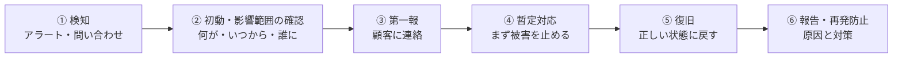

# 単元 7-2：監視・アラート・障害対応

> **この単元のゴール**
> 「顧客から言われる前に、異常に気づける」監視を設計できるようになる。障害が起きたときに、慌てずに順序立てて対応し、顧客に説明できるようになる。

---

## 【概念の解説】

### 1. 監視の目的は「顧客より先に気づく」こと

最悪の障害の知り方は、**顧客からの電話**です。「ダッシュボードの数字が3日前から変わっていないんだけど」と言われた時点で、信頼は大きく損なわれています。

監視は、次の3つに分けて考えます。

| 種類 | 問い | 例 |
|---|---|---|
| **動いているか**（死活） | システムは応答しているか | Webhook 受付の URL に定期的にアクセスして、200 が返るか |
| **正しく動いているか**（処理の成否・データ） | 処理は成功しているか、データは新しいか | 同期処理の失敗、BigQuery の最新日付が古い |
| **余裕があるか**（資源） | このまま使い続けて大丈夫か | DB のディスク使用率、接続数、CPU |

データ基盤で特に重要なのが2つ目です。**データ基盤の障害は「エラーで止まる」より「黙って古いまま・間違ったまま」になることが多い**からです（単元6-3）。

### 2. このカリキュラムの構成で監視すべきもの

| 対象 | 監視項目 | しきい値の例 | 学んだ単元 |
|---|---|---|---|
| 取り込み処理（Cloud Run jobs） | 実行の失敗（終了コード ≠ 0） | 1回でも失敗したら通知 | 4-1（`sync.php` の exit 1） |
| | 取り込みエラー行の件数 | 前日比で急増したら通知 | 4-2 |
| Webhook 受付 | 5xx の割合、署名検証の失敗回数 | 失敗の急増（攻撃の兆候） | 5-3 |
| キュー（Pub/Sub） | 未処理メッセージの数・最古の滞留時間 | 30分以上滞留 | 4-3 |
| | デッドレターに入った件数 | 1件でも入ったら通知 | 5-3 |
| PostgreSQL（Cloud SQL） | ディスク使用率 | 80% 超 | 3-1 |
| | 接続数 | 上限の 80% 超 | 1-2 |
| | 長時間実行中のトランザクション | 10分超 | 3-2 |
| | CPU・メモリ使用率 | 継続的に 80% 超 | 1-1 |
| BigQuery | mart の最新日付（鮮度） | 前日分が朝 7 時までに入っていない | 6-3 |
| | 1日のスキャン量 | 想定の数倍 | 6-2 |
| 費用 | 月の利用額 | 予算の 50% / 90% / 100% | 7-3 |
| 証明書 | 有効期限 | 残り 30 日 | 2-4 |

Google Cloud では、**Cloud Monitoring**（指標の収集・グラフ・アラート）と **Cloud Logging**（ログの収集・検索）を使います。ログに特定の文字列（例：`"同期に失敗しました"`）が出たら通知する「ログベースのアラート」も設定できます。第4章の `sync.php` がログを JSON 形式で出力していたのは、こうした検索・集計をしやすくするためです。

### 3. アラート設計の原則

アラートは多ければよいものではありません。

| 原則 | 理由 |
|---|---|
| **対応が必要なものだけ通知する** | 毎日何十通も「念のため」のアラートが届くと、誰も見なくなる（**アラート疲れ**）。本当に重要な通知が埋もれる |
| **緊急度を分ける** | 「今すぐ対応（夜中でも）」と「翌営業日でよい」を分け、通知先も分ける |
| **各アラートに「次に何をするか」を書く** | 通知の本文に、確認手順書（ランブック）へのリンクを入れる |
| **通知先は個人ではなくチーム** | 担当者の休暇・退職で通知が誰にも届かなくなるのを防ぐ |

### 4. 障害対応の流れ

障害が起きたときは、次の順で動きます。



| 段階 | ポイント |
|---|---|
| ② 影響範囲 | 「いつから」「どのデータが」「誰に影響しているか」を最初に押さえる。ログと監査ログ（単元3-5・5-4）が材料になる |
| ③ 第一報 | **原因が分かっていなくても、早く連絡する**。「現在○○の事象が発生しています。影響は△△です。次の報告は□時に行います」。沈黙が最も信頼を損なう |
| ④ 暫定対応 | 原因究明より、**被害の拡大を止める**ことを優先する。例：不正アクセスの疑いがあれば、該当トークンを無効化する（単元5-1）。同期が壊れたデータを流し続けているなら、同期を止める |
| ⑤ 復旧 | 第4章・第6章の**冪等な設計**により、多くの場合「原因を直して再実行するだけ」で正しい状態に戻せる。データ破壊なら単元7-1のリストア |
| ⑥ 再発防止 | 「誰が悪かったか」ではなく「**なぜ仕組みとして防げなかったか**」を書く。人を責める報告書は、次の障害の隠蔽を生む |

**セキュリティ事故（情報漏洩の疑い）の場合**は、技術的な対応に加えて、単元7-4の**法的な報告義務**が絡みます。証拠（ログ）を消さないこと、早い段階で顧客の経営層と連携することが重要です。

### 5. 障害報告書の型

```markdown
## 障害報告：kintone 連携の停止（2026-10-27）

- 発生期間：10/25 02:00 〜 10/27 10:30（約56時間）
- 影響：BigQuery の顧客・受注データが 10/25 以降未更新。ダッシュボードの数字が古いまま表示されていた。
        データの欠損・誤りはなし（再同期により全件反映済み）。
- 検知：10/27 09:00、顧客からの問い合わせ（監視では検知できず）
- 原因：kintone アプリの「会社名」フィールドが「取引先名」に変更され、
        取り込み処理がフィールド構成の変化を検知して停止していた。
        停止自体は設計どおりだったが、停止の通知が届いていなかった。
- 対応：フィールド対応表を更新し、再同期を実行（10:30 完了）。
- 再発防止：
  1. 取り込み処理の失敗を、ログベースのアラートでチームのチャンネルに通知する（設定済み）
  2. BigQuery の鮮度チェックを毎朝 7 時に実行し、前日分がなければ通知する（設定済み）
  3. kintone のフィールド変更時の連絡ルールを、顧客の担当者と再確認する
```

---

## 【実務・ビジネスとの結びつき】

### これが理解できていないと起きること

| 現場の症状 | 根本原因 |
|---|---|
| 「3日間データが更新されていないことに、顧客の指摘で気づいた」 | 処理の失敗とデータの鮮度を監視していなかった |
| 「アラートが多すぎて、誰も見ていなかった」 | 対応不要なアラートまで通知していた |
| 「障害中、顧客に連絡したのは原因が分かった半日後だった」 | 第一報の手順がなく、原因究明を優先した |
| 「再発防止策が"担当者が気をつける"だった」 | 仕組みではなく人に原因を求めた |

### 顧客のどの課題を解決するか

- **保守運用契約の中身を具体的に示せる**：何を監視し、何が起きたら何分以内に誰が対応するか。「何かあったら連絡ください」という保守との違いが明確になる。
- 障害時の誠実な対応と報告は、**障害が起きる前よりも信頼を高める**ことすらある。長期の取引関係の土台になる。

---

## 【理解度チェック課題】

**Q1.**
データ基盤の監視で、「処理が失敗したら通知」だけでは不十分で、「データの鮮度」も監視すべき理由を説明してください。

**Q2.**
アラートを「念のため」たくさん設定すると、どんな問題が起きますか。アラート設計の原則を2つ挙げてください。

**Q3.**
障害発生時、原因がまだ分かっていない段階でも顧客に第一報を入れるべき理由を説明し、第一報に含めるべき内容を3つ挙げてください。

---

## 【顧客向け言語化トレーニング】

専門用語（監視、アラート、ランブック等）を使わずに答えてください。

**演習1**
> 社長「保守契約って、月々払うけど、実際は何もしてないんじゃないの？」

**演習2**
> 社長（障害発生中）「いつ直るの？ 原因は何なの？ うちのデータは大丈夫なの？」

<details>
<summary>💡 回答のヒント（考えてから開く）</summary>

- 演習1：保守の価値は「何も起きていないこと」なので見えにくい。月次の報告書で「今月は○件の異常を自動で検知し、△件は御社の業務に影響が出る前に対応しました」「バックアップの復元訓練を実施し、□分で戻せることを確認しました」と見える化する、と提案する。
- 演習2：3つの質問に、分かっていることと分かっていないことを分けて答える。「データは消えていません（確認済み）」「原因は現在調査中で、○時までに次のご報告をします」「復旧の見込みは、原因が分かり次第お伝えします」。分からないことを推測で答えない。落ち着いた口調と、次の連絡時刻の約束が安心につながる。

</details>

---

回答は [`answers/chapter-07/02.md`](../answers/chapter-07/02.md) に記入してください。
