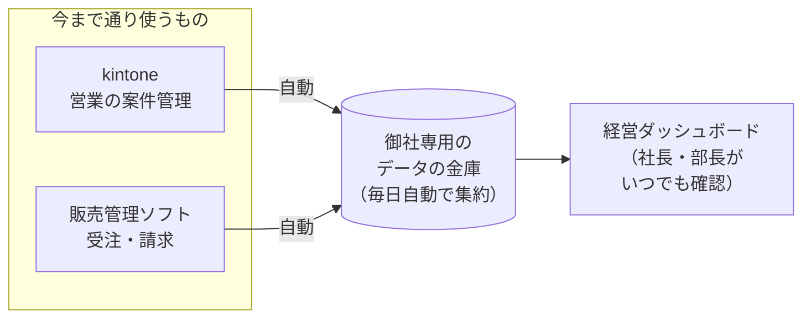

# 単元 8-2：提案書の作成（構成図・進め方・見積もり・ROI）

> **この単元のゴール**
> ヒアリングで聞き取った内容から、**経営者が「やる・やらない」を判断できる提案書**を作れるようになる。技術的な正しさと、経営の言葉での分かりやすさを両立させる。

---

## 【概念の解説】

### 1. 提案書は「判断材料」

経営者が提案書を読んで判断したいのは、次の4つです。

1. **何が良くなるのか**（効果）
2. **いくらかかるのか**（費用）
3. **何が起きうるのか**（リスクと、その備え）
4. **何をすればいいのか**（自社がやること、スケジュール）

技術的な詳細（PostgreSQL のバージョン、インデックスの設計…）は、経営者の判断材料ではありません。**本編は経営の言葉で書き、技術の詳細は付録に回す**のが原則です。ただし、顧客側に IT 担当者がいる場合や、取引先からセキュリティの確認を求められている場合（ミナト部品のケース）は、付録の技術資料が受注を左右します。

### 2. 提案書の構成

| 章 | 内容 | ポイント |
|---|---|---|
| **0. 1ページ要約** | 課題・解決策・効果・費用・期間を1枚に | **社長はここしか読まないかもしれない**。最後に書き、最初に置く |
| **1. 現状と課題** | ヒアリングで聞き取った事実と、そこから生じている問題 | 顧客の言葉・数字を使う。「御社では毎月3日間、6名が…」 |
| **2. 目指す姿** | 導入後に、誰が・何を見て・どう行動が変わるか | ダッシュボードのイメージ図があると強い |
| **3. 解決策の全体像** | 構成図（経営者向けの簡略版）と、各部分の役割 | 単元2-5・6-1の図を、業務の言葉に置き換える |
| **4. 進め方（フェーズ）** | 段階を分け、各段階の成果物と期間 | **小さく始めて、効果を確認してから広げる** |
| **5. 費用** | 初期費用・月額費用（保守・クラウド実費）、前提条件 | 単元7-3。幅と前提を明記 |
| **6. 投資対効果** | 作業時間の削減額、回収期間 | 確実な効果だけで計算し、その他は定性的に |
| **7. 安全性と運用** | セキュリティ・バックアップ・監視・障害時の対応 | 単元3-5・5章・7章を経営の言葉で |
| **8. 御社にお願いしたいこと** | 担当者のアサイン、データの提供、運用ルールの合意 | 顧客の協力が必要なことを、最初に明示する |
| **9. 前提条件とリスク** | 見積もりの前提、想定外の場合の扱い | 後の紛争を防ぐ |
| **付録** | 技術構成図（詳細）、セキュリティ対策の一覧、用語集 | IT 担当者・取引先のチェック向け |

### 3. フェーズ分け：「小さく始める」設計

中小企業、特に**過去にシステム導入で失敗した経験のある会社**には、一度に全部を作る提案は通りにくく、リスクも大きくなります。

| フェーズ | 内容（ミナト部品の場合の例） | 成果物 | 判断のタイミング |
|---|---|---|---|
| **0. 調査（有償・短期）** | 販売管理ソフトの CSV、kintone、在庫 Excel の実物を調査。データの品質と移行の手間を見積もる | 調査報告書、確定見積もり | 本格的に進めるかを判断 |
| **1. 最小構成** | 販売管理 CSV ＋ kintone → PostgreSQL → BigQuery → **経営会議用ダッシュボード1枚** | 会議資料作りが不要になる | 効果を確認して、次に進むか判断 |
| **2. 拡張** | 在庫 Excel の取り込み、営業担当別・得意先別の分析画面 | 部署ごとのダッシュボード | |
| **3. 業務改善** | 二重入力の解消（販売管理ソフトの置き換え・連携方法の見直し）、セキュリティ体制の整備 | 入力の手間の削減 | |

フェーズ1で「**毎月の会議資料作りがなくなった**」という目に見える成果を早く出すことが、その後の信頼と追加の発注につながります。

### 4. 構成図は2種類用意する

**経営者向け（本編）**



**技術者向け（付録）**：単元2-5・CURRICULUM.md の完成形アーキテクチャのような、サービス名・ネットワーク・権限の入った詳細図。

同じ構成を、**読む人に合わせて2つの粒度で描き分ける**ことが大切です。

### 5. 「現場の業務を壊さない」をどう示すか

ミナト部品の営業部長は「kintone の入力が増えるのは困る」という立場でした。こうした**現場の懸念に、提案書の中で先回りして答える**と、意思決定が進みやすくなります。

- 「営業の皆様の kintone の入力方法は、**一切変わりません**」（第4章：裏側で自動的に取り込む）
- 「フェーズ3 で、営業事務の二重入力をなくすことを目指します」（現場にとってのメリット）
- 「営業部長の視点で見たい数字（担当者別の受注状況など）を、フェーズ2 で一緒に設計させてください」（巻き込み）

### 6. 前提条件とリスクを書く勇気

「前提条件」や「リスク」を書くと、提案が弱く見えると感じるかもしれません。しかし実際は逆で、**リスクを書いて、その備えを示す提案の方が、経営者の信頼を得ます**。

```markdown
## 前提条件とリスク

- 販売管理ソフトからは、現在の CSV 出力機能でデータを取り出せることを前提としています。
  出力できない項目がある場合は、フェーズ0 の調査でご報告し、対応方法と費用を別途ご相談します。
- 在庫 Excel のファイル形式が担当者ごとに異なるため、取り込みの前に、
  形式の統一（記入ルールの合意）をお願いする場合があります。
- 販売管理ソフトは提供元のサポートが終了しており、将来、動かなくなるリスクがあります。
  本提案のデータ基盤に過去のデータを移しておくことで、その際の影響を小さくできます。
```

---

## 【実務・ビジネスとの結びつき】

### これが理解できていないと起きること

| 現場の症状 | 根本原因 |
|---|---|
| 「技術的には完璧な提案書なのに、社長に"よく分からない"と言われた」 | 経営の言葉で書かず、判断材料（効果・費用・リスク）が見えなかった |
| 「一括で大きな金額を提示して、検討が止まった」 | フェーズ分けをせず、顧客のリスクが大きく見えた |
| 「受注後に、データ移行の手間が見積もりの3倍になった」 | 調査フェーズを設けず、前提条件も書いていなかった |
| 「社長は乗り気だったが、営業部長の反対で白紙になった」 | 現場の懸念に先回りして答えていなかった |

### 顧客のどの課題を解決するか

- 提案書そのものが、顧客にとって「**自社の課題と、解決の道筋が整理された資料**」になる。たとえ今回は見送りになっても、将来の相談相手として思い出してもらえる。
- フェーズ分けにより、顧客は**小さな投資で効果を確かめられ**、あなたは**継続的な案件**を得られる。

---

## 【理解度チェック課題】

**Q1.**
提案書の冒頭に「1ページ要約」を置くべき理由と、そこに必ず含めるべき項目を答えてください。

**Q2.**
ミナト部品への提案で、「フェーズ0：調査」を有償の独立した工程にするメリットを、顧客側・自分側の両方の立場から説明してください。

**Q3.**
提案書に「前提条件とリスク」を書くことが、なぜ受注にとってプラスになるのか説明してください。ミナト部品の場合に書くべきリスクを、単元8-1の内容から1つ追加で考えてください。

---

## 【顧客向け言語化トレーニング】

**演習（提案書の作成）**

単元8-1のロールプレイで聞き取った内容をもとに、**株式会社ミナト部品への提案書**を作成してください。

**提出物**

- 上の「提案書の構成」の **0〜9 章**（付録は任意）
- 形式は自由（Markdown、Google ドキュメント、スライドなど）。`answers/chapter-08/` に保存
- 費用は、単元7-3 の手順で、**前提条件を明記したうえで幅で**示す（クラウド費用は料金計算ツールで試算。自分のサービス価格は仮の単価でよい）

**講師（Claude）からのフィードバックの観点**

| 観点 | 確認すること |
|---|---|
| 課題の捉え方 | ヒアリングで聞き取った事実と数字に基づいているか。社長の言葉で書けているか |
| 解決策の妥当性 | 課題と解決策が対応しているか。過剰な構成になっていないか |
| フェーズ分け | 早く目に見える成果が出るか。各フェーズの判断ポイントが明確か |
| 費用と ROI | 前提条件が明記されているか。効果を盛りすぎていないか |
| 安全性 | 第3章・第5章・第7章の内容が、経営の言葉で説明されているか |
| 関係者への配慮 | 営業部長など、現場の懸念に答えているか |
| リスク | 想定されるリスクと、その備えが書かれているか |

<details>
<summary>💡 ヒント（書き始める前に）</summary>

- まず「1ページ要約」の下書きを3行で書いてみる：「御社の課題は○○。△△することで、□□が良くなる。費用は××、期間は◇◇」。これが書けなければ、課題の整理が足りていない。
- 社長が4月の経営計画会議で「新しい数字で議論したい」と言っていたことを、スケジュールにどう反映するか考える。
- 大手設備メーカーからのセキュリティチェックシートへの対応は、提案のどこに入れると価値が伝わるか考える。

</details>
