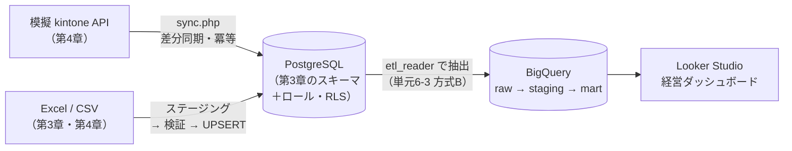

# 最終課題：デモ環境 ＋ 提案書を、営業用ポートフォリオとしてまとめる

> **目的**：カリキュラムで作ってきたものを1つにつなげ、**実際の営業で使える「見せられる成果物」**に仕上げる。学習完了の定義（README のゴール1〜4）を満たしているかを、自分で確かめる。
> **所要時間**：目安 15〜25 時間（数週間かけて取り組む）

---

## 1. 提出物

| # | 成果物 | 内容 | 対応するゴール |
|---|---|---|---|
| ① | **デモ環境** | 架空の会社（ミナト部品、または自分で設定した会社）のデータで動く、一気通貫のデータ基盤 | ゴール2・3 |
| ② | **構成・設計資料** | 構成図（経営者向け・技術者向け）、テーブル設計（ER図）、権限設計、セキュリティ対策の一覧、運用設計（バックアップ・監視） | ゴール1・2 |
| ③ | **提案書** | 単元8-2 の提案書を、デモ環境の実物（ダッシュボードの画面など）を使ってブラッシュアップしたもの | ゴール4 |
| ④ | **10分間のプレゼン** | 提案書を使った説明（録画、またはチャットで台本を提出） | ゴール4 |
| ⑤ | **質疑応答** | 講師（Claude）が顧客役で行う質疑応答（単元8-3 の形式、10問） | ゴール1・4 |

---

## 2. デモ環境の要件

各章のハンズオンをつなげて、次の流れが**1本につながって動く**ことを目指します。



| レベル | 要件 |
|---|---|
| **必須** | ・第3章のスキーマを拡張し、顧客・受注・明細・商品・担当者を PostgreSQL で管理する<br>・第4章の同期処理で、模擬 kintone の顧客データを PostgreSQL に取り込む<br>・PostgreSQL のデータを CSV に書き出し、BigQuery の raw に入れ、staging・mart を作る（第6章）<br>・品質チェックがすべて合格する<br>・Looker Studio で、単元6-5 のレイアウトのダッシュボードを作る<br>・ロール分離（`app_rw` / `etl_reader` など）を実装する |
| **推奨** | ・PostgreSQL → BigQuery の書き出しを、スクリプトで自動化する（`etl_reader` で接続し、`updated_at` で差分抽出して CSV を出力する PHP / Python スクリプト）<br>・Excel の受注データの取り込み処理を作り、エラー行を記録する<br>・売上の定義を文書化し、ダッシュボードに注記する |
| **発展** | ・Google Cloud の無料トライアル等を使い、Cloud SQL・Cloud Run jobs・Secret Manager・BigQuery で実際のクラウド構成を組む（**課金の上限・予算アラートを必ず先に設定すること**。単元7-3）<br>・Cloud Run jobs ＋ Cloud Scheduler で、同期を毎日自動実行する<br>・監視（失敗時の通知、鮮度チェック）を設定する<br>・GitHub Actions から Workload Identity 連携でデプロイする |

> **注意**：デモ環境に**実在の会社・個人のデータを使わない**こと。すべて架空のデータで作ります（単元7-4）。

---

## 3. ポートフォリオとしての見せ方

営業の場では、技術の詳細より「**何ができるか**」を見せます。

| 見せるもの | 見せ方 |
|---|---|
| **Before / After** | 「Excel と kintone がバラバラ（Before）」→「ダッシュボード1枚で全社の数字が分かる（After）」を、画面のスクリーンショットで並べる |
| **ダッシュボード** | 実際に操作して見せる（部署で絞り込む、前年と比べる） |
| **安全性** | 経営者向けの構成図で「データの金庫」「入口は1つ」「役割ごとの鍵」を説明 |
| **運用** | 「毎朝自動で更新され、失敗したら通知が届く」「何かあっても5分前の状態に戻せる」 |
| **進め方** | フェーズ分けと、最初の成果が出るまでの期間 |

リポジトリの `portfolio/` フォルダに、次の構成でまとめることを推奨します。

```text
portfolio/
├── README.md              1ページ要約（何ができるか、デモの見方）
├── proposal.md            提案書（または PDF へのリンク）
├── architecture/          構成図（経営者向け・技術者向け）
├── screenshots/           ダッシュボードの画面、Before / After
└── demo/                  デモ環境の構築手順（docker compose で再現できるように）
```

---

## 4. 評価の観点（ルーブリック）

講師（Claude）は、次の観点で評価・フィードバックします。

| 観点 | 3：十分 | 2：おおむね | 1：要改善 |
|---|---|---|---|
| **データの正しさ** | 品質チェックが自動化され、すべて合格。数字の定義が文書化されている | 品質チェックは合格しているが、手動 | 数字の検証がされていない |
| **設計の根拠** | テーブル設計・権限設計・構成の選択理由を、カリキュラムの原理から説明できる | 設計はできているが、理由の説明が一部あいまい | 「なんとなく」の設計がある |
| **セキュリティ** | 多層防御（ネットワーク・権限・暗号化・監査・秘密情報の管理）が一貫している | 主要な対策はあるが、抜けがある | 対策が断片的 |
| **運用** | バックアップ・監視・障害対応が設計され、手順書がある | 一部のみ | 考慮されていない |
| **提案書** | 顧客の課題・数字に基づき、フェーズ・費用・ROI・リスクが明確 | 構成は揃っているが、根拠が弱い部分がある | 技術の説明に偏っている |
| **言語化** | 専門用語を使わず、結論から、根拠を持って、短く答えられる | おおむね答えられるが、長い・専門用語が残る | 質問に正面から答えられない |

---

## 5. 進め方

1. **計画**：チャットで「最終課題を始めます」と伝え、デモ環境の範囲（必須 / 推奨 / 発展のどこまでやるか）と、スケジュールを講師と相談する
2. **構築**：デモ環境を作る。詰まったら、該当する単元に戻って確認する。質問はいつでもチャットで
3. **資料作成**：構成・設計資料、提案書をまとめる
4. **レビュー**：資料を講師に提出し、フィードバックを受けて改善する
5. **プレゼン ＆ 質疑応答**：講師が顧客役となり、本番さながらに実施する
6. **振り返り**：学習完了の定義（ゴール1〜4）を、自分で達成できたか評価し、次の学習テーマを決める

---

## 6. その先へ

このカリキュラムを修了した後、実際の案件に向けて取り組むとよいこと：

- **Google Cloud の認定資格**（例：Associate Cloud Engineer、Professional Data Engineer）で、知識を体系的に補強し、顧客への信頼の材料にする
- **情報処理安全確保支援士**などのセキュリティ系の資格で、第5章・第7章の知識を深める
- **最初の1社**：知人の会社や、現職の社内業務など、小さな範囲で「フェーズ1」を実際にやってみる。実績と顧客の声が、次の案件を連れてくる
